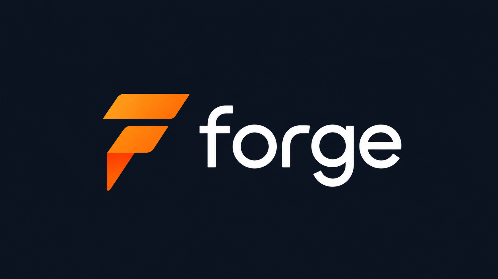

<div align="center">



**Coordinate programming work between people and agents with explicit authority and evidence.**

[](LICENSE)

[Architecture](docs/architecture.md) · [Getting started](docs/getting-started.md) · [REST, MCP, and SSE](docs/api.md) · [CLI](docs/cli.md) · [Contributing](CONTRIBUTING.md)

</div>

---

Forge is a local platform for coordinating programming work with agents that keep their native harness. The harness owns its model loop, tools, and session behavior. Forge owns work records, authorization, collaboration, workspace isolation, integration, and lifecycle.

## Work model

| Record | Purpose |
|---|---|
| **Actor** | A human or a harness-bound Agent. |
| **TaskRole / RoleMembership** | Defines a Task responsibility and the Actors eligible to participate. Membership does not allocate executable work. |
| **WorkUnit** | Defines an executable scope, Role, and optional Actor assignment. Create it explicitly before starting an Execution. |
| **Workspace** | Isolates a repository WorkUnit that requires integration. A non-repository WorkUnit can run without a Workspace or WorkspaceLease under the supported local-host constraints. |
| **Execution / HarnessSession** | Records one Actor, Role, Purpose, and WorkUnit. Session continuity follows an explicit HarnessSession reference. |
| **Artifact, Message, Handoff, Proposal, Decision** | Stores outputs and collaboration as separate durable records. A Proposal or Decision does not execute a protected action. |
| **ReviewReport, ValidationRun, Gate** | Keeps reviewer judgment, deterministic validation evidence, and policy evaluation distinct. A Gate evaluates exact records; it does not run tests or a review. |

WorkUnits can run concurrently when their dependencies, Actor capacity, and workspace authority allow it. Repository integration is an explicit serialized operation. Forge's event-driven Orchestrator currently supports a bounded set of typed actions; it does not reason inside an Agent harness or autonomously perform every proposed operation.

## Interfaces

The local server provides REST, MCP, the `forge-ctl` client, and the web UI. It starts an embedded daemon by default and can also connect to compatible external daemon hosts. Daemon, provider, credential, and WorkUnit constraints apply to each execution path.

## Build this repository

At the PR14 documentation audit on 2026-10-16, this repository had no published GitHub release and no npm or Homebrew distribution of this fork was verified. Build from source to use this version. The build requires stable Rust, Git, Node.js 24, and pnpm 10; building the `forge` binary also builds the web UI.

```bash
git clone https://github.com/AlRos14/forge.git
cd forge
corepack enable
corepack prepare pnpm@10 --activate
cargo run --locked -p forge-cli
```

The server prints its local management URL and records its address in the data directory. Follow the [reproducible walkthrough](docs/getting-started.md) to create a Project, register a Repo, allocate a WorkUnit, and run an Execution.

The retained `npx-cli` wrapper downloads ForgeAILab release assets; it is upstream-owned and does not install this fork. The inherited release workflow restricts npm and Homebrew publication to `ForgeAILab/forge`. This repository's `install.sh` targets `AlRos14/forge`, but it cannot install until this repository publishes a release; use the source build above for now. See [the upstream and attribution note](docs/upstream.md).

## Documentation

- [Architecture after PR13](docs/architecture.md)
- [Getting started](docs/getting-started.md)
- [REST, MCP, and SSE reference](docs/api.md)
- [`forge-ctl` reference](docs/cli.md)
- [Execution logs and session identity](docs/execution-logs.md)
- [Release checklist](docs/release_checklist.md)
- [Upstream relationship and attribution](docs/upstream.md)
- [Changelog](CHANGELOG.md)

## Project identity and history

The workspace version is `0.8.0`; it does not identify a published release. The current schema contains migrations through V134. Migration records, earlier design documents, and historical ProjectRelease snapshots remain historical evidence.

The public product name remains **Forge** until the owner provides a replacement name. This repository preserves its MIT license and upstream attribution.
