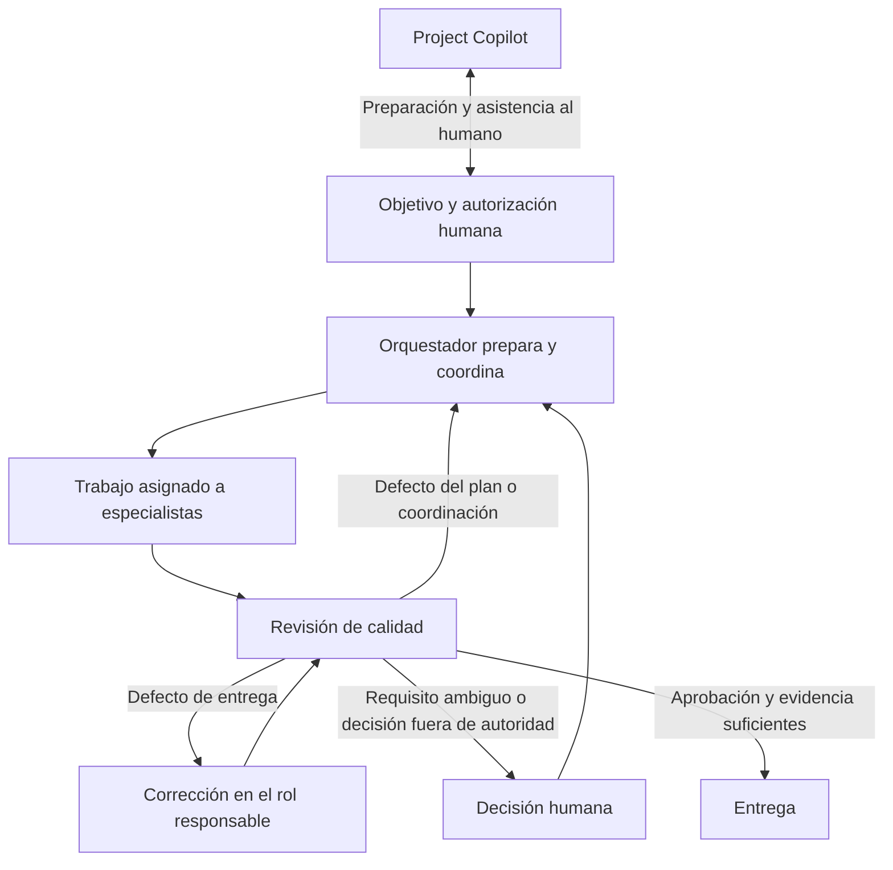

# Modelo operativo de tareas y experiencia de usuario

Decisión de producto aceptada por el propietario: 2026-11-07.
Estado: contrato objetivo aprobado; implementación pendiente. No describe las
capacidades disponibles hoy ni autoriza operaciones sobre tareas existentes.
Baseline de análisis: `fd599647`. El contrato de runtime actual sigue en
[Architecture](../architecture.md). La transición se detalla en el
[plan de implementación](../plans/task-coordination-and-guided-experience.md).

## Objetivo

El usuario expresa un resultado, sus restricciones y el grado de autonomía que
autoriza. Forge ayuda a preparar y ejecutar ese trabajo con un equipo adecuado.
El recorrido principal no exige diseñar manualmente roles, membresías,
WorkUnits, dependencias y sujetos de revisión antes de poder comenzar.

Esos hechos siguen siendo explícitos y durables dentro de Forge. Su edición
manual se conserva como modo avanzado, con las mismas reglas de autoridad.
Automatizar su preparación no equivale a eliminar sus controles.

## Responsabilidades

| Participante | Responsabilidad | Límite |
|---|---|---|
| Humano / Product Owner | Objetivo, restricciones, autorización, decisiones de negocio y aceptación humana cuando se requiera | No necesita operar cada transición técnica |
| Project Copilot | Interlocución del proyecto, aclarar requisitos, preparar tareas/equipo, decisiones entre tareas y asistencia al intervenir | No dirige por una segunda vía la ejecución de una tarea activa |
| Orquestador de la tarea | Preparar el desglose, coordinar todo el ciclo, reaccionar a evidencia y bloqueos, proponer ajustes y organizar correcciones/entrega | No se autoasigna permisos, no redefine requisitos de negocio ni escribe resultados de Gates |
| Implementadores y especialistas | Resolver WorkUnits concretos y producir entregables/evidencias | No actúan fuera de su asignación ni se aprueban a sí mismos |
| Revisor / Calidad | Evaluar resultados y detectar defectos de implementación, planificación, coordinación o requisitos | No modifica la entrega revisada ni decide unilateralmente excepciones de negocio |
| Forge | Aplicar políticas, autoridad, persistencia, dispatch, límites, revisión, Gates y recuperación | No sustituye la cognición del harness por decisiones heurísticas ocultas |

El Orquestador no es únicamente un diseñador de planes. Supervisa el avance
hasta la entrega o una decisión humana. Puede coordinar investigación, diseño,
implementación, revisión y recuperación según el alcance autorizado.

Roles y capacidades son configurables. Las etiquetas de esta tabla expresan
responsabilidades, no nuevos nombres especiales ni tipos obligatorios de Agent.
Un mismo Agent puede asumir responsabilidades distintas en intentos diferentes,
respetando separación de alcance e independencia de revisión.

## Proyecto: configurar una vez, reutilizar de forma visible

El proyecto contiene un equipo predeterminado: roles, Actors elegibles, responsable
de coordinación, rutas de calidad y límites. Reutilizar los defaults y capacidades
existentes; no crear un segundo directorio de asignaciones ni recuperar Project
Agent/Main Agent. El Agent de Copilot y el coordinador pueden coincidir como
identidad, pero sus delegaciones y contextos son distintos.

El alta guiada pide solo lo que falte. Una plantilla de equipo puede preparar
una propuesta de roles y miembros; el humano confirma autoridad y agentes.
El sistema no elige cuentas ajenas, amplía capacidades ni activa proveedores por
la descripción textual del objetivo. Cambiar defaults no reescribe tareas activas.

Al crear una tarea se captura una versión del equipo y de la política aprobados.
Si un cambio posterior afecta a trabajo pendiente, se muestra el efecto y se
revalida antes de admitirlo; no hay reasignaciones silenciosas.

## Tarea: objetivo, equipo y autorización

Entrada principal:

1. Resultado esperado y criterios de aceptación.
2. Restricciones: alcance, repositorio/contexto, lectura/escritura y acciones
   externas permitidas. La planificación de FirePOS puede ser solo lectura y
   producir Artifacts, sin permitir cambios Git.
3. Equipo del proyecto, con el coordinador y especialistas visibles por nombre.
4. Modo: **Preparar propuesta** o **Preparar y ejecutar** dentro de los límites.

Preparar propuesta permite coordinación y lectura autorizadas; no inicia trabajo
ordinario, escritura de repositorio, integración, merge ni operaciones externas.
El humano ve el desglose y puede aprobarlo, ajustarlo o pedir cambios.
Preparar y ejecutar delega el desglose y el avance permitido; no elimina las
aprobaciones reservadas ni amplía el alcance si el plan encuentra trabajo nuevo.

No exigir información innecesaria para el tipo de tarea. Un repo no es requisito
universal para investigación o entregables en Artifacts. Si falta acceso,
capacidad o un Actor, preguntar por ese bloqueo concreto.

## Arranque y coordinación

Un turno de coordinación debe poder admitirse desde Task + equipo + autorización,
sin exigir previamente los WorkUnits de implementación que precisamente debe
preparar. Sus intentos deben identificar Task, Actor, TaskRole/configuración,
solicitante o evento, versión de autorización, contexto, harness y resultado.

La dirección arquitectónica propuesta es evolucionar los wakes/intentos durables
del Orchestrator hacia turnos de gestión acotados a la Task, reutilizando el
plumbing seguro de harness/delegación de Copilot cuando corresponda. No crear
WorkUnits de relleno para conseguir arrancar ni otro scheduler paralelo.
La frontera técnica exacta se confirma en la fase de contrato del plan.

Una ejecución de trabajador sigue requiriendo WorkUnit creado y asignado antes
de arrancar, Actor elegible, versión exacta y WorkspaceLease cuando corresponda.
Un turno de gestión no concede autoridad de trabajador ni acceso de escritura.
La coordinación produce acciones tipadas; Forge las valida y aplica como hechos
durables. No crea permisos a partir del texto generado por el agente.

La autorización inicial y la política determinan qué acciones se materializan
solas y cuáles quedan como propuestas. Los roles/membresías ya autorizados pueden
instanciarse desde el equipo mediante un servicio determinista; el coordinador
no puede inventar capacidades o concederse nuevos destinos.

## Flujo, calidad y devolución

La devolución tiene destinatario y efecto definidos. Un hallazgo puede requerir
corrección de entrega, revisión del plan, intervención de un especialista o decisión
humana. El usuario no necesita cablear de nuevo el circuito en cada ronda.

Calidad emite solicitudes estructuradas con informe/evidencia exactos, categoría,
resultado afectado, ruta autorizada y condición de resolución. Forge registra,
valida y enruta el trabajo. Un mensaje o handoff informativo no se presenta como
una asignación ejecutable. La interfaz distingue «notificado», «trabajo creado»,
«asignado», «en ejecución», «resuelto» y «requiere decisión» como proyecciones de
hechos reales, sin fingir que enviar un mensaje arrancó otro agente.

La política define destinos y rutas de retorno, presupuestos y condiciones de
parada. Si el hallazgo supera el alcance autorizado, se pide decisión humana. Un
fallo técnico no equivale a un informe request_changes; una aprobación antigua
no valida un resultado nuevo. Conservar independencia, resultados inmutables,
review lines, manifiestos y Gates exactos.

Replanificar conserva la historia: crear o sustituir solo trabajo futuro seguro,
registrar qué requisitos/entregas cambian y qué revisión debe repetirse. No editar
un alcance en ejecución ni invalidar silenciosamente trabajo ya aprobado. Los
trabajadores activos continúan sujetos a sus asignaciones admitidas.

## Automatización e intervención humana

El ciclo normal no pide al humano aceptar cada paso técnico. El trabajador puede
presentar entrega; Forge registra la finalización técnica cuando se cumpla el
contrato verificable y despierta al siguiente participante autorizado. Esto no
es aprobación de calidad ni de negocio. El modo manual sigue disponible.

Son intervenciones justificadas: objetivo ambiguo, permisos insuficientes,
cambio de alcance, discrepancia sin resolver, evidencia insuficiente, agotamiento
de presupuesto o acciones que el usuario reservó. Mostrar problema, evidencia,
opciones y efecto de cada decisión; continuar después desde el punto durable.

Project Copilot puede explicar o ayudar a preparar esa respuesta. Cualquier
cambio que proponga a una tarea activa entra por el mismo circuito versionado de
intervención de la Task. No modifica por detrás el plan vigente ni crea una
segunda cola de órdenes independiente del Orquestador.

## Experiencia de usuario obligatoria

- En Proyecto, una entrada clara **Equipo y flujo de trabajo**; **Añadir rol**
  visible en la cabecera y plantillas explicadas. Configuración avanzada plegable.
- Cada Actor se muestra por nombre, harness y host relevante; ID solo en detalles
  o al copiar referencia. Nombres iguales deben desambiguarse sin exponer secretos.
- En Task vacía, ofrecer preparar o preparar y ejecutar; no bloquear primero con
  «no WorkUnits». Si falta coordinador/equipo, guiar su selección concreta.
- Vista principal: objetivo, equipo, plan/avance, resultado y próxima acción.
  Roles técnicos, raw IDs, Executions y leases permanecen accesibles en detalles.
- Una acción principal acorde al estado: preparar, aprobar propuesta, continuar,
  resolver bloqueo o revisar entrega. Pausar/cancelar tienen efectos explicados.
- Estado comprensible: quién trabaja, sobre qué entrega, qué espera y por qué.
  No inferir avance del número de Executions ni reemplazar TaskLifecycle.
- El usuario puede inspeccionar/editar manualmente el plan dentro de su autoridad.
  El modo avanzado no es un prerrequisito oculto del flujo normal.

## Autoridad, durabilidad y compatibilidad

TaskLifecycle permanece como única autoridad de progreso de Task. Propuesta,
turno de gestión, revisión y dispatch tienen sus estados operativos propios,
no un segundo task.status. La propuesta de desglose puede ser un Artifact de
entrada; tras materializarse, WorkUnits y dependencias durables son autoridad.
No se introduce sincronización obligatoria con un segundo plan canónico.
SSE comunica hechos; no decide permisos o transiciones.

Cada admisión, acción, devolución y decisión es idempotente y versionada. Pause,
resume, cancelación, revocación, caída del harness, proveedor incierto y reinicio
conservan la identidad del efecto. No repetir una acción externa para reconstruir
una conversación. Establecer límites de rondas, turnos, presupuesto, tiempo y
concurrencia; una nueva ruta no permite evadir el límite existente de rework.

Preservar usuarios, roles, IDs, tareas y evidencia existentes mediante migraciones
aditivas. No activar automatización retroactivamente. Los modos avanzados y los
flujos manuales existentes siguen funcionando; cambios públicos deliberados se
documentan en CHANGELOG. No renombrar Forge ni reintroducir Execution purpose.
