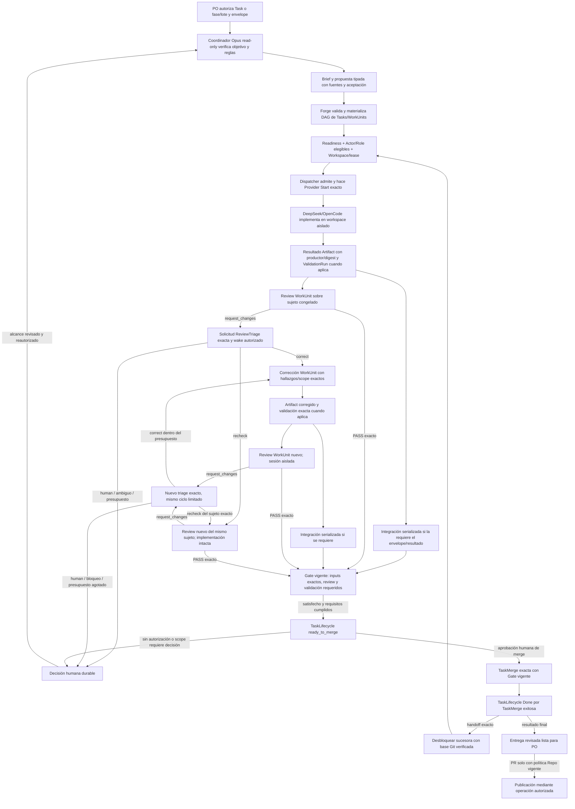
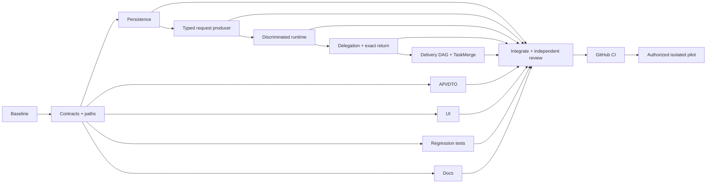

# Plan — Fluidez de entrega autónoma de extremo a extremo

Fecha: 2026-11-13. Baseline inspeccionado: rama `feat/orchestrated-delivery-polish`,
HEAD `7a589cbb`; el código validado por el último run documentado corresponde al
SHA `71c323701a9a953d92fcd41b563a4b37c2329162`. El run GitHub
`43259664636` figura PASS para ese SHA. Este documento es un plan; no declara
aceptación funcional del recorrido completo.

**Estado de ejecución:** implementación autorizada por el usuario y en curso con
subagentes Luna 6 Max. Revisión documental de dominio y aceptación **PASS**.
Los estados por nodo y la evidencia se registran al integrar; pruebas nuevas y
CI integrado **NOT RUN**. El piloto con proveedor real sigue **NOT RUN** y
requiere autorización separada. No autoriza merge, despliegue ni trabajo sobre
FirePOS real.

Este plan complementa [el DAG de Proyecto y work packets](project-dag-implementation.md)
y [el plan de coordinación y experiencia guiada](task-coordination-and-guided-experience.md).
No reabre sus nodos DONE, no reescribe sus recibos y no crea una segunda fuente
de verdad. El DAG de Proyecto sigue ordenando Tasks/work packets; el DAG interno
de cada Task sigue compuesto por WorkUnits y sus dependencias.

## Objetivo

Conseguir que una autorización humana explícita de Task o de fase/lote pueda
avanzar de forma comprensible desde el brief hasta una entrega integrada y
revisada, o detenerse en una decisión humana concreta. El humano no debe
aprobar cada transición técnica. Sí conserva las decisiones sobre seguridad,
ampliaciones de alcance, cambios de autoridad, acciones externas, aceptación de
negocio y merge.

La comparación funcional es un ciclo dirigido por un coordinador Opus que
comprueba el repo y sus reglas, redacta briefs concretos, delega implementación
y revisión en WorkUnits/Workspaces aislados, filtra hallazgos con evidencia y
pide correcciones o decisiones hasta cerrar la entrega. La configuración
objetivo puede seleccionar DeepSeek 4.1 Flash Max mediante OpenCode para trabajo
y revisiones, con un presupuesto explícito por Task. El antecedente de doce
rondas más extensiones es una configuración de ejecución, no un nuevo límite o
default de producto: conserva budgets actuales, no cambia contadores y requiere
la extensión humana versionada existente al agotarlos. Los nombres de modelo
no acreditan identidad, esfuerzo, host, sesión nativa ni aislamiento: el piloto
debe comprobarlos en recibos reales. No se presupone que OpenCode pueda reanudar
una sesión de implementación entre WorkUnits; cada unidad recibe el brief y los
Artifacts/commits exactos que necesita.

## Baseline: piezas existentes y hueco compuesto

El run `43259664636` pasó build, Rust, Clippy, formato, web, browser y binarios
para el SHA `71c323701a9a953d92fcd41b563a4b37c2329162`. Los casos de orquestación
y review incluidos usan adaptadores/fakes; ese PASS no es una prueba de proveedor
real ni del ciclo compuesto en un Project. El HEAD actual es `7a589cbb` y no debe
presentarse como SHA exacto del run.

Ya existen y se deben reutilizar:

- Propuestas DAG de Tasks, lotes de Project versionados, readiness, cupo de
  paralelismo y handoff que fija resultado e integración exactos.
- TaskLifecycle, TaskCoordinationRequest, WorkUnitService, Dispatcher,
  WorkspaceLease y Workspace/Execution/HarnessSession durables.
- WorkUnit review subject congelado, ReviewReport inmutable, línea de revisión,
  approval requirements, GateEvaluation y TaskIntegrationOperation serializada.
- Salida PR6 `review_findings` con `correct|recheck|human`, comprobación de
  autoridad y recibo de triage inmutable. La autorización batch suprime
  deliberadamente los wakes genéricos.
- Política de sesiones read-only de coordinador/revisor y límites de turns,
  calidad, rework, autonomía y capacidad.

El hueco bloqueante es que las piezas no prueban un único A→B completo: una fase
autorizada debe mantener A en ejecución, retener B hasta aceptación de A,
integración Git exacta y handoff, y continuar por la misma cadena de autoridad.
La finalización de una Execution o WorkUnit por sí sola no prueba aceptación,
no satisface un Gate y no desbloquea B.

Hay además un hueco conocido en lote: el wake genérico no debe iniciar una
coordinación batch. La triage `review_findings` existente no es hoy uno de los
orígenes tipados de solicitud batch (`scheduler`, `quality_replan`,
`human_replan`); por eso el rework automático espera una decisión tipada del
coordinador en vez de adivinarla desde `request_changes`. Hace falta enlazar el
informe exacto a una solicitud/origen durable y entregar al coordinador la
salida tipada correcta. Crear un WorkUnit y escribir un Handoff tampoco
garantiza que exista Actor asignado, preparación, admisión, Provider Start,
resultado o continuación del coordinador.

Las pruebas existentes cubren partes del circuito, no esta aceptación
compuesta. Entre ellas están `project_batch_coordinator_materializes_work_and_binds_worker_review_and_reports_to_exact_origin`, las pruebas de
`orchestrator_review_tests`, el bloqueo de sucesora antes de aceptar su
prerrequisito en API y la comprobación de base Git divergente en `project_plan`.
El plan previo registra esas piezas y las separa de la aceptación de Project y
proveedor real.

## Contratos que gobiernan el plan

1. **Una autorización, un envelope visible.** El dueño/administrador vigente
   autoriza el Task o lote, equipo, coordinación, repos/contexto, alcance,
   límites y modo. La autorización inicial no concede capacidades nuevas,
   acceso Git al coordinador, acciones externas, publicación de PR ni merge.
2. **El coordinador es read-only.** El turno de coordinación no recibe
   WorkspaceLease ni repositorio escribible. Opus puede inspeccionar Artifacts,
   diffs, resultados y rutas fijadas cuando el harness y su allowlist read-only
   lo permitan. Las comprobaciones que requieren ejecutar comandos, cambiar
   archivos o usar más permisos se delegan a un WorkUnit de verificación o
   implementación asignado a un Actor autorizado. La lectura de evidencia
   disponible no se convierte en otra ronda de delegación. Un Actor puede usar
   otro TaskRole en una Execution separada solo si el dueño autorizó ese rol y
   su membresía; no adquiere ese rol por inferencia.
3. **La intención no es ejecución.** Plan, Handoff, WorkUnit creado, asignación,
   admisión, provider Start, Artifact, integración, review y Gate son hechos
   separados con recibos propios. La interfaz deriva la etapa y próxima acción
   de esos hechos; no crea otro estado de Task ni un WorkflowEngine paralelo.
4. **La revisión no aprueba por delegación.** `request_changes` no es PASS. El
   coordinador solo confirma un hallazgo exacto como `correct`, pide `recheck`
   del mismo sujeto exacto o escala a `human`. Ni su criterio, ni un resultado
   técnico, ni una respuesta positiva sobre una revisión vieja alteran el
   ReviewReport o satisfacen el Gate. Un humano puede satisfacer review solo
   mediante una ReviewReport formal de un Actor/rol permitido por el Gate. Puede
   reutilizarse el mismo Agent/Actor y perfil en otro rol cuando el contrato de
   sesión lo permita: la review usa HarnessSession y contexto nativos nuevos,
   sin fork ni conversación privada del contribuidor. La independencia no
   exige otro Actor, perfil o modelo. Un Human que contribuyó al resultado
   sigue sin poder revisarlo.
5. **La calidad cierra los resultados materiales.** Cada entregable sustantivo
   conserva Artifact, productor, digest y criterios revisables. No hay una
   excepción por “nit menor” que omita por defecto la revisión/evidencia
   requerida. Evidencia incompleta deja el Gate insatisfecho.
6. **Sin autoridad implícita de GitHub.** Distinguir integración serializada de
   WorkUnits al branch de Task, merge del Task y publicación de PR. Auditar
   `TaskIntegrationOperation`, `MergeService`, Gates, servicios de integración,
   rutas REST/MCP y política del Repo. La publicación de PR usa solo la
   operación existente y la política de repo vigente si satisface el caso; no
   se promete creación automática de PR. El merge requiere autorización humana
   explícita y el Gate actual. No poner `allow_external_actions=true` ni
   `allow_merge=true` como defaults de este plan, no heredar tokens ni aprobar
   usando credenciales ambientales.
7. **La autoridad es versionada, exacta y recuperable.** Revalidar Task,
   autorización, Actor, RoleMembership, envelope, TaskRole, report/sujeto,
   batch/Project plan y membresía en las transacciones de escritor y Provider
   Start. Pausa, revocación, restart y replay conservan identidad; revocar
   bloquea nuevos efectos y no reactiva el grant batch antiguo.

## Flujo objetivo

### Brief, tareas y asignación

- Opus contrasta el objetivo, las restricciones, `CLAUDE.md`/`AGENTS.md`,
  arquitectura, contratos públicos, estado real del repo y trabajo previo. Lee
  diffs/Artifacts exactos de forma read-only si el harness lo permite. El brief
  fija resultado, fuentes de verdad, paths/repos, scope permitido, acceptance
  checks, outputs con ID/digest y puntos que requieren decisión. Un microfix se
  delega como corrección acotada desde el resultado exacto; no da escritura al
  turno de coordinación.
- El DAG de Proyecto expresa dependencias entre work packets/Tasks. Cada Task
  materializa su propio DAG de WorkUnits para contratos, backend, interfaz,
  validación, review y entrega. Una ambigüedad de arista se presenta como
  Proposal o decisión humana; no se inventa en silencio.
- DeepSeek recibe WorkUnits preparados y Workspaces separados para escritores
  concurrentes. La review usa una HarnessSession nativa nueva, inputs fijados y
  aislamiento del contexto privado/fork de contribución; puede reutilizar el
  mismo Actor/Agent cuando la política de sesiones lo autorice. V162 y
  `actor_contributed_to_work_unit` fijan la independencia actual; resolver
  referencias doc desactualizadas en F2G sin cambiar ese contrato. La
  integración serializada ocurre según el requisito del resultado, sobre el
  commit exacto; el contrato no fija que integración siempre preceda a review.
- Las tareas sobre varias PRs/repos usan Tasks y dependencias explícitas. No
  se usa el orden cronológico de ramas, una sesión de harness ni el “último
  commit” como sustituto de la relación causal.

### Review, rework y cierre

- Cuando termina una review, Forge fija el ReviewReport, digest, productor,
  Execution, review subject y resultado revisado. Si pide cambios, esa línea
  sigue insatisfecha hasta un resultado nuevo y review favorable válido.
- El contrato implementado usa una solicitud durable común con
  `kind = work_unit_plan | review_findings` y un origen inmutable. Para
  `review_findings`, ese origen incluye al menos Task, authorization version,
  TaskRole/Actor del coordinador, team generation/digest, envelope digest,
  ReviewReport ID/digest, Execution productora, sujeto WorkUnit/version,
  resultado Artifact/Execution, commit, Workspace/snapshot y, para lote,
  Project, batch/owner authorization, graph/Task versions y
  `origin = ReviewTriage`. Crear solicitud, cobrar el límite aplicable y
  escribir el evento debe ser atómico e idempotente.
- El runtime enruta por tipo: `work_unit_plan` usa solo el parser/Artifact de
  plan existente; `review_findings` recibe el único report fijado y solo acepta
  `correct|recheck|human` con rationale e instrucciones acotadas. No aceptar
  triage arbitraria por el endpoint genérico de plan ni usar el Artifact parser
  como salida de review. Reusar `OrchestratorWake`, Provider Start receipts,
  `record_review_triage` y el registro inmutable de triage.
- Opus lee primero el sujeto e informe exactos disponibles en contexto read-only.
  Si no puede fundamentar una decisión sin ejecutar algo, F1 fija `recheck`
  formal del mismo sujeto como camino de verificación admitido. No se añade
  una operación genérica de verificación cognitiva. Una verificación bajo lote
  debe volver al coordinador por request/Artifact/Productor/resultado fijado,
  auth/team/budget y wake autorizado; un Handoff o generic event no basta.
  No se implementa una rama genérica “verificar” que no pueda reanudar el ciclo.
- `correct` crea mediante la operación existente una corrección exacta y una
  nueva review independiente; `recheck` pide otra review del mismo resultado
  sin editar implementación; `human` no crea trabajo de corrección. Preguntas,
  fallos técnicos, reportes incompletos y texto libre nunca se reinterpretan
  como `request_changes`.
- Un resultado corregido vuelve a pasar por review fresca, requisitos de
  validación exactos y Gate actual. `recheck` no borra el primer informe ni
  convierte su veredicto en PASS; un desacuerdo sin resolución de la política
  conduce a review formal permitida o a decisión humana. El coordinador no
  altera ni waives GateEvaluation.
- Preservar los defaults vigentes: 32 turns de coordinación, 64 solicitudes de
  calidad, 16 rondas correct/reassessment, 16 solicitudes por ruta y 16
  WorkUnits planificadas (configurables hasta 64), además de los límites
  existentes de rework. No resetear counters ni cambiar defaults aquí. Un Task
  de piloto puede usar el presupuesto explícito autorizado —incluida una
  configuración de doce rondas si cabe— y cualquier extensión adicional usa
  la operación humana versionada existente. Exhaustion, falta de Actor/reviewer,
  scope nuevo, conflicto de seguridad o evidencia ambigua produce un bloqueo
  durable explicable.

### Entrega Git y PR

La aceptación de esta iniciativa termina en **entrega revisada lista para el
PO** con evidencia exacta. Para worktrees/branches, WorkUnit Integration puede
ser automática solo si el envelope vigente la autoriza; su receipt fija
operation, Task, workspace y commit. En el contrato actual, TaskLifecycle
`done` requiere TaskMerge exitoso exacto. Una sucesora solo se admite tras ese
hecho y con handoff que contenga Artifact/digest, integración exitosa y commit
ancestral verificado como base de su workspace. Sin autoridad/merge aplicable,
la Task permanece `ready_to_merge` y espera decisión; no se salta a `done`.

El contrato debe inspeccionar el camino real de integración, Gate, TaskMerge,
PR publish, REST/MCP y controles de repo. Si la petición final exige PR, se
verifica primero si la operación existente admite ese caso bajo política
actual. En ausencia de autorización de repo explícita, se detiene en “lista
para publicar”; no se crea PR, no se mergea ni se publica código. La autorización
de fase no sustituye la política de repo ni la aprobación humana de merge.

## DAG de implementación propuesto

Este DAG organiza el trabajo de desarrollo de esta iniciativa; no añade un
tercer DAG al runtime ni una nueva autoridad persistida del producto. Forge
mantiene el DAG de Tasks y el DAG de WorkUnits dentro de cada Task.

F1 congela ownership por archivo, handoff entre owners y contratos antes de
abrir worktrees paralelos. Las identidades concretas se seleccionan al autorizar
implementación; esta tabla asigna áreas, no grants a Actors.

| Nodo | Trabajo y criterio DONE | Depende | Owner/paths aislados | Estado |
|---|---|---|---|---|
| F0 | Baseline, piezas reutilizables, hueco A→B, puntos de autoridad y diferencia entre CI y piloto quedan fijados aquí, sin mutar runtime. | — | Plan/doc de alcance | **DONE (solo lectura)** |
| F1 | Congelar contrato de solicitud tipada/origen ReviewTriage, discriminación de salida, estados UX, authority matrix, límites, evidencia/receipts, compatibilidad, acceptance matrix y ownership/handoffs exactos por archivo. Contrato cerrado: request común con `kind`, fuente ReviewReport/digest/productor y snapshot de autorización inmutables; `recheck` formal para F2V; Git/PR conserva autoridad existente. | F0 | Domain/API contract owner; sin edición de implementación | **DONE (contrato fijado)** |
| F2A | Persistencia aditiva para `kind`/origen exacto, row mappers, migración, triggers/guards, replay y compatibilidad. V168 preserva los requests existentes como `work_unit_plan`; no añade alias semántico y registra `triaged` como decisión aplicada. | F1 | DB/domain persistence; `crates/db/**`, modelos y migración nueva | **IMPLEMENTADO / CI pendiente** |
| F2B | Productor standalone/batch para triage exacta; atomicidad request+source+budget+event; revalidar batch running, auth/team, report/sujeto/rework intent en writer y Provider Start. Pause/revoke/restart; generic event sigue sin wake batch. | F1, F2A | `crates/services/src/task_coordination.rs`, `task_rework/triage.rs`; sin ownership DB mapper | **IMPLEMENTADO / CI pendiente** |
| F2C | Salida runtime discriminada; parser exclusivo para `work_unit_plan` o `review_findings`, con contexto exacto y límites. La coordinación no crea estado de Task paralelo. | F1, F2B | `crates/services/src/orchestrator_runtime.rs`; sin ownership DB, route o UI | **IMPLEMENTADO / CI pendiente** |
| F2V | Delegación/retorno source-bound: materialización, Actor/Role autorizado, asignación, Workspace/lease, dispatcher/provider, resultado Artifact/digest y vuelta al coordinador con request/origen/productor/resultado/auth/team/budget exactos. En batch no basta generic wake. F1 fija `recheck` formal; el nuevo informe retorna por la misma fuente tipada si solicita cambios y un PASS resuelve solo la política formal vigente. Distinguir ejecución cognitiva de Worker de ValidationRun/Evidence determinista. | F1, F2B, F2C | `crates/services/src/task_dispatcher*`, WorkUnit/Artifact y retorno runtime; owner paths registrados antes de worktrees | **IMPLEMENTADO / CI pendiente** |
| F2D | Camino compuesto Task DAG → WorkUnit DAG → Artifact → review/Gate e integración según sujeto/policy → TaskLifecycle válido → handoff exacto. El contrato actual exige TaskMerge exitoso exacto para `done`; sin él, permanece `ready_to_merge`/decisión humana. Auditar servicios/Gates/MCP/PR; no abre merge ni publicación automática. | F1, F2B, F2V | `crates/services/src/project_plan*`, `task_lifecycle*`, `task_integration_operation*`, `pr_service.rs`; un owner por path | **IMPLEMENTADO / CI pendiente** |
| F2E | DTO/API/MCP/SSE de request kind/origin y hechos durables; endpoint genérico conserva semántica `work_unit_plan`. OpenAPI/types se generan desde `api-types`. | F1 DTO freeze; wiring final F2A–F2D y F2V en F3 | `crates/api-types/src/task_coordination.rs`, `crates/api/src/routes/task_coordination.rs`, MCP owner designado; no coeditar services | **IMPLEMENTADO / CI pendiente** |
| F2U | UI de preparación, ejecución, review, bloqueo y entrega; estados/acción siguiente derivados de proyecciones durables. Puede empezar tras congelar DTO/fixtures F1; integra API real en F3. | F1 DTO freeze; integración F2E | `web/src/components/task-detail/task-coordination-panel.tsx`, `task-journey-panel.tsx`, `task-coordination-status.ts`; generated bindings no editados a mano | **IMPLEMENTADO / CI pendiente** |
| F2F | Escribir regresiones separadas para contrato, autoridad/atomicidad, recovery, review/rework, retorno de verificación F2V, A→B y UX. Adapters fake son contrato determinista, no provider acceptance. | F1 | Solo test files/fixtures; interfaces congeladas | **ESCRITO / NOT RUN** |
| F2G | Actualizar arquitectura/conceptos/API/CHANGELOG según contratos finales. Alinear `docs/concepts/work-units.md` con V162 y `actor_contributed_to_work_unit`; preparar guía/recibo de piloto. | F1, contratos finales | Solo docs/changelog | **ACTUALIZADO / recibo final pendiente** |
| F3 | Verificar ownership map/handoffs F1; integrar lanes; review independiente del SHA integrado, fixes delegados y re-review. Check estático/formato/`git diff --check`, sin compilación local. Agente implementer/reviewer puede compartir Actor/profile solo con sesión/contexto role-isolated V162; Human contributor sigue ineligible. | F2A–F2G, F2U, F2V | Root integra; reviewer con contexto/sesión aislados según V162 | **PASS (revisión estática)** |
| F4 | Lanzar el workflow GitHub tras integración completa; sin CI por nodo ni compilación local. Registrar SHA/run/artefactos y cada check PASS/FAIL/BLOCKED/NOT RUN. Si hay fallo, anexarlo, corregir y revalidar el cambio justificado; no trasladar PASS entre SHA. | F3 | Owner autorizado del workflow; GitHub CI únicamente | **FAIL / revalidación pendiente** |
| F5 | Aceptación aislada con perfiles OpenCode/Opus reales, Project/repo/datos desechables, navegación y recibos de sesiones/providers. Requiere autorización previa para cuotas/costes, cambiar proveedor o acciones externas; sin fallback automático a proveedor de pago. | F4 y autorización explícita del piloto | Owner del entorno/provider; nada de Task/Repo FirePOS real | **TODO / NO AUTORIZADO** |

Cada carril empieza al satisfacer sus dependencias y el contrato/ownership de
F1. UI, tests y docs pueden
trabajar en paralelo desde contratos/fixtures congelados; ningún par de
worktrees comparte archivo sin owner y handoff registrados. La integración real
de UI/API espera las interfaces finales. Cualquier cambio de contrato vuelve a
F1; no se resuelve con compatibilidad silenciosa ni migraciones históricas
editadas. La numeración de migración se elige al implementar verificando el
último número entonces.

## Matriz de aceptación

Las nuevas pruebas compuestas y la aceptación visual/real son **NOT RUN en este
plan**. El CI previo valida sus checks en `71c32370`, pero no el SHA actual ni
el flujo compuesto A→B descrito aquí. Los tests de servicio/API existentes son
reutilizables como piezas.

| Caso | Evidencia mínima para PASS |
|---|---|
| A→B, permiso una vez | A inicia; B permanece bloqueada antes del resultado. A solo libera B con ReviewReport favorable vigente, Gate satisfecho, integración/handoff requeridos exactos y TaskLifecycle `done` por transición válida; TaskMerge real exitosa exacta, exigida por el contrato actual. La batch authorization se usa una vez; el merge humano usa su operación/authority actual sin reautorizar el lote. Prohibido fijar `done` con SQL o inferirlo de Gate PASS. |
| `request_changes` + `correct` | Evento/request fija report/digest/sujeto/auth; coordinador confirma hallazgos dentro del scope; C1 recibe findings exactos y base del resultado revisado; R2 usa sesión/contexto aislado y mira el resultado nuevo; solo el PASS fresco puede satisfacer línea/Gate. Un nuevo `request_changes` inicia triage de ese report exacto. Replays no duplican request, budget charge, admission ni Provider Start; incertidumbre del provider queda `start_uncertain`/intervención, sin retry forzado ni afirmación de costo cero. |
| Verificación delegada F2V | El coordinador solicita la comprobación admitida por F1; se registran WorkUnit, Actor/Role elegibles, Workspace/lease y Provider Start. El Artifact fija productor, digest y sujeto; una solicitud/wake tipados con autorización vigente devuelven ese resultado al coordinador original, que decide y continúa el ciclo. Probar standalone y lote, sin wake genérico batch; replay no duplica Start ni cargos de presupuesto. Una comprobación cognitiva no se presenta como ValidationRun determinista. |
| `recheck` | No crea corrección ni modifica el workspace implementado; review formal nueva apunta al mismo sujeto/snapshot. Si pide cambios vuelve a triage exacto; si pasa, solo los inputs/policy del Gate determinan si satisface la línea. Reporte inicial queda inmutable; el coordinador no aprueba el Gate. |
| `human`, ambigüedad y scope/security | No inicia nuevos workers. Expone informe, evidencia, autoridad faltante y opciones; una reautorización crea nueva versión. Una ReviewReport humana cuenta solo si su actor/rol cumple el Gate. |
| Falso positivo / informes viejos | Un PASS viejo no satisface resultado corregido; technical failure, `questions` y prose no se convierten a `request_changes`; coordinator no cambia verdict/Gate. |
| Pause/revoke/restart | Pausar antes de Start impide provider call; resume continúa el receipt durable exacto. Revoke, team/auth staleness o batch terminal impiden nuevos efectos. Reinicio, evento duplicado y misma clave no duplican admission, budget charge ni Provider Start. Misma clave/cuerpo distinto da conflicto; provider uncertain exige recovery/intervención, no retry forzado. |
| Capacidad e independencia | Paralelismo respeta batch y slots WorkUnit separados. Actor/RoleMembership/WorkspaceLease se revisan al Start; un Agent puede compartir Actor/profile entre roles con HarnessSession/role context nuevos y sin contributor fork; Human contributor sigue ineligible. Falta de asignado o capacidad produce blocker sin filas parciales. |
| UX completa | Browser real sobre servidor/datos desechables muestra brief, quién trabaja, resultado/digest, próxima acción, bloqueo y efecto de pausa/revocar. No requiere clicks humanos entre pasos técnicos autorizados; mantiene clicks para alcance, seguridad, decisión, aceptación de negocio, publicación no autorizada y merge. |
| Git/PR boundary | TaskIntegrationOperation exacta y Gate verificable. Verificar que batch Start no crea GitHub PR ni merge sin la política/operación vigente; merge requiere acción humana y Gate actual. No usar credential ambiental del runner como autorización. |
| Perfiles reales | Recibos muestran Actor, Harness, host, profile/model, esfuerzo, HarnessSession y scope autorizados. Un nombre configurado o fake adapter no es evidencia de DeepSeek/Opus real ni de capacidad de reanudar sesión. |

La aceptación automatizada final hace una pasada por todos los checks acordados
en GitHub sobre el SHA integrado. Si el workflow falla, el run permanece FAIL:
registrar logs/causa, corrección y revalidación justificada. No correr CI desde
carriles paralelos ni compilar localmente. No afirmar que una revisión o una
prueba fake cubrió el workflow completo.

## Piloto, salida y stop/resume

El piloto futuro usa un Project, repos, cuentas de harness y datos desechables,
sin credenciales compartidas ni ramas de producción. Antes de arrancarlo, el
owner comprueba perfiles/modelos/esfuerzo/host, scopes read-only y write de cada
WorkUnit, política de repositorio, límites y costes; autoriza expresamente
Task/lote, proveedor, presupuesto y cualquier operación Git externa permitida.
La preparación no autoriza publicación, merge, despliegue ni operaciones sobre
el Task FirePOS real.

Cada bloqueo durable muestra causa, evidencia, Actor/rol requeridos, límites
consumidos y opciones. Resume continúa desde el request/receipt exacto tras
revalidar autoridad y evidencia. Cambiar el scope, actor, team generation,
policy, resultado o digest exige propuesta/autorización versionada nueva; no se
rescata una sesión externa dudosa repitiendo Start.

Etiquetar la evidencia por etapa: **PASS**, **FAIL**, **BLOCKED** o **NOT RUN**.
Mantener separadas revisión estática, pruebas fixture, CI por SHA, aceptación
visual y aceptación con proveedor real. En el cierre registrar el SHA exacto,
run, cobertura no alcanzada, perfil real observado y decisión humana pendiente;
la entrega puede quedar lista para el PO sin merge/deploy.

## Registro de implementación y verificación

La implementación conserva los dos DAG del producto. Los carriles de trabajo
se han integrado por ownership de archivos en la rama existente, sin aplicar
migraciones a datos instalados ni iniciar proveedores reales.

- Persistencia y contrato: V168 preserva el historial y añade request kind,
  fuentes exactas, `triaged`, vistas de autoridad actual y guards de escritor,
  admisión, Provider Start y decisión.
- Runtime: productor y recuperación durables, parser/contexto por kind,
  decisiones sobre un informe exacto y continuación formal de recheck/rework.
- UI: próxima acción derivada de recibos, pausa/revocación y estados de carga;
  referencias técnicas consultables en Evidence.
- Regresiones: ciclo batch recheck → report nuevo → correct → corrección →
  review PASS; pausa tras Start con la misma respuesta completada; y A→B con
  integración, review, Gate, TaskMerge real y handoff. La prueba de migración
  conserva todos los estados históricos y comprueba referencias/FKs.
- Estado actual: `cargo fmt --all -- --check`, `git diff --check` y revisión
  independiente estática **PASS**, sin compilación local; las suites nuevas,
  Clippy, build y browser quedan **NOT RUN** hasta el CI integrado. El caso batch
  expira la lease de la respuesta completada durante la pausa para comprobar
  recuperación exacta. Los perfiles y la aceptación visual con proveedor real
  siguen **NOT RUN**.

La revisión independiente verificó además los fences de pausa antes de Start,
respuesta completada tras pausa/caducidad de lease, incertidumbre visible en el
request y cancelación con evento terminal pendiente. Los hallazgos P1 se
corrigieron y el último snapshot obtuvo **PASS estático**. Esto no acredita
compilación ni ejecución de las regresiones: queda pendiente el CI por SHA.

### Anexo CI 1 — corrección justificada

- Commit revisado y publicado: `12a2e418ff3e4871751258ccec95c5e792b669e8`.
- Run: [43469438163](https://github.com/AlRos14/forge/actions/runs/43469438163),
  `run_checks=true`. Primeros resultados: **FAIL** en compilación Rust y en tres
  expectativas de tests web; web build y lint **PASS**. No se toma el PASS del
  baseline como validación de este commit.
- Corrección: importar `sqlx::Row`, extraer el ID del Actor API por su variante,
  usar el Actor API correcto en el fixture y desempaquetar el resultado opcional
  del productor. Los tests UI comprueban estados, recibos y necesidad de review
  nueva en vez de depender de frases concretas.
- Revisión independiente del delta correctivo: **PASS estático**. La repetición
  del workflow se justifica por estos fallos; las suites de flujo seguirán sin
  aceptación hasta que se ejecuten sobre el SHA corregido.

### Anexo CI 2 — ownership de eventos

- SHA: `beee2c3fa5145483f47b97bf8a56853e70f62bfd`; run
  [43472857759](https://github.com/AlRos14/forge/actions/runs/43472857759).
- Web build, lint/tests y browser smoke **PASS** sobre ese SHA. Rust **FAIL**
  por dos errores de ownership de `actor` y `now` entre los eventos de triage y
  de request; las suites dependientes siguen bloqueadas por compilación.
- Corrección mínima: tomar prestado el Actor y clonar su ID/timestamp para los
  dos eventos. Conserva los mismos valores y la transacción existente.
- La siguiente revalidación se justifica por este diagnóstico nuevo, que
  quedaba oculto tras los errores de tipos anteriores. Ningún PASS parcial se
  traslada al SHA siguiente.

### Anexo CI 3 — fixture bloqueado y diagnósticos

- SHA: `f20aa01c2d25536e07f9de72c147c3f34a33c861`; run
  [43473922248](https://github.com/AlRos14/forge/actions/runs/43473922248).
- Build completo, web, navegador y binarios **PASS**. Clippy **FAIL** por siete
  lints en tests (patrones de caracteres, aliases de filas y auto-deref).
- Runtime **BLOCKED**: un fixture conservaba otro Wake `running` del mismo
  Actor; la exclusión correcta del dispatcher impedía llegar a una barrera sin
  timeout. Se canceló el run para detener la espera indefinida; su conclusión
  real es **CANCELLED**, no PASS. Los fallos de Clippy quedan registrados.
- Corrección del fixture mediante reconciliación real del Execution anterior;
  barreras limitadas a 30 segundos con diagnóstico. No se relaja la exclusión de
  Actors ni ningún guard de producción. Los lints se corrigen sin supresiones.
- El test batch también apareció como FAIL antes de la cancelación; su detalle
  capturado no llegó a imprimirse porque el otro test no terminaba. El workflow
  conserva toda la suite y añade `--nocapture` para retener el diagnóstico en la
  siguiente ejecución. Ese caso seguirá sin aceptación hasta obtener resultado.

### Anexo CI 4 — diagnóstico funcional completo

- SHA: `f0af8fe69e082661eb3bfa8fb7f432d178832d2d`; run
  [43478216837](https://github.com/AlRos14/forge/actions/runs/43478216837).
- Build, frontend, navegador y Clippy **PASS**. Runtime **FAIL**: 43 casos
  pasan y dos fallan; ya no queda una espera indefinida.
- El caso de pausa antes de Start conserva `current_attempt = 1` al diferir el
  Wake, mientras el test exige liberarlo tras confirmar que no hubo Start.
  La transición ahora limpia explícitamente el intento solo tras NoAttempt
  confirmado; los demás aplazamientos conservan su semántica. La regresión
  reanuda el mismo request/Wake tras el backoff, registra otro intento técnico
  y confirma ausencia de Start y de consumo adicional tras una segunda pausa.
- El caso batch llega a la revisión, pero el resultado simulado usa un verdict
  rechazado por el parser nativo de `FORGE_RESULT`. El fixture ahora emite
  `fail`, normalizado por el parser vigente a `request_changes`, sin ampliar
  el parser ni sustituir la revisión formal.
- La siguiente repetición se justifica por estos dos fallos concretos. Las
  suites restantes terminaron: persistencia/migraciones, coordinación/calidad,
  Project Plan, MCP, API e2e y superficie pública **PASS**. En la batería final
  pasó el resto de regresiones API, pero el nuevo A→B **FAIL** al agotar la
  espera del Start del daemon simulado (`daemon request arrives: Elapsed`).
  La revisión estática no encontró una causa de autoridad/admisión; el helper
  compartido limita cada frame a dos segundos mientras el runtime recorre sus
  scanners antes de Start. La espera del fixture A→B se acota localmente con
  diagnóstico del resultado del runtime y sus registros durables, sin cambiar
  el helper compartido ni los guards. La causa queda pendiente de confirmar en
  CI. El run completo concluyó **FAIL**; los PASS parciales no validan otro SHA.

### Anexo CI 5 — reanudación técnica y protocolo del fixture

- SHA: `9f203ac4f724a0eb69fdf4a6861d0dd188fb1cc8`; run
  [43483962420](https://github.com/AlRos14/forge/actions/runs/43483962420),
  conclusión **FAIL**. Build completo, web, navegador, Clippy y las suites
  restantes de persistencia, coordinación, calidad, Project Plan, MCP y API
  **PASS**, salvo runtime (43 PASS, dos FAIL) y el nuevo test A→B.
- El test de pausa supera ahora la liberación del intento, pero la reanudación
  expone que `task.coordination_turn_started` deduplica por request: un segundo
  intento revierte su actualización de Execution al colisionar el evento. Se
  corrige la identidad del evento por intento técnico, sin crear otro request
  ni consumir otro turno de coordinación. Si el vínculo no puede persistirse,
  el runtime detiene ese intento antes de Start, libera su capacidad y difiere
  el Wake; no continúa con un request apuntando a otra Execution.
- El caso batch llega al triage pausado, pero lee `Running` antes de que la
  tarea asíncrona persista el terminal. El fixture espera el resultado exacto
  con deadline y conserva la exigencia de `Completed`, sin fabricar recibos.
- El diagnóstico nuevo de A→B demuestra que no era un timeout: el transporte
  rechaza el daemon simulado porque no anuncia `task_role_capabilities_v1`,
  requerido para la capacidad de coordinación. El fixture local anuncia esa
  capacidad; se conserva el guard del transporte y la espera con diagnóstico.
- La siguiente ejecución completa se justifica por estas tres causas
  concretas. La aceptación funcional y el piloto real siguen pendientes.

### Anexo CI 6 — preparación de lease caducada

- SHA: `2e262bb529840ad5751f7f2c2c6764edc56f31f9`; run
  [43585428498](https://github.com/AlRos14/forge/actions/runs/43585428498).
- Build completo y Clippy **PASS**. Runtime: **44 PASS, un FAIL**. La
  reanudación del mismo request con Execution nueva y eventos distintos pasa.
- El fallo restante aparece en la preparación del test batch: después de
  completar el proveedor, el Wake está `running` sin lease. Cambiar solo
  `lease_until` viola las restricciones que vinculan estado, propietario y
  vencimiento. Se corrige el snapshot desechable de lease caducada conservando
  el intento y la Execution completada reales; no se relaja ninguna restricción
  ni se fabrican resultados, receipts o decisiones.
- El run terminó **FAIL**. Persistencia/migraciones, coordinación/calidad,
  Project Plan, MCP, API e2e y superficie pública **PASS**. El nuevo A→B supera
  el arranque, la implementación y la review, pero **FAIL** al esperar
  `ReadyToMerge` tras un Gate satisfecho. Se revisan los requisitos vigentes de
  lifecycle y sus eventos durables antes de repetir el workflow. El resto de
  regresiones API pasa. El ciclo batch completo sigue pendiente.
- Causa de A→B confirmada: la vista de vigencia de V142 aún exige el nombre de
  rol `reviewer`, mientras la admisión y evaluación actuales usan la capacidad
  `formal_review`. El productor válido `quality_reviewer` satisface el Gate,
  pero la vista lo marca obsoleto. La corrección usa una migración nueva y la
  autoridad congelada del Execution exacto, conservando el resto de checks y
  las migraciones históricas.

### Anexo CI 7 — distinguir sujeto y productor del recheck

- SHA: `afe564bdcacab20ff7ed0ee82225b8966a07bce4`; run
  [43588618550](https://github.com/AlRos14/forge/actions/runs/43588618550).
- Build completo y Clippy **PASS**. Runtime: **44 PASS, un FAIL**. El caso
  batch supera la recuperación pausada y llega a cinco WorkUnits completados,
  tres ReviewReports y dos requests `triaged` antes de fallar en una aserción
  final; eso no equivale a PASS del test completo.
- La comparación de los sujetos incluye `review_execution_id`, que pertenece
  a la procedencia del nuevo informe y debe cambiar en un recheck. Se compara
  el mismo sujeto/resultado congelado excluyendo únicamente ese identificador,
  y se exige por separado que las Executions de revisión sean distintas y
  correspondan a los productores durables de cada informe.
- El run terminó **FAIL**. Persistencia/migraciones, coordinación/calidad,
  Project Plan, MCP, API e2e y superficie pública **PASS**. A→B supera ahora
  `ReadyToMerge`, confirmando el caso de V169, pero el merge rechaza un informe
  sin sujeto de Workspace exacto. El fixture había revisado el resultado de un
  WorkUnit, no el agregado de integración que exige el Gate de merge.
- Se usa el flujo público existente `POST /tasks/{id}/review-executions` con el
  TaskRole formal y `workspace_id` del target exacto de la integración, seguido
  de la presentación del informe humano. El Gate conserva esa revisión formal;
  no se añade inferencia source→target ni se relaja MergeService. La siguiente
  repetición se justifica por estas dos correcciones concretas del fixture.

### Anexo CI 8 — revisión formal del workspace de integración

- SHA: `0f180f87`; run [43591918400](https://github.com/AlRos14/forge/actions/runs/43591918400).
- **FAIL** en A→B: `POST /tasks/{id}/review-executions` con el `workspace_id` de
  integración responde 500 (`code 1811`, "Task integration workspace is not a
  worker workspace for WorkUnit Tasks"). Causa: los triggers
  `execution_legacy_integration_workspace_guard_insert/_update` de V091 abortan
  toda Execution sin WorkUnit ligada a ese workspace, incluida la revisión
  formal documentada en `docs/api.md`.
- Corrección: migración V170 (las históricas no se tocan). El guard de INSERT
  exime solo a Executions cuyo rol/membresía activa porta la capacidad
  `formal_review` (misma consulta que el snapshot V150, que se crea AFTER
  INSERT); el guard de UPDATE exige el snapshot inmutable con `formal_review`.
  Cualquier otra Execution sin WorkUnit sigue prohibida en ese workspace.
- Estado: pendiente de CI por SHA; no se compiló ni ejecutó nada localmente.

### Anexo CI 9 — handoff exacto de A

- SHA: `9b5e42fd`; run [43603696244](https://github.com/AlRos14/forge/actions/runs/43603696244).
- V170 **PASS** en su efecto: la revisión formal del workspace de integración,
  el Gate, `ReadyToMerge`, el merge y el desbloqueo de la sucesora ya pasan.
- **FAIL** en la última comprobación de A→B: el fixture leía
  `work_units[0]` del handoff y esa entrada no es el WorkUnit implementador
  (`execution: null`, solo posible para un WorkUnit cancelado o sin
  integración). La revisión estática confirma que el scheduler y su aritmética
  `version - 1` son correctos.
- Corrección del fixture: localizar el WorkUnit por su id exacto, imprimir el
  handoff en cada aserción y exigir `review: null`, porque A se revisó en el
  workspace de integración y no mediante una línea de revisión del WorkUnit.
- Estado: pendiente de CI por SHA; sin compilación local.
