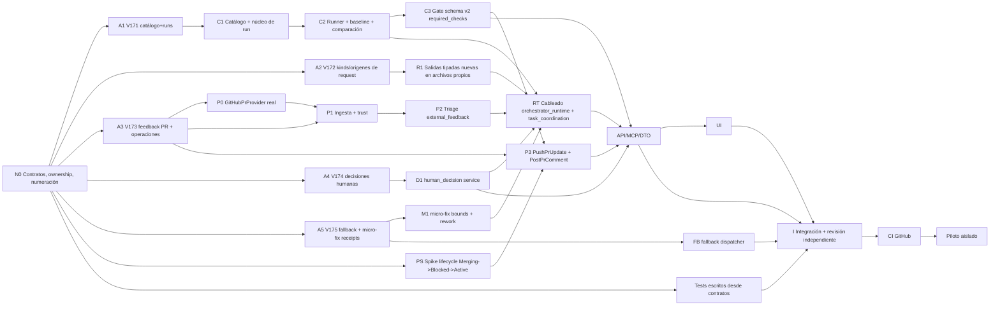

# Plan — Verificación determinista solicitada por el coordinador y bucle de PR

Fecha: 2026-11-15. Baseline inspeccionado: rama `feat/orchestrated-delivery-polish`,
HEAD `8d89573b` (el último SHA con CI integrado PASS documentado es `6db87ea3`,
run 43648809452; los commits posteriores son documentales). Este documento es un
plan: no declara ninguna de las capacidades siguientes como implementada ni
aceptada. Ninguna evidencia de este plan se ha obtenido compilando o ejecutando
tests localmente.

**Estado de ejecución:** N0 (congelación de contratos) **DONE (estático)** el
2026-11-15; ver «Contratos congelados (N0)» y «Fases». A1 (V171), A2 (V172) y A4
(V174) están **IMPLEMENTADO / NOT RUN** (migraciones y capa `db` escritas; validadas
solo con SQLite vía Python y `cargo fmt`; nada compilado ni ejecutado con cargo,
ver «Anexo A1/A2/A4»). Los demás nodos siguen **TODO**. D1–D8 están **RESUELTAS**
(sección «Decisiones»).

Este plan continúa [autonomous-delivery-fluency.md](autonomous-delivery-fluency.md)
(cerrado) y respeta sus contratos: coordinador read-only, la intención no es
ejecución, `request_changes` no es PASS, sin autoridad implícita de GitHub. No
reabre nodos DONE de [project-dag-implementation.md](project-dag-implementation.md)
ni de [task-coordination-and-guided-experience.md](task-coordination-and-guided-experience.md).

## Objetivo

Dos mejoras de seguridad y cinco ajustes de fluidez que no relajan ninguna
frontera de autoridad:

1. **S1 — Verificación determinista solicitada por el coordinador.** Un catálogo
   de checks nombrados, versionados y con digest, declarado por el dueño/admin del
   Project. El coordinador pide un check por identidad mediante una salida tipada;
   Forge (no el agente) lo ejecuta sobre un workspace/commit/snapshot exactos y
   produce un `ValidationRun` + Evidence. Incluye comparación determinista con la
   base (¿el fallo ya existía?) y ejecución automática de los checks requeridos
   tras integrar y antes de evaluar el Gate. El resultado vuelve al coordinador por
   la misma vía tipada y exacta que `review_findings`.
2. **S2 — Bucle de PR.** Tras una publicación de PR autorizada por Gate, ingerir
   reviews/comentarios de GitHub como registros externos durables, usarlos como
   fuente de triage (`correct|recheck|human|dismiss`), llevar el rework a nuevos
   commits en la misma rama del PR bajo autorización explícita, y publicar de
   vuelta un resumen del `ReviewReport`. El merge sigue siendo humano.
3. **Fluidez sin perder seguridad** (carriles F-a..F-e): micro-fix acotado,
   decisión sobre verificación ad-hoc (catálogo, no shell), cadena de fallback de
   proveedor/perfil preautorizada, solicitud de decisión humana estructurada y
   replan a mitad de ejecución con aprobación humana solo si cambia alcance o
   autoridad.

## No objetivos

- No dar al coordinador un workspace escribible, shell, ni comandos arbitrarios.
- No añadir `allow_merge=true`, no auto-merge, no merge por API de GitHub desde
  Forge. El humano mergea en GitHub; Forge solo observa (camino existente de
  `PrReconciler`).
- No cambiar defaults de budgets (32 turns, 64 calidad, 16 rondas, 16 WorkUnits).
- No renombrar identificadores públicos ni editar migraciones históricas
  V001–V170.
- No aceptación con proveedor real ni GitHub real en este plan (piloto separado,
  requiere autorización); las pruebas usan servidor HTTP simulado local.
- No `gh` CLI ni credenciales ambientales del runner/host como autorización.
- No ejecución de checks dentro de un workspace con `WorkspaceLease` activo de un
  worker.
- No fallback del coordinador (cambiaría el digest de equipo y exige
  reautorización humana).

## Baseline verificado en el código (hallazgos que condicionan el diseño)

| # | Hecho | Fuente |
|---|---|---|
| B1 | `ValidationService::run_command` está completo (claim con heartbeat, bounded tails, digest de entorno, `Stale` si cambian HEAD/snapshot, Evidence + artifact `validation_report`) pero **no tiene ningún llamador en runtime**: solo tests y `crates/api/tests/happy_path.rs`. Docs: REST/MCP/CLI/web solo leen ValidationRuns. | `crates/services/src/validation_service.rs:55`, `docs/architecture.md:192` |
| B2 | `check_identity` hoy es `ci:{check_index}:{sha256(command)}`; `config_digest` = sha256 del `config_summary_json` (shell, digest de entorno, límites). Idempotencia = digest de (task, workspace, commit, snapshot, execution causante, identidad, config). No existe catálogo ni configuración persistida de checks. | `validation_service.rs:84-111`, `V099__review_executions_validation_runs_evidence.sql:69` |
| B3 | El Gate v1 exige `ValidationRequirement` con `validation_run_id` y `evidence_id` **exactos** en la política (immutable revision). No hay requisito declarativo «el check X sobre este sujeto». Nunca resuelve `latest`. | `gate_engine.rs:138-151`, `docs/concepts/gates.md` |
| B4 | Salida tipada actual del Orchestrator: `OrchestratorAction` = `Message`, `Handoff`, `CreateWorkUnit`, `Proposal` (+ `ReviewFindings` como `OrchestratorActionKind`); política de TaskRole `allowed_actions` por `OrchestratorActionKind`. Turnos de coordinación: request con `kind = work_unit_plan | review_findings`; `review_findings` solo `correct|recheck|human`. | `orchestrator_runtime.rs:85-135`, `docs/concepts/orchestration.md`, `V168__review_findings_coordination.sql` |
| B5 | Los orígenes batch tipados son cuatro (`scheduler`, `quality_replan`, `human_replan`, `ReviewTriage`); el wake genérico no inicia coordinación batch. Añadir un origen exige reconstruir la tabla de requests (V168 lo hizo con `task_coordination_request_v168`) y revisar guards V167. | `docs/concepts/project-plan.md`, `V168` |
| B6 | `CoordinationEnvelope` v1: `deny_unknown_fields`, `validate()` **rechaza** `allow_merge` y `allow_external_actions`; el digest es `sha256` del JSON almacenado al autorizar, de modo que añadir campos con `#[serde(default)]` no altera autorizaciones históricas. | `task_coordination.rs:79-146`, `:705` |
| B7 | `GitHubPrProvider` es un **placeholder**: `find_pr/create_pr/get_pr_status` solo hacen `tracing::info!` y devuelven registros sintéticos (`placeholder-…`). El token se lee de la variable de entorno cuyo nombre está en `token_secret_ref` (congelado en `remote_pr_admission`). | `pr_service.rs:112-210`, `:822-846` |
| B8 | `publish_pr` exige operación `PublishPr` activa con `gate_evaluation_id`, `remote_pr_admission` y `TaskMerge` en `running`+`remote_waiting`, lifecycle `Merging`; `PrReconciler` sondea cada 60 s las admisiones `admitted|reconciliation_required|open`. | `pr_service.rs:233-330`, `:586-700`, `:848-862` |
| B9 | Transiciones de lifecycle permitidas desde `Merging`: solo `Done` o `Blocked`. `Blocked → Ready|Active` sí. No hay camino «PR abierto → rework». | `task_lifecycle.rs:1299-1317` |
| B10 | `TaskIntegrationOperationKind` = `WorkUnitIntegration, TaskMerge, PublishPr, WorkUnitCreate, WorkUnitWorkspacePrepare, IntegrationWorkspaceCleanup`. No hay operación de push de actualización ni de comentario. | `crates/db/src/models.rs:770` |
| B11 | Infra de credenciales: `CredentialService` (cifrado, entries de proveedor de modelos) y `external_api/github.rs` (`reqwest` con `Authorization: Bearer`, solo issues, token pasado por parámetro, nunca en URL). Integraciones de Project guardan token propio. `pr_provider_config.base_url` ya existe y se congela en la admisión (permite servidor simulado en tests). | `external_api/github.rs`, `V029__primary_repo_work_mode.sql:59` |
| B12 | Fallback existente: lista ordenada `fallbacks` dentro de la config de **un mismo Agent**; `validate_same_agent_candidate` prohíbe cambiar de harness o cuenta nativa («select or reassign a separate Agent»). `ExecutionFailureClass::{TaskFailed, ExecutorUnavailable}`, `retry_after` → `retry_at` en snapshot de routing, `route_attempts` con `RouteAttemptOutcome` (`usage_exhausted`, `unavailable`, `skipped_cooldown`, …). `ExecutorUnavailable` **no consume** presupuesto de retry y bloquea la Task (`executor_unavailable`); nada reasigna a otro Agent. | `crates/executors/src/lib.rs:97`, `config.rs:390-526`, `task_service/config.rs:248-400`, `task_failure_retry.rs:1240`, `task_lifecycle.rs:1432` |
| B13 | Escalación humana actual: quality request categoría `human_decision` / target `human` (resumen, findings, condición de resolución) **sin opciones, recomendación ni enlaces de evidencia tipados**. Intervención humana `decision`. | `crates/api-types/src/task_coordination.rs:451-545`, `TaskInterventionKind` |
| B14 | Replan existente: Human `request_replan` con Artifact de plan aprobado explícito; origen batch `QualityReplan` (desde quality request `plan_revision`, con Artifact fuente y Execution productora). El coordinador no puede iniciar un replan por sí mismo. | `task_coordination.rs:1466-1620`, `docs/concepts/project-plan.md:76` |
| B15 | El turno de coordinación es workspace-free y read-only; Claude usa allowlist Read/Glob/Grep **que no es sandbox de SO**. | `docs/concepts/orchestration.md` |

## Invariantes tocados

Referencia: [architecture-v2.md](../migration/architecture-v2.md). Cada nodo
nombra los suyos; este plan no suspende ninguno.

| INV | Cómo se respeta |
|---|---|
| INV-020 Orchestrator no aprueba/falla | El coordinador solicita checks y triagea; nunca escribe ReviewReport ni GateEvaluation. El resultado de un check no es veredicto de review. |
| INV-028 Validation y Review distintas | ValidationRun sigue siendo evidencia determinista sin Actor; el catálogo no crea ReviewReports; un check PASS no sustituye review ni viceversa. |
| INV-029 Feedback de review es colaboración | El feedback externo de PR entra como registro externo + Handoff/request tipado, no como reescritura oculta de prompts. |
| INV-030 Autoridad determinista | Catálogo, bounds de micro-fix, clasificador de scope de replan, autorización de push/comentario y cadena de fallback se validan en Rust, en la transacción del escritor y en Provider Start. |
| INV-031 Política cognitiva no es ramificación Rust | El coordinador decide *qué* verificar/replanear/preguntar; Rust solo comprueba autoridad y límites medibles. |
| INV-032 Lo no soportado no es silencioso | Un daemon/harness sin capacidad, un check fuera del catálogo o un fallback agotado producen bloqueo durable explicado. |
| INV-033 Historial auditable | Todas las tablas nuevas son append-only/inmutables con receipts; las Executions de fallback conservan `route_attempts`. |
| INV-034 Sin fuentes de verdad ocultas | EventBus/SSE solo proyectan; `TaskLifecycle` sigue siendo el único estado de Task; no se crea estado de Task paralelo. |
| INV-016/017 | Micro-fix y rework siguen siendo WorkUnits explícitos y workspaces aislados. |
| INV-038 | Visibilidad de Project no da autoridad de escritura sobre catálogo, política de feedback ni decisiones humanas. |

Reglas de CLAUDE.md aplicables: breaking changes visibles en `CHANGELOG.md`
Unreleased; migraciones solo hacia delante; `Project.owner_id`; no tokens en URLs,
logs, errores, telemetría ni eventos; REST/MCP/SSE/forge-ctl son contratos
públicos; cambios de respuesta tocan route + `api-types` + tipos generados en
`web/src/types/generated/` + `docs/api.md`.

## Contratos por mejora

### S1 — Catálogo de verificación y solicitud del coordinador

**C1. Catálogo.** Tabla inmutable `validation_check_definition` (V171):
`id`, `project_id`, `repo_id` (NULL = todo el Project), `check_key` (slug 1–64),
`version`, `command` (1–8192, como el CHECK actual de `validation_run.command`),
`timeout_seconds` (≤ 3600), `env_policy` (`captured_default` en v1: el
`capture_environment()` actual, sin variables nuevas), `definition_digest`
(`sha256` del JSON canónico de clave+versión+comando+timeout+env_policy), `state`
(`active|retired`), `created_by`, timestamps. Una nueva versión es una fila nueva;
nunca se edita. Escritura solo por owner/admin del Project (REST); agentes y
coordinador nunca escriben el catálogo. Un coordinador puede *proponer* una
entrada mediante el `Proposal` tipado existente (ver F-b); un humano la aprueba.

**C2. Identidad del run.** `ValidationRun` gana (V171, aditivo con valores por
defecto que preservan filas históricas) `catalog_check_id`, `definition_digest`,
`run_origin` (`legacy_command|coordinator_request|after_integration|baseline`) y
`requested_by_request_id`. Para runs de catálogo,
`check_identity = "catalog:{check_key}@{definition_digest[0..16]}"` y el
`config_summary_json` incluye `definition_digest`, por lo que `config_digest` y la
clave de idempotencia cambian cuando cambia la definición. El camino
`run_command(index, command)` existente sigue disponible para tests y no cambia
de comportamiento (sin alias semántico: es otro origen).

**C3. Autorización por Task.** El envelope gana (campos con `#[serde(default)]`,
sin romper digests históricos, ver B6):
`validation_checks: [{ check_key, definition_digest, trigger }]` con
`trigger ∈ {on_request, after_integration}` (máx. 8). `validate()` comprueba que
cada clave existe, está `active` y su digest coincide con el pin; una definición
posterior (nueva versión) no cambia lo autorizado. Sin entrada en el envelope, el
coordinador **no** puede pedir el check (rechazo tipado
`validation.check_not_authorized`). No se concede capacidad nueva: el envelope
sigue sin permitir `allow_merge`/`allow_external_actions`.

**C4. Salida tipada.** Nueva acción `RequestValidation` (`OrchestratorActionKind`
+ `allowed_actions` de TaskRole) y su equivalente dentro de la respuesta de
`review_findings`/nuevo kind `validation_findings`:
`{ check_key, subject: { kind: work_unit_result|task_integration, id, version },
baseline: bool, reason }`. El coordinador no elige workspace, comando, ruta ni
commit: Forge resuelve el sujeto exacto (workspace, commit y snapshot congelados
del WorkUnit aceptado o del workspace de integración), exige workspace `Ready`,
sin `WorkspaceLease` activo de un worker, y toma el `WorkspaceExecutionLockManager`.
Idempotencia por `(task, authorization_version, check pin, sujeto exacto)`.

**C5. Ejecución.** Cola durable `validation_check_request` (V171) consumida por un
worker nuevo `ValidationCheckRunner` (claim/heartbeat reutilizando
`claim_validation_run`), que invoca un núcleo común extraído de `run_command`.
No corre en el turno del coordinador ni en el daemon del agente: corre en el
proceso de Forge, con las mismas cotas (8 KiB de tail por stream, 1 h máx.).

**C6. Base (baseline).** Si `baseline=true`, Forge crea (o reutiliza) un
workspace de verificación desechable en el commit base **exacto** del sujeto
(`git worktree` detached, solo lectura para agentes, sin lease, limpieza por
`workspace_cleanup.rs`) y ejecuta el mismo check con `run_origin=baseline`.
Registro inmutable `validation_comparison` (V171) con `candidate_run_id`,
`baseline_run_id` y clasificación calculada **por Rust, no por el modelo**:
`regression` (base PASS, candidato FAIL), `pre_existing_failure` (ambos FAIL),
`fixed` (base FAIL, candidato PASS), `both_pass`, `inconclusive` (cualquier
`error|stale|cancelled`); incluye bandera `same_output_digest`. Un
`pre_existing_failure` **no satisface** un requisito PASS; solo una `Decision`
humana sobre un `Proposal` exacto puede dispensarlo (requisito `Decision` ya
existente en el Gate).

**C7. Gate.** Política schema v2 añade `required_checks:
[{ check_key, definition_digest, required_outcome: passed }]` para
merge-readiness. La resolución es por **clave exacta**, no por `latest`: se
recalcula la clave de idempotencia del run para el sujeto de la evaluación
(workspace/commit/snapshot del merge candidate) y se busca ese único run. La
evaluación congela `validation_run_id`, `evidence_id` y digests como hoy. Schema
desconocido sigue fallando cerrado. D2 resuelta: la política v2 la suministra el autor (REST de Gate existente).

**C8. Automático tras integración.** Un consumidor de eventos duraderos (patrón
del Gate Engine) reacciona al éxito de `WorkUnitIntegration`/preparación de merge
y encola los checks con `trigger=after_integration` del envelope vigente sobre el
workspace de integración exacto, **antes** de la evaluación de merge-readiness. Si
el sujeto cambia (nuevo commit), el run anterior queda historial y se encola uno
nuevo.

**C9. Retorno al coordinador.** Un run terminal `failed|error|stale` o una
comparación `regression|inconclusive` crea una solicitud tipada
`validation_findings` (misma maquinaria que `review_findings`: Wake autorizado,
request+origen+presupuesto atómicos, contexto exacto, límites). Respuestas
permitidas: `correct` (reutiliza `TaskReworkService`, que ya consume «failed
ValidationRun» como fuente de receipt), `recheck` (re-ejecutar el check sobre el
nuevo snapshot o review formal), `human` (→ F-d). Un PASS no despierta al
coordinador; aparece en su contexto de la siguiente decisión.

### S2 — Bucle de PR

**P-pre (precondición bloqueante).** Hoy no hay cliente GitHub real para PRs (B7).
Sin él, nada de S2 es aceptable fuera de simulación. Nodo P0: implementar
`GitHubPrProvider` real con `reqwest`, `Authorization: Bearer` (nunca en URL ni en
logs), `User-Agent` genérico, `base_url` congelado, errores redactados, y
clasificación `DefinitiveRejection|OutcomeUnknown|Unavailable` coherente con
`find_or_create`. Credencial (D4 resuelta): token GitHub almacenado cifrado en
`CredentialService` y referenciado por `credential_handle_id` (ver «Congelado 6»);
**no** variable de entorno. Se rechaza `gh` CLI.

**P1. Política de feedback congelada.** `pr_provider_config` gana
`feedback_policy_json` (V173, versionado): `ingest` (bool, default false),
`trusted_author_associations` (default `OWNER|MEMBER|COLLABORATOR`),
`trusted_logins`, `max_items_per_poll`, `push_corrections` (`human_approval|
automatic`, default `human_approval`), `post_summary` (`human_approval|
automatic|off`, default `off`). Se **congela en la admisión remota** (digest en
`remote_pr_admission`), igual que `provider_config_digest`: cambiar la política
después no amplía una admisión ya emitida; requiere nueva admisión.

**P2. Ingesta.** Extender `PrReconciler` (mismo tick; intervalo =
`polling_interval_seconds`) con `PrFeedbackIngestor`: para admisiones `open`,
lee reviews, comentarios inline y comentarios de issue con `ETag`/`since`.
Registro inmutable `external_feedback_item` (V173): `task_id`, `admission_id`,
`provider_item_id`, `kind`, `author_login`, `author_association`,
`review_state` (`CHANGES_REQUESTED|COMMENTED|APPROVED|DISMISSED`), `path`, `line`,
`commit_sha` del head comentado, `body` (≤ 16 KiB, truncado con marca, nunca
silencioso), `body_digest`, `provider_url`, `trust_class`
(`trusted|untrusted`), `ingested_at`; `UNIQUE(admission_id, provider_item_id,
body_digest)` (una edición añade fila nueva, la anterior queda). Los comentarios
publicados por Forge se excluyen mediante un marcador
`forge:artifact=<id> digest=<d>` (anti-bucle). Contenido externo es **dato no
confiable**: solo ítems `trusted` entran al contexto del coordinador, citados en
bloques de datos con digest; los `untrusted` son visibles a humanos y no activan
turnos. Un ítem de un head SHA distinto al actual se marca `stale_head`.

**P3. Triage.** Nuevo kind de request `external_feedback` (origen batch tipado
`ExternalFeedback`): fuente = conjunto exacto y acotado (≤ 20) de ítems
`trusted` + head SHA + admisión + autorización; respuesta tipada por ítem
`correct|recheck|human|dismiss` con rationale e instrucciones acotadas. Mismos
fences que `review_findings` (autorización vigente, team digest, wake lease,
presupuesto atómico, replay seguro, sin wake genérico batch). `dismiss` registra
decisión inmutable; no responde en GitHub por sí mismo.

**P4. Rework y camino de lifecycle.** Estado actual: la Task está en `Merging`
con el TaskMerge `remote_waiting` (B8) y desde `Merging` solo se sale a
`Done|Blocked` (B9). Diseño propuesto, **sin añadir una arista nueva**:
`Merging → Blocked` (`reason_kind=pr_feedback`, `reason_ref`=request id) y
`Blocked → Active`, con causa de lifecycle tipada. El TaskMerge remoto permanece
en `running`+`remote_waiting` y el reconciliador sigue observándolo: si el PR se
fusiona o cierra durante el rework, el camino existente decide (con head
coincidente → `Done`; si no → `reconciliation_required`). Esto se valida en el
nodo de spike PS antes de comprometer la implementación (D3 resuelta: si falla, parar y preguntar). El rework
usa `TaskReworkService` (budgeted), integra al branch de Task, pasa review formal
fresca, Gate de merge-readiness nuevo (inputs exactos, incluidos `required_checks`
de S1) y entonces:

**P5. Push de actualización.** Nueva acción `push_update` en la tabla
`pr_external_action` (V173; **no** se amplía `TaskIntegrationOperationKind`, ver
«Decisión de diseño N0» en V173), serializada con `WorkspaceExecutionLockManager`
y un trigger de exclusión frente a operaciones de integración en curso: fast-forward del branch fuente del PR, con
condición *expected remote head == admitted/last pushed sha* (sin force), pinned a
una `GateEvaluation` satisfecha nueva y al commit exacto. Autorización:
`push_corrections=human_approval` → `Proposal`+`Decision` humana sobre
(commit, evaluación, admisión); `automatic` solo si el owner/admin lo habilitó en
la política congelada. Resultado de proveedor incierto → `reconciliation_required`,
sin reintento ciego. El envelope sigue sin `allow_external_actions`: la
autorización externa proviene de la política congelada del Repo + Decisión, no del
envelope del coordinador.

**P6. Comentario de resumen.** Acción `post_comment` de `pr_external_action` (V173): cuerpo
determinista generado desde el `ReviewReport`/resumen Artifact exacto (plantilla
fija, ≤ 16 KiB, sin rutas locales ni secretos; pasa por redacción), con marcador de
idempotencia y búsqueda previa para resolver `OutcomeUnknown`. Autorización:
igual que P5 según `post_summary`. El merge nunca se invoca.

### Carriles de fluidez

**F-a. Micro-fix acotado.** *No* se da escritura al coordinador ni se aplica un
parche suyo. `correct` gana una variante `micro_fix` en la respuesta del
coordinador (en `review_findings`, `validation_findings` y `external_feedback`):
`{ finding refs, instructions, paths ⊆ paths de los findings }`. Forge crea un
WorkUnit de corrección **auto-admitido dentro de la autorización batch/Task**
asignado al implementador responsable (o la ruta de corrección ya configurada).
Límites deterministas en el envelope (`micro_fix: { enabled, max_files=3,
max_changed_lines=60, forbidden_globs, max_per_task=3 }`), comprobados *después*
del resultado sobre el diff contra el commit revisado (`crates/services/src/diff.rs`):
paths fuera del conjunto declarado, dependencias nuevas (manifiestos y lockfiles
en `forbidden_globs`: `Cargo.toml`, `Cargo.lock`, `package.json`, `pnpm-lock.yaml`,
`.github/**`, `crates/db/migrations/**`, `CLAUDE.md`), o exceso de tamaño marcan
`micro_fix_bounds_exceeded`: el resultado no se acepta por la vía rápida y vuelve
al triage ordinario/humano. La revisión posterior sigue siendo **formal** y el
Gate exige reporte favorable sobre el último resultado de la línea: «ligera»
significa contexto acotado al delta + hallazgo (y perfil de revisor económico
declarado en el envelope si el dueño lo autoriza), nunca una revisión omitida.
Consume una ronda de rework normal y además `max_per_task`.

**F-b. Verificación ad-hoc — decisión: catálogo, no allowlist de comandos.**
Evaluado y descartado ofrecer al coordinador una allowlist de comandos de
inspección: (1) el coordinador corre con allowlist de herramientas del harness,
documentada como política y no sandbox de SO (B15); (2) un comando libre, aunque
sea «de lectura», no queda ligado a digest/sujeto y su salida entraría a prompts
sin Evidence; (3) la lectura de Artifacts/diffs exactos ya está en su contexto.
Fluidez: el coordinador usa `RequestValidation` (S1) y, si falta un check útil,
emite un `Proposal` tipado (existente) «añadir check al catálogo» con comando y
justificación; el owner/admin lo aprueba creando una versión de catálogo y
reautorizando el pin en el envelope.

**F-c. Fallback de perfil/proveedor preautorizado.** Hoy: fallback solo *dentro*
del mismo Agent y cuenta (B12); `ExecutorUnavailable` bloquea la Task. Diseño:
envelope gana `fallback_agents: [{ task_role_id, actor: {agent_id}, cost_class,
max_wait_seconds }]` (≤ 3 por rol), que es a la vez la autorización y lo que la UI
muestra (incluida clase de coste: la presencia en el envelope es la preautorización
explícita). Disparo: Execution de WorkUnit terminal con
`failure_class=executor_unavailable` y route agotada (todos los
`route_attempts` ∈ `usage_exhausted|unavailable|skipped_cooldown`), **sin** Provider
Start incierto (`start_uncertain` nunca desencadena fallback) y con `retry_at` nulo
o posterior a `max_wait_seconds` (si es menor, se espera al mismo perfil). El
dispatcher (`task_dispatcher/fallback.rs`, nuevo) realoca el WorkUnit con
`WorkUnitService::allocate` (versión nueva, mismo TaskRole, mismo alcance), exige
que el Agent sea miembro activo del mismo rol con las mismas capacidades, mismo
dueño de cuenta (regla de admisión de `docs/architecture.md`), independencia de
review preservada (`reviewer_is_independent`) y credencial disponible. Nueva
Execution con `HarnessSession` nueva (no hay reanudación entre harnesses). Recibo
inmutable `work_unit_fallback_receipt` (V175): execution origen, clase de fallo,
digest de `route_attempts`, actor origen/destino, índice de cadena, digest del
envelope. Nunca escala autoridad: no cambia rol, scope, workspace ni lease; no
toca el equipo del coordinador; cadena agotada → bloqueo durable existente
(`executor_unavailable`) con la causa visible.

**F-d. Solicitud de decisión humana estructurada.** Tabla
`human_decision_request` (V174): `task_id`, `source_kind/source_id`
(request de coordinación, quality request, Gate, feedback de PR, replan),
`question` (≤ 1 KiB), `options` (2–6: `id`, `label`, `description`,
`consequence`, `authority_effect ∈ none|scope|authority`), `recommended_option_id`
+ `recommendation_rationale`, `evidence_links` ([{kind, id, digest}] validados
contra el Task: Artifact, ReviewReport, ValidationRun, GateEvaluation, Execution,
feedback item), `state` (`open|answered|superseded|cancelled`), `version`,
`answered_by`, `answered_option_id`, `answer_note`, `resume_binding`. Salida tipada
`ask_human` válida en todos los kinds de respuesta del coordinador. Respuesta:
`POST /tasks/{id}/human-decisions/{id}/answer` con `expected_version`; solo un
Human con autoridad de mutar la Task; si la opción tiene
`authority_effect != none` exige owner/admin y, cuando cambia el envelope, una
reautorización versionada (no se aplica sola). Reanudación: la respuesta escribe
una intervención `decision` existente y emite un evento durable que despierta al
coordinador por un nuevo origen batch tipado `HumanDecisionAnswer` que lleva el
`request_id` original y la opción elegida, de modo que continúa **exactamente** el
ciclo que quedó en pausa (sin turno genérico). Project Copilot no puede responder
(regla existente). Proyección SSE: `task.human_decision_requested|answered`; UI
tarjeta con opciones, recomendación y enlaces; MCP solo lectura.

**F-e. Replan a mitad de ejecución.** Existente (B14): Human `request_replan` y
`QualityReplan`. Hueco: el coordinador no puede proponerlo. Nueva salida tipada
`propose_replan { reason, evidence_links, plan_request }` que abre un turno
`work_unit_plan` (origen `QualityReplan` extendido con la fuente coordinador, ver
D6). El plan resultante pasa por un **clasificador determinista de delta de
autoridad** en Rust sobre hechos medibles: `objective_digest` sin cambios, roles y
actores ⊆ equipo actual, `max_work_units` y repos/paths ⊆ alcance original, sin
flags nuevos de envelope, contador de replans ≤ límite. `within_envelope` →
continúa bajo la autorización vigente (mismo mecanismo de aprobación de plan que
hoy para el modo vigente); `scope_or_authority_change` → se crea
automáticamente un `human_decision_request` (F-d) con opciones
`approve_replan|reject|revise_scope` y el plan como evidencia; no se materializa
hasta la respuesta. La clasificación no es política cognitiva sino comprobación de
límites (INV-030/031).

## Contratos congelados (N0)

Estado: **congelado el 2026-11-15 (revisión estática, nada compilado)**. Todo carril
implementa contra esta sección; un cambio aquí vuelve a N0 y exige nota en el
registro de decisiones. Los nombres se verificaron contra el código del baseline
`8d89573b` (sin colisiones: no existen hoy `human_decision`, `external_feedback`,
`validation_check`, `pr_feedback`, `micro_fix`, `fallback_receipt` ni
`CoordinatorReplan` en `crates/` ni `web/src`). Las migraciones reales se
numeran al implementar; la reserva es V171–V175 (último actual V170).

### Fases y puertas de CI

Cada fase termina con su propio lanzamiento de CI (ver nodo CI) sobre el SHA
integrado de esa fase; no se traslada PASS entre fases.

| Fase | Nodos | Entrega |
|---|---|---|
| **1** | A1, A2, A4, C1, C2, C3, R1 (solo `request_validation` y `ask_human`), D1, RT (fase 1), API/UI/T para estos | Catálogo, `RequestValidation`, runner, baseline, comparación, Gate v2, check tras integración, `validation_findings`, decisión humana estructurada y reanudación. Sin GitHub. |
| **2** | A3, P0, P1, P2, PS, P3 (+ R1 `external_feedback`, RT/API/UI/T) | Credencial GitHub cifrada, cliente PR real, ingesta, triage, rework de PR, push/comentario. |
| **3** | A5, M1, FB, R1 `micro_fix` y `propose_replan`, replan | Micro-fix, fallback cross-Agent, replan del coordinador. |

**A2 (V172) añade en UNA sola reconstrucción todos los kinds y orígenes de las tres
fases** (incluidos los de fase 2 y 3) para que ninguna fase posterior reconstruya
`task_coordination_request` ni `project_plan_batch_coordination_request`. Un kind
u origen aún sin productor lo rechaza el servicio con
`coordination.output_not_permitted` hasta su fase; la tabla ya lo admite.

### Decisiones resueltas que condicionan los contratos

Ver «Decisiones» al final. Resumen operativo: baseline en v1 (D1); Gate v2
`required_checks` (D2); `Merging → Blocked(pr_feedback) → Active` vía spike PS y
**parar y preguntar si falla** (D3); credencial GitHub en `CredentialService`
cifrado, nunca variable de entorno (D4); push/comentario `human_approval` por
defecto, `automatic` por política de repo owner/admin, merge siempre humano (D5);
origen `CoordinatorReplan`, máximo 2 por Task, aprobación humana solo si el
clasificador determinista detecta cambio de alcance/autoridad (D6); perfiles
más baratos solo si están predeclarados en el envelope, con `cost_class` visible
y recibo por cambio (D7); el coordinador no tiene fallback de proveedor (D8).

### Congelado 1 — Envelope v2 y compatibilidad de digest

Archivo: `crates/services/src/task_coordination.rs` (solo el nodo C1 toca la
parte de envelope; RT el cableado). Hechos verificados: `CoordinationEnvelope`
usa `#[serde(default, deny_unknown_fields)]`, `validate()` exige
`schema_version == 1` y rechaza `allow_merge`/`allow_external_actions`;
`envelope_digest = sha256(canonical_json(&envelope))` se calcula **al autorizar**
y se persiste junto a `envelope_json`; `semantic_unconfigured_manual_default`
compara por igualdad estructural contra el default.

Reglas de compatibilidad (invariantes de la prueba de migración/golden):

1. Todos los campos nuevos llevan `#[serde(default)]` **y**
   `#[serde(skip_serializing_if = ...)]` (vacío/`None`/`false`). Un envelope sin
   funciones nuevas se serializa **byte a byte igual** a hoy ⇒ mismo
   `envelope_digest` para autorizaciones nuevas equivalentes y ningún cambio para
   las históricas (su JSON y digest ya están guardados; no se re-serializan).
2. `schema_version` pasa a aceptar `1` o `2`. `validate()` rechaza campos nuevos
   no vacíos cuando `schema_version == 1` (`coordination.unsupported_plan_item`).
   El cliente opta por v2 explícitamente; el default sigue siendo v1.
3. `allow_merge` y `allow_external_actions` siguen siendo `false` obligatorios en
   v2. La autorización de push/comentario en GitHub **no** viaja en el envelope
   (viene de la política congelada del Repo y de una Decisión; ver Congelado 7).
4. Validación asíncrona de pins (existencia, `active`, digest, pertenencia al
   Project/Repo de la Task, miembro activo del rol) en `authorize_inner` con un
   método nuevo `CoordinationEnvelope::validate_pins(&self, ctx)`, junto a
   `validate()` síncrono. `deny_unknown_fields` se mantiene.
5. `GET` del envelope sigue siendo `serde_json::Value` pasante en la API
   (`AuthorizeTaskCoordinationRequest.envelope`); no hay DTO nuevo ni tipo ts-rs
   para el envelope. Se documenta en `docs/api.md`.

```rust
// task_coordination.rs — campos añadidos (todos opcionales en el JSON)
pub struct CoordinationEnvelope {
    /* ...campos v1 sin cambios... */
    #[serde(default, skip_serializing_if = "Vec::is_empty")]
    pub validation_checks: Vec<EnvelopeValidationCheck>,        // <= 8
    #[serde(default, skip_serializing_if = "Option::is_none")]
    pub micro_fix: Option<EnvelopeMicroFix>,                    // fase 3
    #[serde(default, skip_serializing_if = "Option::is_none")]
    pub micro_fix_reviewer: Option<EnvelopeProfileGrant>,       // fase 3, D7
    #[serde(default, skip_serializing_if = "Vec::is_empty")]
    pub fallback_agents: Vec<EnvelopeFallbackAgent>,            // fase 3, <= 3 por rol
    #[serde(default, skip_serializing_if = "std::ops::Not::not")]
    pub allow_coordinator_replan: bool,                         // fase 3, D6
}
#[serde(deny_unknown_fields)]
pub struct EnvelopeValidationCheck {
    pub check_key: String,            // slug [a-z0-9_-]{1,64}
    pub definition_digest: String,    // 64 hex; pin de una versión exacta
    pub trigger: EnvelopeCheckTrigger // "on_request" | "after_integration"
}
#[serde(deny_unknown_fields)]
pub struct EnvelopeMicroFix {
    pub enabled: bool,
    pub max_files: u32,               // 1..=3  (constante de producto: 3)
    pub max_changed_lines: u32,       // 1..=60 (constante de producto: 60)
    pub max_per_task: u32,            // 1..=3
    #[serde(default)] pub extra_forbidden_globs: Vec<String>, // <= 16, se SUMAN a los obligatorios
}
// Obligatorios siempre (no configurables): Cargo.toml, Cargo.lock, package.json,
// pnpm-lock.yaml, .github/**, crates/db/migrations/**, CLAUDE.md, **/Cargo.toml.
#[serde(deny_unknown_fields)]
pub struct EnvelopeProfileGrant {
    pub task_role_id: String,
    pub agent_id: String,
    pub cost_class: CostClass,        // "economy" | "standard" | "premium"
}
#[serde(deny_unknown_fields)]
pub struct EnvelopeFallbackAgent {
    pub task_role_id: String,
    pub agent_id: String,
    pub cost_class: CostClass,
    pub max_wait_seconds: u32,        // 0..=86400
}
```

Ejemplo v2 (solo S1 activa):

```json
{"schema_version":2,"max_work_units":16,"allow_new_task_roles":false,
 "allow_membership_changes":false,"allow_capability_changes":false,
 "allow_repository_write":true,"allow_external_actions":false,
 "allow_integration":true,"allow_merge":false,
 "allowed_review_roles":["reviewer"],"require_independent_review":true,
 "orchestrator_reviews_findings":true,
 "validation_checks":[{"check_key":"services-tests","definition_digest":"<64hex>","trigger":"after_integration"}]}
```

Códigos: `validation.check_not_authorized`, `validation.check_unknown`,
`validation.check_stale_pin` (clave retirada o digest distinto).

### Congelado 2 — Migraciones V171–V175

Reglas comunes: solo hacia delante; no se edita V001–V170; inmutabilidad por
triggers `BEFORE UPDATE/DELETE` con excepción de `project_deletion_guard` (patrón
V164 `task_review_triage_immutable*`); ids/timestamps por la aplicación
(`new_uuid_v4`, `now_rfc3339`); cada migración con tabla temporal `_vNNN_check`
si reconstruye (patrón V168). Las pruebas viven en `crates/db/src/tests.rs` con
prefijo de función `v171_`…`v175_` (necesario para el filtro del workflow).

**V171 (A1, fase 1)** — catálogo y checks (el DDL de abajo es el borrador congelado; la «Forma final implementada de V171» más abajo y `V171__validation_check_catalog.sql` prevalecen donde difieren):

```sql
CREATE TABLE validation_check_definition (
  id TEXT PRIMARY KEY,
  project_id TEXT NOT NULL REFERENCES project(id) ON DELETE RESTRICT,
  repo_id TEXT REFERENCES repo(id) ON DELETE RESTRICT,          -- NULL = todo el Project
  check_key TEXT NOT NULL CHECK (length(check_key) BETWEEN 1 AND 64
      AND check_key NOT GLOB '*[^a-z0-9_-]*'),
  version INTEGER NOT NULL CHECK (version >= 1),
  command TEXT NOT NULL CHECK (length(trim(command)) BETWEEN 1 AND 8192),
  timeout_seconds INTEGER NOT NULL CHECK (timeout_seconds BETWEEN 1 AND 3600),
  env_policy TEXT NOT NULL CHECK (env_policy IN ('captured_default')),
  definition_digest TEXT NOT NULL CHECK (length(definition_digest) = 64),
  state TEXT NOT NULL DEFAULT 'active' CHECK (state IN ('active','retired')),
  created_by TEXT NOT NULL REFERENCES user(id) ON DELETE RESTRICT,
  created_at TEXT NOT NULL, retired_at TEXT,
  UNIQUE(id, definition_digest), UNIQUE(id, project_id),
  CHECK ((state = 'active') = (retired_at IS NULL)));
CREATE UNIQUE INDEX idx_vcd_version ON validation_check_definition
  (project_id, COALESCE(repo_id,''), check_key, version);
CREATE UNIQUE INDEX idx_vcd_one_active ON validation_check_definition
  (project_id, COALESCE(repo_id,''), check_key) WHERE state = 'active';
```
Trigger: solo se permite `active → retired` (con `retired_at`); resto inmutable;
el borrado solo en teardown. `definition_digest = sha256(serde_json::to_string(
&ValidationCheckDigestInput{check_key,version,command,timeout_seconds,env_policy}))`
(orden de campos del struct = orden anterior). El servicio publica una versión
nueva y retira la activa anterior en la misma transacción `BEGIN IMMEDIATE`.

```sql
CREATE TABLE validation_check_request (
  id TEXT PRIMARY KEY,
  task_id TEXT NOT NULL REFERENCES task(id) ON DELETE RESTRICT,
  authorization_version INTEGER NOT NULL CHECK (authorization_version >= 1),
  check_definition_id TEXT NOT NULL,
  definition_digest TEXT NOT NULL CHECK (length(definition_digest) = 64),
  trigger_kind TEXT NOT NULL CHECK (trigger_kind IN ('coordinator_request','after_integration')),
  subject_kind TEXT NOT NULL CHECK (subject_kind IN ('work_unit_result','task_integration')),
  subject_id TEXT NOT NULL, subject_version INTEGER NOT NULL CHECK (subject_version >= 1),
  workspace_id TEXT NOT NULL,
  commit_sha TEXT NOT NULL CHECK (length(trim(commit_sha)) BETWEEN 7 AND 128),
  workspace_snapshot_digest TEXT NOT NULL CHECK (length(workspace_snapshot_digest) = 64),
  baseline INTEGER NOT NULL CHECK (baseline IN (0,1)),
  baseline_workspace_id TEXT, baseline_commit_sha TEXT,
  requested_by_request_id TEXT REFERENCES task_coordination_request(id) ON DELETE RESTRICT,
  requested_by_execution_id TEXT,
  reason TEXT CHECK (reason IS NULL OR length(reason) <= 1024),
  idempotency_key TEXT NOT NULL UNIQUE CHECK (length(trim(idempotency_key)) BETWEEN 1 AND 256),
  state TEXT NOT NULL DEFAULT 'queued' CHECK (state IN
      ('queued','running','completed','cancelled','failed_to_start')),
  candidate_run_id TEXT, baseline_run_id TEXT,
  failure_code TEXT, version INTEGER NOT NULL DEFAULT 1 CHECK (version >= 1),
  created_at TEXT NOT NULL, updated_at TEXT NOT NULL, completed_at TEXT,
  UNIQUE(id, task_id),
  FOREIGN KEY (check_definition_id, definition_digest)
     REFERENCES validation_check_definition(id, definition_digest) ON DELETE RESTRICT,
  FOREIGN KEY (workspace_id, task_id) REFERENCES workspace(id, task_id) ON DELETE RESTRICT,
  FOREIGN KEY (requested_by_execution_id, task_id) REFERENCES execution(id, task_id) ON DELETE RESTRICT,
  FOREIGN KEY (candidate_run_id, task_id) REFERENCES validation_run(id, task_id) ON DELETE RESTRICT,
  FOREIGN KEY (baseline_run_id, task_id) REFERENCES validation_run(id, task_id) ON DELETE RESTRICT,
  CHECK ((trigger_kind = 'coordinator_request') = (requested_by_request_id IS NOT NULL)),
  CHECK (baseline = 1 OR (baseline_workspace_id IS NULL AND baseline_run_id IS NULL)));
```
`idempotency_key = sha256("{task_id}|{authorization_version}|{definition_digest}|{subject_kind}|{subject_id}|{subject_version}|{commit_sha}|{workspace_snapshot_digest}|{baseline}")`.
Trigger de inserción: el `task_coordination` vigente debe tener
`authorization_version` coincidente y el pin presente en su `envelope_json`
(`json_each(envelope_json,'$.validation_checks')`, con `trigger` compatible); y
no puede existir `workspace_lease` activa de un worker sobre `workspace_id`
(mismo criterio que la guarda de integración V092).

```sql
ALTER TABLE validation_run ADD COLUMN catalog_check_id TEXT;
ALTER TABLE validation_run ADD COLUMN definition_digest TEXT
  CHECK (definition_digest IS NULL OR length(definition_digest) = 64);
ALTER TABLE validation_run ADD COLUMN run_origin TEXT NOT NULL DEFAULT 'legacy_command'
  CHECK (run_origin IN ('legacy_command','coordinator_request','after_integration','baseline'));
ALTER TABLE validation_run ADD COLUMN check_request_id TEXT;
-- Triggers: run_origin='legacy_command' <=> catalog_check_id IS NULL AND check_request_id IS NULL;
-- columnas inmutables tras el insert; filas históricas quedan 'legacy_command'.
CREATE TABLE validation_comparison (
  id TEXT PRIMARY KEY, task_id TEXT NOT NULL,
  check_request_id TEXT NOT NULL UNIQUE,
  candidate_run_id TEXT NOT NULL, baseline_run_id TEXT NOT NULL,
  candidate_status TEXT NOT NULL, baseline_status TEXT NOT NULL,
  classification TEXT NOT NULL CHECK (classification IN
      ('regression','pre_existing_failure','fixed','both_pass','inconclusive')),
  same_output_digest INTEGER NOT NULL CHECK (same_output_digest IN (0,1)),
  created_at TEXT NOT NULL,
  UNIQUE(candidate_run_id, baseline_run_id),
  FOREIGN KEY (check_request_id, task_id) REFERENCES validation_check_request(id, task_id),
  FOREIGN KEY (candidate_run_id, task_id) REFERENCES validation_run(id, task_id),
  FOREIGN KEY (baseline_run_id, task_id) REFERENCES validation_run(id, task_id));
-- Trigger de insert: ambos runs terminales, mismo definition_digest, candidato con
-- run_origin != 'baseline', base con 'baseline', y classification coherente con
-- (candidate_status, baseline_status): passed/passed=both_pass, failed/passed=regression,
-- failed/failed=pre_existing_failure, passed/failed=fixed, cualquier error|stale|cancelled=inconclusive.
```
Nota de spike C2 — **resuelta por decisión del lead (2026-11-15)**: el workspace
base desechable es un worktree desacoplado propiedad del runner, **sin fila
`workspace` ni `workspace_scope`**; no se reconstruye `workspace_scope` y la
alternativa (ii) queda descartada. Como `validation_run` exige
`FOREIGN KEY (workspace_id, task_id) REFERENCES workspace(id, task_id)`, el
resultado base **no** es un `validation_run`.

**Forma final implementada de V171 (desviaciones verificadas respecto al borrador
anterior; el DDL autoritativo es `V171__validation_check_catalog.sql`):**
- `validation_check_request`: sin `baseline_workspace_id` ni `baseline_run_id`;
  gana `baseline_commit_sha` (commit base exacto resuelto, escribible una sola vez
  mientras la solicitud está abierta); `CHECK (baseline = 1 OR baseline_commit_sha IS NULL)`.
  FKs a `task` y `project` pasan a `ON DELETE CASCADE` (la inmutabilidad se
  conserva con triggers `BEFORE DELETE` permitidos solo bajo `project_deletion_guard`;
  la teardown de `project.rs` borra explícitamente las tablas nuevas).
  Trigger de inserción: definición `active` del Project/Repo de la Task
  (`FORGE_VALIDATION_CHECK_STALE_PIN`), pin exacto en `envelope_json`
  (`coordinator_request` exige trigger `on_request`; `after_integration` exige
  `after_integration`; `FORGE_VALIDATION_CHECK_NOT_AUTHORIZED`), sin
  `workspace_lease` activa de `worker` (`FORGE_VALIDATION_WORKSPACE_LEASED`);
  solo nace `queued`. Transiciones solo hacia delante con `version+1`.
- `validation_comparison`: ya no referencia un `baseline_run_id`; guarda
  `candidate_status`, `candidate_output_digest`, `baseline_commit_sha`,
  `baseline_snapshot_digest`, `baseline_provenance_json` (procedencia local del
  runner), `baseline_status`, `baseline_exit_code`, `baseline_output_digest`;
  `classification` y `same_output_digest` son CHECK deterministas derivados de
  esos hechos (el repositorio los calcula). `UNIQUE(check_request_id)`,
  `UNIQUE(candidate_run_id)`, `UNIQUE(id, task_id)`.
- `validation_run`: `run_origin='baseline'` queda **reservado y rechazado** por
  trigger (el enum Rust lo conserva por el contrato congelado); procedencia de
  catálogo todo-o-nada; una sola ejecución de catálogo por solicitud; un
  reintento idempotente de la misma `idempotency_key` omite la guarda para que
  `ON CONFLICT DO NOTHING` siga funcionando. Triggers de inmutabilidad de las
  columnas nuevas.
- `validation_check_definition`: creada solo `active`; `version` debe ser la
  siguiente exacta; el autor debe ser owner/admin del Project; el repo debe
  pertenecer al Project; el repositorio asigna `version`, calcula
  `definition_digest` y retira la activa anterior en una `BEGIN IMMEDIATE`.

**V172 (A2, fase 1; incluye todo lo de fases 2–3)** — una reconstrucción siguiendo
V168 (`*_v172`, copia con verificación `EXCEPT`, `RENAME`, recrear triggers/índices
y vistas dependientes de `task_coordination_request` y
`project_plan_batch_coordination_request`: los 8 triggers que V168 elimina más
`task_coordination_request_identity_immutable`, `..._review_source_guard`,
`..._origin_kind_guard`, `task_coordination_plan_request_kind_guard`,
`project_plan_batch_review_request_kind_guard`, `task_coordination_request_triaged_guard`,
`task_review_triage_current_request_guard`, el índice único
`idx_task_coordination_exact_review_source` y las vistas
`task_review_coordination_source_current` / `..._request_current`):

- `kind` CHECK: `('work_unit_plan','review_findings','validation_findings','external_feedback','human_decision_resume')`.
- Columnas nuevas (todas NULL para filas históricas):
  `source_subject_kind TEXT CHECK (source_subject_kind IS NULL OR source_subject_kind IN ('validation_run','validation_comparison','external_feedback_set','human_decision'))`,
  `source_subject_id TEXT`, `source_subject_digest TEXT CHECK (source_subject_digest IS NULL OR length(source_subject_digest)=64)`,
  `resumes_request_id TEXT REFERENCES task_coordination_request(id) ON DELETE RESTRICT`.
- CHECK por kind: `work_unit_plan`/`review_findings` ⇒ `source_subject_*` NULL (más las
  condiciones V168 existentes); `validation_findings` ⇒ subject_kind ∈ {validation_run, validation_comparison} y los tres campos no nulos;
  `external_feedback` ⇒ `external_feedback_set`; `human_decision_resume` ⇒ `human_decision` y `resumes_request_id` NOT NULL.
- Estado `triaged` aplica a `validation_findings`, `external_feedback` y `human_decision_resume` además de `review_findings`.
- `project_plan_batch_coordination_request.origin_kind` CHECK:
  `('scheduler','quality_replan','human_replan','review_triage','validation_triage','external_feedback_triage','human_decision_resume','coordinator_replan')`.
  Reglas de columnas: `validation_triage`, `external_feedback_triage`,
  `human_decision_resume` ⇒ `claim_token`, `source_artifact_id`,
  `producer_execution_id`, `approved_plan_artifact_id` todos NULL (la fuente
  exacta vive en `task_coordination_request.source_subject_*`);
  `coordinator_replan` ⇒ `producer_execution_id` NOT NULL, resto NULL.
  El guard `task_coordination_request_batch_scope_guard` replica las condiciones
  `started` de `quality_replan` para los orígenes nuevos.

Tablas nuevas en V172:

```sql
CREATE TABLE task_validation_triage (            -- espejo de task_review_triage (V164)
  request_id TEXT PRIMARY KEY REFERENCES task_coordination_request(id) ON DELETE RESTRICT,
  task_id TEXT NOT NULL REFERENCES task(id) ON DELETE CASCADE,
  validation_run_id TEXT NOT NULL, comparison_id TEXT,
  run_digest TEXT NOT NULL CHECK (length(run_digest)=64),
  execution_id TEXT NOT NULL REFERENCES execution(id) ON DELETE RESTRICT,
  authorization_version INTEGER NOT NULL,
  disposition TEXT NOT NULL CHECK (disposition IN ('correct','recheck','human')),
  rationale TEXT NOT NULL, instructions TEXT NOT NULL,
  decision_digest TEXT NOT NULL CHECK (length(decision_digest)=64),
  review_work_unit_id TEXT REFERENCES work_unit(id) ON DELETE RESTRICT,
  rework_ref TEXT, created_at TEXT NOT NULL,
  UNIQUE(validation_run_id, authorization_version));  -- una decisión por run exacto
CREATE TABLE task_coordinator_replan (           -- límite duro D6
  id TEXT PRIMARY KEY, task_id TEXT NOT NULL REFERENCES task(id) ON DELETE CASCADE,
  ordinal INTEGER NOT NULL CHECK (ordinal BETWEEN 1 AND 2),
  authorization_version INTEGER NOT NULL CHECK (authorization_version >= 1),
  source_request_id TEXT NOT NULL REFERENCES task_coordination_request(id) ON DELETE RESTRICT,
  producer_execution_id TEXT NOT NULL REFERENCES execution(id) ON DELETE RESTRICT,
  plan_request_id TEXT REFERENCES task_coordination_request(id) ON DELETE RESTRICT,
  reason TEXT NOT NULL CHECK (length(reason) BETWEEN 1 AND 2048),
  evidence_links_json TEXT NOT NULL CHECK (json_valid(evidence_links_json)),
  classification TEXT CHECK (classification IN ('within_envelope','scope_or_authority_change')),
  classification_facts_json TEXT CHECK (classification_facts_json IS NULL OR json_valid(classification_facts_json)),
  human_decision_id TEXT, state TEXT NOT NULL CHECK (state IN
      ('proposed','planning','awaiting_human','approved','rejected','materialized','failed')),
  version INTEGER NOT NULL DEFAULT 1, created_at TEXT NOT NULL, updated_at TEXT NOT NULL,
  UNIQUE(task_id, ordinal));
```
`ordinal` lo asigna el servicio como `max+1` en `BEGIN IMMEDIATE`; el CHECK
`BETWEEN 1 AND 2` hace que un tercer replan falle en la base, y el servicio lo
traduce a `coordination.replan_limit_reached`.

**Forma final implementada de V172 (autoritativo: `V172__coordination_request_kinds.sql`):**
- Una sola reconstrucción (patrón V168) de ambas tablas; las vistas
  `task_review_coordination_*` y los triggers de otras tablas
  (`task_coordination_plan_request_kind_guard`, `task_review_triage_current_request_guard`)
  se conservan sin tocar (referencian las tablas por nombre). Se recrean los 12
  triggers de las dos tablas y los 5 índices; se añaden
  `task_coordination_request_subject_source_guard` y
  `idx_task_coordination_exact_subject_source`
  (`task_id, authorization_version, kind, source_subject_kind, source_subject_id, source_subject_digest`).
- CHECK por kind (más estricto que el borrador): `validation_findings` y
  `external_feedback` son kinds de triage (sin `plan_artifact_id` ni estados de plan);
  `human_decision_resume` permite estados de plan (continúa cualquier request) y
  exige `resumes_request_id`. `resumes_request_id` referencia
  `task_coordination_request(id)` por su nombre final.
- Guards de kind↔origen exactos y simétricos en `task_coordination_request_origin_kind_guard` y
  `project_plan_batch_review_request_kind_guard` (`work_unit_plan` solo con
  `scheduler|quality_replan|human_replan|coordinator_replan`).
  `project_plan_batch_coordination_request_scope_guard` trata los orígenes nuevos
  como `started`, y `coordinator_replan` exige su Execution productora enlazada
  en `project_plan_batch_execution`.
- `task_coordination_request_subject_source_guard`: kinds nuevos nacen
  `requested`, `version=1`, sin Execution, con coordinación vigente;
  `validation_findings` valida la fuente exacta (run `failed|error|stale` o
  comparación `regression|inconclusive`). **A3 (V173) debe sustituir
  `task_coordination_request_triaged_guard` y añadir su guard de fuente para
  `external_feedback`** (hoy solo exige `execution_id`); V174 añade el guard de
  fuente de `human_decision_resume`.
- `task_validation_triage` gana FKs compuestas a `validation_run` y
  `validation_comparison` (esta con `UNIQUE(id, task_id)`) y un trigger de
  inserción que exige request vigente, misma Execution/autorización y digest de
  fuente exactos. `task_coordinator_replan`: ordinal contiguo (trigger),
  transiciones solo hacia delante, delete solo en teardown.
- El estado `triaged` de `validation_findings` exige su fila `task_validation_triage`.

**V173 (A3, fase 2)**:

```sql
-- Credencial (D4): referencia exacta al secreto cifrado; nunca valor ni env var.
ALTER TABLE pr_provider_config ADD COLUMN credential_handle_id TEXT
  REFERENCES credential_handle(id) ON DELETE RESTRICT;
ALTER TABLE pr_provider_config ADD COLUMN credential_owner_user_id TEXT
  REFERENCES user(id) ON DELETE RESTRICT;
ALTER TABLE pr_provider_config ADD COLUMN feedback_policy_json TEXT NOT NULL
  DEFAULT '{"schema_version":1,"ingest":false,"trusted_author_associations":["OWNER","MEMBER","COLLABORATOR"],"trusted_logins":[],"max_items_per_poll":50,"push_corrections":"human_approval","post_summary":"off"}'
  CHECK (json_valid(feedback_policy_json) AND json_extract(feedback_policy_json,'$.schema_version') = 1);
CHECK-trigger: (credential_handle_id IS NULL) = (credential_owner_user_id IS NULL)
  y credential_handle.owner_user_id = credential_owner_user_id y provider = 'github'.
ALTER TABLE remote_pr_admission ADD COLUMN credential_handle_id TEXT;      -- congelados en la admisión
ALTER TABLE remote_pr_admission ADD COLUMN credential_owner_user_id TEXT;
ALTER TABLE remote_pr_admission ADD COLUMN feedback_policy_json TEXT;
ALTER TABLE remote_pr_admission ADD COLUMN feedback_policy_digest TEXT
  CHECK (feedback_policy_digest IS NULL OR length(feedback_policy_digest)=64);
-- DROP + CREATE de remote_pr_admission_insert_guard (V112) añadiendo
--   AND config.credential_handle_id IS NEW.credential_handle_id
--   AND config.credential_owner_user_id IS NEW.credential_owner_user_id
--   AND config.feedback_policy_json IS NEW.feedback_policy_json
-- y de remote_pr_admission_identity_immutable (V112) con las 4 columnas nuevas.
-- Revisar el snapshot terminal V116 (remote_pr_history) y sus triggers: A3 decide
-- y documenta si las 4 columnas se copian (recomendado: sí, nullable).
-- Un agent_profile no puede referenciar un handle provider='github':
CREATE TRIGGER agent_profile_credential_not_scm_insert BEFORE INSERT ON agent_profile
 WHEN NEW.credential_ref IS NOT NULL AND EXISTS (SELECT 1 FROM credential_handle
   WHERE id = NEW.credential_ref AND provider = 'github') BEGIN SELECT RAISE(ABORT,
   'SCM credentials cannot back an Agent profile'); END;   -- y gemelo BEFORE UPDATE
```
`credential_handle.provider` no tiene CHECK (V062) ⇒ **no hay reconstrucción**;
la restricción de valores vive en `CredentialService` (Rust).

```sql
CREATE TABLE external_feedback_item (
  id TEXT PRIMARY KEY, task_id TEXT NOT NULL REFERENCES task(id) ON DELETE RESTRICT,
  admission_id TEXT NOT NULL REFERENCES remote_pr_admission(task_merge_operation_id) ON DELETE RESTRICT,
  provider_item_id TEXT NOT NULL CHECK (length(trim(provider_item_id)) BETWEEN 1 AND 128),
  kind TEXT NOT NULL CHECK (kind IN ('review','review_comment','issue_comment')),
  author_login TEXT NOT NULL CHECK (length(author_login) BETWEEN 1 AND 128),
  author_association TEXT NOT NULL CHECK (length(author_association) <= 32),
  review_state TEXT CHECK (review_state IN ('CHANGES_REQUESTED','COMMENTED','APPROVED','DISMISSED')),
  path TEXT CHECK (path IS NULL OR length(path) <= 1024), line INTEGER,
  commit_sha TEXT CHECK (commit_sha IS NULL OR length(commit_sha) BETWEEN 7 AND 128),
  body TEXT NOT NULL CHECK (length(body) <= 16384),
  body_truncated INTEGER NOT NULL DEFAULT 0 CHECK (body_truncated IN (0,1)),
  body_digest TEXT NOT NULL CHECK (length(body_digest)=64),
  provider_url TEXT CHECK (provider_url IS NULL OR length(provider_url) <= 2048),
  trust_class TEXT NOT NULL CHECK (trust_class IN ('trusted','untrusted','forge_authored')),
  head_state TEXT NOT NULL CHECK (head_state IN ('current','stale_head')),
  ingested_at TEXT NOT NULL,
  UNIQUE(admission_id, provider_item_id, body_digest), UNIQUE(id, task_id));
CREATE TABLE task_external_feedback_triage (
  id TEXT PRIMARY KEY, task_id TEXT NOT NULL REFERENCES task(id) ON DELETE CASCADE,
  request_id TEXT NOT NULL REFERENCES task_coordination_request(id) ON DELETE RESTRICT,
  feedback_item_id TEXT NOT NULL, body_digest TEXT NOT NULL CHECK (length(body_digest)=64),
  disposition TEXT NOT NULL CHECK (disposition IN ('correct','recheck','human','dismiss')),
  rationale TEXT NOT NULL, instructions TEXT NOT NULL,
  decision_digest TEXT NOT NULL CHECK (length(decision_digest)=64),
  execution_id TEXT NOT NULL REFERENCES execution(id) ON DELETE RESTRICT,
  created_at TEXT NOT NULL, UNIQUE(request_id, feedback_item_id),
  FOREIGN KEY (feedback_item_id, task_id) REFERENCES external_feedback_item(id, task_id));
CREATE TABLE pr_external_action (       -- ver decisión de diseño abajo
  id TEXT PRIMARY KEY, task_id TEXT NOT NULL REFERENCES task(id) ON DELETE RESTRICT,
  admission_id TEXT NOT NULL REFERENCES remote_pr_admission(task_merge_operation_id) ON DELETE RESTRICT,
  kind TEXT NOT NULL CHECK (kind IN ('push_update','post_comment')),
  state TEXT NOT NULL CHECK (state IN ('proposed','approved','running','succeeded','failed',
       'outcome_unknown','reconciliation_required','rejected','abandoned')),
  authorization_mode TEXT NOT NULL CHECK (authorization_mode IN ('human_approval','automatic')),
  gate_evaluation_id TEXT REFERENCES gate_evaluation(id) ON DELETE RESTRICT,
  subject_commit_sha TEXT, expected_remote_head_sha TEXT,
  summary_artifact_id TEXT REFERENCES artifact(id) ON DELETE RESTRICT,
  body_digest TEXT CHECK (body_digest IS NULL OR length(body_digest)=64),
  proposal_id TEXT REFERENCES proposal(id) ON DELETE RESTRICT,
  decision_id TEXT REFERENCES decision(id) ON DELETE RESTRICT,
  idempotency_key TEXT NOT NULL UNIQUE CHECK (length(trim(idempotency_key)) BETWEEN 1 AND 256),
  provider_event_id TEXT, provider_result_json TEXT CHECK (provider_result_json IS NULL OR json_valid(provider_result_json)),
  version INTEGER NOT NULL DEFAULT 1 CHECK (version >= 1),
  created_at TEXT NOT NULL, updated_at TEXT NOT NULL, finished_at TEXT,
  CHECK (kind != 'push_update' OR (gate_evaluation_id IS NOT NULL AND subject_commit_sha IS NOT NULL AND expected_remote_head_sha IS NOT NULL)),
  CHECK (kind != 'post_comment' OR (summary_artifact_id IS NOT NULL AND body_digest IS NOT NULL)),
  CHECK (authorization_mode = 'automatic' OR state IN ('proposed','rejected','abandoned') OR decision_id IS NOT NULL));
CREATE UNIQUE INDEX idx_pr_external_action_open ON pr_external_action(task_id)
  WHERE state IN ('proposed','approved','running','outcome_unknown','reconciliation_required');
```

**Decisión de diseño N0 (desviación respecto al borrador del plan):** las
operaciones de push y comentario **no** se añaden a `TaskIntegrationOperationKind`.
El `CHECK (kind IN (...))` vive solo en `task_integration_operation` (V092) y
sobre esa tabla cuelgan decenas de triggers (V104, V112–V114, V142, …); ampliar el
CHECK exige reconstruirla con alto riesgo (R5). Una tabla propia
`pr_external_action` con trigger de inserción «requiere ninguna
`task_integration_operation` en `running` para la Task» y exclusión mutua en el
servicio mediante `WorkspaceExecutionLockManager` consigue la misma serialización
sin tocar la tabla existente. El enum Rust `TaskIntegrationOperationKind` **no
cambia**. El trigger de inserción de `pr_external_action` replica
`pr9_task_merge_current_inputs_guard` (`gate_evaluation_currentness.inputs_current=1`)
para `push_update`.

**V174 (A4, fase 1)** — decisión humana estructurada:

```sql
CREATE TABLE human_decision_request (
  id TEXT PRIMARY KEY, task_id TEXT NOT NULL REFERENCES task(id) ON DELETE CASCADE,
  source_kind TEXT NOT NULL CHECK (source_kind IN ('coordination_request','quality_request',
      'gate_evaluation','validation_run','external_feedback','coordinator_replan')),
  source_id TEXT NOT NULL CHECK (length(trim(source_id)) > 0),
  raised_by_execution_id TEXT,                       -- turno del coordinador, si aplica
  authorization_version INTEGER CHECK (authorization_version IS NULL OR authorization_version >= 1),
  question TEXT NOT NULL CHECK (length(question) BETWEEN 1 AND 1024),
  options_json TEXT NOT NULL CHECK (json_valid(options_json) AND json_type(options_json)='array'
      AND json_array_length(options_json) BETWEEN 2 AND 6 AND length(options_json) <= 8192),
  recommended_option_id TEXT, recommendation_rationale TEXT CHECK (length(recommendation_rationale) <= 2048),
  evidence_links_json TEXT NOT NULL CHECK (json_valid(evidence_links_json) AND json_type(evidence_links_json)='array'
      AND json_array_length(evidence_links_json) <= 16),
  max_authority_effect TEXT NOT NULL CHECK (max_authority_effect IN ('none','scope','authority')),
  state TEXT NOT NULL DEFAULT 'open' CHECK (state IN ('open','answered','superseded','cancelled')),
  answered_by_user_id TEXT REFERENCES user(id), answered_option_id TEXT,
  answer_note TEXT CHECK (length(answer_note) <= 2048), answered_at TEXT,
  resume_request_id TEXT REFERENCES task_coordination_request(id) ON DELETE RESTRICT,
  resume_binding_json TEXT NOT NULL CHECK (json_valid(resume_binding_json)),
  version INTEGER NOT NULL DEFAULT 1 CHECK (version >= 1),
  created_at TEXT NOT NULL, updated_at TEXT NOT NULL,
  UNIQUE(id, task_id),
  CHECK ((state = 'answered') = (answered_at IS NOT NULL AND answered_option_id IS NOT NULL
         AND answered_by_user_id IS NOT NULL)));
CREATE UNIQUE INDEX idx_human_decision_exact_source          -- una pregunta por fuente exacta
  ON human_decision_request(source_kind, source_id, COALESCE(authorization_version, 0));
```
Formas JSON:
`options_json` = `[{"id":"a","label":"…","description":"…","consequence":"…","authority_effect":"none|scope|authority"}]`
(`id` slug ≤ 32, único; label ≤ 80; description ≤ 512; consequence ≤ 512);
`evidence_links_json` = `[{"kind":"artifact|review_report|validation_run|validation_comparison|gate_evaluation|execution|external_feedback|work_unit","id":"…","digest":"<64hex|null>"}]`;
`resume_binding_json` = `{"request_id":"…","request_kind":"…","authorization_version":N,"source_subject":{"kind":"…","id":"…","digest":"…"}}`.
Triggers: transiciones `open → answered|superseded|cancelled` con `version+1`,
nada más cambia; `recommended_option_id` ∈ ids de opciones; `max_authority_effect`
= máximo de las opciones.

**Forma final implementada de V174 (autoritativo: `V174__human_decision_request.sql`):**
validación en trigger de inserción de forma de opciones (objeto con `id` slug único
≤32, `label` ≤80, `description`/`consequence` ≤512, `authority_effect` obligatorio),
enlaces de evidencia (kind del conjunto cerrado, `id`, digest nulo o 64) y
`resume_binding_json` (debe nombrar un `task_coordination_request` de la misma Task con
ese `kind` y `authorization_version`); CHECK adicional: los campos `answered_*` y
`resume_request_id` solo existen en `answered`; `raised_by_execution_id` gana FK
compuesta `(id, task_id)` a `execution`; la respuesta debe nombrar una opción;
`resume_request_id` solo se fija una vez sobre una fila `answered` y debe ser el
request `human_decision_resume` exacto. V174 añade además
`task_coordination_request_human_decision_source_guard` sobre
`task_coordination_request` (decisión `answered`, sin reanudar, misma Task,
autorización exacta y `resumes_request_id` igual al de `resume_binding_json`).

**V175 (A5, fase 3)**:

```sql
CREATE TABLE work_unit_fallback_receipt (
  id TEXT PRIMARY KEY, task_id TEXT NOT NULL REFERENCES task(id) ON DELETE RESTRICT,
  work_unit_id TEXT NOT NULL, work_unit_version_before INTEGER NOT NULL, work_unit_version_after INTEGER NOT NULL,
  origin_execution_id TEXT NOT NULL, failure_class TEXT NOT NULL CHECK (failure_class = 'executor_unavailable'),
  route_attempts_digest TEXT NOT NULL CHECK (length(route_attempts_digest)=64),
  task_role_id TEXT NOT NULL,
  from_actor_kind TEXT NOT NULL CHECK (from_actor_kind='agent'), from_actor_id TEXT NOT NULL,
  to_actor_kind TEXT NOT NULL CHECK (to_actor_kind='agent'), to_actor_id TEXT NOT NULL,
  chain_index INTEGER NOT NULL CHECK (chain_index BETWEEN 0 AND 2),
  cost_class TEXT NOT NULL CHECK (cost_class IN ('economy','standard','premium')),
  authorization_version INTEGER NOT NULL, envelope_digest TEXT NOT NULL CHECK (length(envelope_digest)=64),
  new_execution_id TEXT, created_at TEXT NOT NULL,
  UNIQUE(origin_execution_id),            -- un fallback por ejecución origen
  UNIQUE(work_unit_id, chain_index),
  FOREIGN KEY (work_unit_id, task_id) REFERENCES work_unit(id, task_id) ON DELETE RESTRICT,
  FOREIGN KEY (origin_execution_id, task_id) REFERENCES execution(id, task_id) ON DELETE RESTRICT);
CREATE TABLE micro_fix_receipt (
  id TEXT PRIMARY KEY, task_id TEXT NOT NULL REFERENCES task(id) ON DELETE RESTRICT,
  request_id TEXT NOT NULL REFERENCES task_coordination_request(id) ON DELETE RESTRICT,
  source_kind TEXT NOT NULL CHECK (source_kind IN ('review_findings','validation_findings','external_feedback')),
  finding_refs_json TEXT NOT NULL CHECK (json_valid(finding_refs_json)),
  declared_paths_json TEXT NOT NULL CHECK (json_valid(declared_paths_json)),
  fix_work_unit_id TEXT NOT NULL, reviewed_commit_sha TEXT NOT NULL, result_commit_sha TEXT,
  changed_files INTEGER, changed_lines INTEGER,
  bounds_outcome TEXT NOT NULL CHECK (bounds_outcome IN ('pending','within_bounds','bounds_exceeded')),
  bounds_violation TEXT CHECK (bounds_violation IN ('paths_outside_declared','forbidden_glob',
       'too_many_files','too_many_lines','new_dependency')),
  reviewer_cost_class TEXT CHECK (reviewer_cost_class IN ('economy','standard','premium')),
  reviewer_actor_kind TEXT, reviewer_actor_id TEXT, envelope_digest TEXT NOT NULL CHECK (length(envelope_digest)=64),
  ordinal INTEGER NOT NULL CHECK (ordinal BETWEEN 1 AND 3), created_at TEXT NOT NULL, updated_at TEXT NOT NULL,
  UNIQUE(task_id, ordinal), UNIQUE(request_id, fix_work_unit_id),
  FOREIGN KEY (fix_work_unit_id, task_id) REFERENCES work_unit(id, task_id) ON DELETE RESTRICT);
```
(`micro_fix_receipt` admite `bounds_outcome` solo avanzar `pending → ...` una vez.)

### Congelado 3 — Tipos Rust (DB y servicios)

`crates/db/src/models.rs` (secciones nuevas al final; solo A1–A5 editan):

- `TaskCoordinationRequestKind` gana `ValidationFindings => "validation_findings"`,
  `ExternalFeedback => "external_feedback"`, `HumanDecisionResume => "human_decision_resume"`.
- `ProjectPlanBatchRequestOrigin` gana `ValidationTriage`, `ExternalFeedbackTriage`,
  `HumanDecisionResume` (sin campos) y `CoordinatorReplan { producer_execution_id: String }`.
- `TaskCoordinationRequest` gana `source_subject_kind: Option<String>`,
  `source_subject_id: Option<String>`, `source_subject_digest: Option<String>`,
  `resumes_request_id: Option<String>`.
- `ValidationRun` y `CreateValidationRun` ganan `catalog_check_id: Option<String>`,
  `definition_digest: Option<String>`, `run_origin: ValidationRunOrigin`,
  `check_request_id: Option<String>`.
- Enums nuevos (todos `#[serde(rename_all="snake_case")]` con `enum_strings!`):
  `ValidationRunOrigin {LegacyCommand, CoordinatorRequest, AfterIntegration, Baseline}`,
  `ValidationCheckState {Active, Retired}`, `EnvelopeCheckTrigger {OnRequest, AfterIntegration}`
  (autorización en el envelope) y `ValidationCheckRequestTrigger {CoordinatorRequest, AfterIntegration}` (fila de solicitud),
  `ValidationCheckRequestState {Queued, Running, Completed, Cancelled, FailedToStart}`,
  `ValidationComparisonClass {Regression, PreExistingFailure, Fixed, BothPass, Inconclusive}`,
  `HumanDecisionState {Open, Answered, Superseded, Cancelled}`,
  `HumanDecisionSourceKind {...}`, `AuthorityEffect {None, Scope, Authority}` (ordenado),
  `CostClass {Economy, Standard, Premium}`, `FeedbackTrustClass {Trusted, Untrusted, ForgeAuthored}`,
  `PrExternalActionKind {PushUpdate, PostComment}`, `PrExternalActionState {...}`,
  `FeedbackDisposition {Correct, Recheck, Human, Dismiss}`.
- Structs (filas 1:1 con las tablas): `ValidationCheckDefinition`,
  `ValidationCheckRequest`, `ValidationComparison`, `HumanDecisionRequest`,
  `ExternalFeedbackItem`, `PrExternalAction`, `WorkUnitFallbackReceipt`,
  `MicroFixReceipt`, `TaskValidationTriage`, `TaskCoordinatorReplan`, con
  `Create*`/`Update*` análogos a los existentes (versión esperada en updates).
- Repos (trait + impl en `crates/db/src/sqlite/`): `validation_catalog.rs`
  (`ValidationCatalogRepo`, `ValidationCheckRequestRepo`, `ValidationComparisonRepo`),
  `human_decision.rs` (`HumanDecisionRepo`), `external_feedback.rs`
  (`ExternalFeedbackRepo`, `PrExternalActionRepo`), y extensión de
  `validation_run.rs`, `task_coordination.rs`, `pr_provider_config.rs`,
  `pr_metadata.rs`. `work_unit_fallback_receipt`/`micro_fix_receipt`:
  `fallback_receipt.rs` (`WorkUnitFallbackReceiptRepo`, `MicroFixReceiptRepo`).

`crates/services/src/` módulos nuevos: `validation_catalog.rs`
(`ValidationCatalogService`), `validation_check_runner.rs` (`ValidationCheckRunner`),
`human_decision_service.rs` (`HumanDecisionService`), `pr_github_client.rs`
(`GitHubClient`), `pr_feedback.rs` (`PrFeedbackIngestor`), `pr_external_action.rs`
(`PrExternalActionService`), `task_dispatcher/fallback.rs` (`FallbackPlanner`),
`task_rework/micro_fix.rs` (`MicroFixBounds`), y
`coordinator_outputs/{mod,validation_request,ask_human,propose_replan,external_feedback,micro_fix}.rs`
(`CoordinatorOutput`, `CoordinatorTurnEnvelopeV2`, validadores y aplicadores).
`lib.rs` re-exporta solo lo necesario (nodo I).

### Congelado 4 — Salidas tipadas del coordinador (JSON exactos)

Dos canales, **un solo modelo de datos** (`coordinator_outputs::CoordinatorOutput`):

**(a) Runtime orientado a eventos** (`OrchestratorResponse.actions[]`,
`#[serde(tag="type", rename_all="snake_case", deny_unknown_fields)]`). Nuevas
variantes de `OrchestratorAction` y de `OrchestratorActionKind` (ambas
snake_case): `RequestValidation`/`request_validation`, `AskHuman`/`ask_human`,
`ProposeReplan`/`propose_replan` (esta última solo fase 3).
**Regla asimétrica de política:** `TaskRoleOrchestratorPolicy::permits` hoy trata
`allowed_actions: None` como «todo permitido». Para no ampliar roles existentes,
las tres kinds nuevas **solo** se permiten si están listadas explícitamente en
`allowed_actions` (None ⇒ no permitidas). Rechazo: `coordination.output_not_permitted`.

```json
{"actions":[
 {"type":"request_validation","check_key":"services-tests",
  "subject":{"kind":"work_unit_result","id":"<work_unit_id>","version":7},
  "baseline":true,"reason":"El resultado toca validation_service; comprobar si el fallo ya existía."},
 {"type":"ask_human","question":"¿Dispensar el fallo preexistente de services-tests?",
  "options":[
    {"id":"waive","label":"Dispensar","description":"Aceptar el fallo preexistente.","consequence":"El Gate podrá continuar con una Decisión exacta.","authority_effect":"scope"},
    {"id":"fix","label":"Corregir primero","description":"Abrir corrección.","consequence":"Un ciclo de rework adicional.","authority_effect":"none"}],
  "recommended_option_id":"fix","recommendation_rationale":"El fallo es en código tocado por esta Task.",
  "evidence_links":[{"kind":"validation_comparison","id":"<id>","digest":"<64hex>"}]}
]}
```
`subject.kind ∈ {"work_unit_result","task_integration"}`; para
`task_integration`, `id` es el `task_id` y `version` la versión del Task.
Forge resuelve el workspace/commit/snapshot exactos; el coordinador **no** puede
enviar comando, ruta, commit, workspace ni timeout (`deny_unknown_fields` los
rechaza). `version` desfasada ⇒ `validation.subject_stale`.
Límites: `reason` ≤ 1024 B, `question` ≤ 1024 B, 2–6 opciones, ≤ 16 enlaces
de evidencia, máx. 4 salidas nuevas por turno.

`propose_replan` (fase 3):
```json
{"type":"propose_replan","reason":"…","evidence_links":[{"kind":"validation_run","id":"…","digest":"…"}],
 "plan_request":{"instructions":"Dividir la tarea X en dos WorkUnits secuenciales."}}
```
`plan_request` solo lleva `instructions` ≤ 4 KiB; el objetivo es inmutable.

**(b) Turnos de coordinación tipados** (la salida es `execution.summary`,
≤ 64 KiB, parseada en `task_coordination.rs::complete_*_turn`). El envelope
`review_findings` v1 **no cambia** (`schema_version: 1`, acepta sin `outputs`).
Todos los kinds nuevos y, opcionalmente, `review_findings` usan
`schema_version: 2` (`deny_unknown_fields`):

```json
{"schema_version":2,"request_id":"<id>","task_id":"<id>","authorization_version":3,
 "validation_findings":[{"validation_run_id":"<id>","comparison_id":"<id|null>",
   "run_digest":"<64hex>","disposition":"correct","rationale":"…","instructions":"…","micro_fix":null}],
 "outputs":[]}
```
- `validation_findings`: exactamente 1 decisión; `disposition ∈ correct|recheck|human`;
  `run_digest` = digest del Evidence/ValidationRun de la solicitud.
- `external_feedback` (fase 2): clave `external_feedback`: exactamente una decisión por ítem de la solicitud (≤ 20):
  `{"feedback_item_id","body_digest","disposition":"correct|recheck|human|dismiss","rationale","instructions","micro_fix":null}`.
- `human_decision_resume`: `{"resumes_request_id","human_decision_id","answered_option_id", <clave del kind pausado>, "outputs":[]}`; la clave y forma de decisión son las del kind pausado.
- `micro_fix` (fase 3, reemplaza `null`): `{"finding_refs":["…"],"instructions":"…","paths":["crates/…"]}` con `paths` ⊆ rutas de los hallazgos (≤ 3). En fase 1/2 un `micro_fix` no nulo se rechaza con `coordination.output_not_permitted`.
- `outputs`: lista (≤ 4) de las mismas variantes `request_validation | ask_human | propose_replan` que en (a).

Ambos canales validan: autorización vigente (`authorization_version` y `team_digest`),
pin del check en el envelope, rol con la kind permitida, y presupuesto
(`TaskAutonomyLimits.max_turns`; RT verifica el contador exacto que ya consume
`review_findings` y lo reutiliza para las kinds nuevas).

### Congelado 5 — Catálogo, runner, comparación y Gate v2

- **Servicio de catálogo** (`ValidationCatalogService`): `create_version(project_id, user_id, input) -> ValidationCheckDefinition` (owner/admin del Project, mediante `project_authority`); `retire(id, expected_state)`; `list(project_id, repo_id, state, cursor)`; sin lecturas con `latest` implícito.
- **Cola y runner** (`ValidationCheckRunner`): consume `validation_check_request` en `queued` con claim/heartbeat como `claim_validation_run`; toma `WorkspaceExecutionLockManager`; rechaza (`validation.workspace_leased`) si hay `WorkspaceLease` activa; ejecuta el núcleo común extraído de `run_command` (cotas actuales: tail 8 KiB, ≤ 1 h). `check_identity = "catalog:{check_key}@{definition_digest[0..16]}"`; `config_summary_json` incluye `definition_digest` y `timeout_seconds`. Con `baseline=true`: crea el workspace de verificación desechable en el commit base exacto, ejecuta el mismo check con `run_origin='baseline'`, inserta `validation_comparison` calculada en Rust, y encola limpieza por `workspace_cleanup.rs`.
- **Retorno al coordinador**: run terminal `failed|error|stale` o comparación `regression|inconclusive` ⇒ inserta una `task_coordination_request` de kind `validation_findings` (`source_subject_kind='validation_comparison'` si existe, si no `'validation_run'`) con request+origen+presupuesto en una transacción y evento. `passed`/`both_pass`/`fixed`/`pre_existing_failure` no despiertan al coordinador (el contexto de la siguiente decisión los incluye).
- **Gate policy schema v2** (`gate_engine.rs`): `GatePolicyDocument` gana `#[serde(default)] pub required_checks: Vec<RequiredCheck>`; `RequiredCheck {check_key, definition_digest, required_outcome: ValidationRunStatus}` con `required_outcome == Passed` obligatorio. `normalize_policy` y las comprobaciones de `schema_version != 1` (líneas ~401/409/1763) pasan a aceptar `1|2`; en v1 `required_checks` debe estar vacío; versión desconocida falla cerrado. La política sigue siendo **suministrada por el cliente/autor** (REST de Gate existente): N0 no introduce generación automática de política. Resolución en evaluación: recomputa la `idempotency_key` del run para el sujeto exacto de la evaluación (workspace/commit/snapshot del merge candidate) y busca ese único run; congela `validation_run_id`, `evidence_id` y digests como entradas de evaluación. `pre_existing_failure` no satisface el requisito; solo la `DecisionRequirement` ya existente con `policy_ref = "validation_waiver:{check_key}@{definition_digest[0..16]}"` aprobada y exacta lo dispensa.
- **Post-integración (C8)**: consumidor de eventos duraderos (patrón `GateEngine`) sobre éxito de `WorkUnitIntegration`; encola `validation_check_request` con `trigger_kind='after_integration'` para cada entrada del envelope vigente con `trigger='after_integration'`. Orden: encolado ocurre antes de que el consumidor de merge-readiness pueda evaluar; si el sujeto cambia, el run viejo es historial y se encola uno nuevo.

### Congelado 6 — Credencial GitHub (D4)

Hechos verificados: `CredentialService` (`crates/services/src/credential_service.rs`)
cifra con XChaCha20-Poly1305 (clave derivada de `key_material`), guarda
`credential_handle` (metadatos; **sin CHECK en `provider`**) y
`protected_credential_secret(handle_id, ciphertext, nonce, key_revision)`;
`Secret` redacta `Debug`; el acceso en memoria pasa por `CredentialStore::acquire(owner_user_id, handle_id, …)`
(solo el dueño del handle puede abrirlo, `status='configured'`);
`connect_api_key_credential` hoy admite solo `openai|xai|gemini|openai_compatible|openrouter`. Hoy el token de PR sale de `std::env::var(token_secret_ref)` (`pr_service.rs::provider_for_admission`).

Diseño congelado:

1. **Alta**: `POST /api/v1/providers` (existente) acepta `provider: "github"` (nuevo valor de `ProviderKind` en api-types) con `label`, `credential` (PAT, solo en el cuerpo de la petición, nunca devuelto) y `base_url` opcional ignorado para el handle. Servicio nuevo `CredentialService::connect_scm_credential(ConnectScmCredential{owner_user_id, provider:"github", label, credential: Secret})` (no reutiliza la ruta de proveedores de modelo; no valida DNS/base_url del handle). El handle queda `credential_method='api_key'`, `metadata_json={"purpose":"scm"}`. `GET /providers` filtra: la lista de proveedores de modelo excluye `purpose=scm`; las entradas SCM se listan con `?purpose=scm`. Las entradas `github` no pueden asignarse a un `agent_profile` (trigger V173 y comprobación en servicio).
2. **Referencia**: `PATCH /api/v1/repos/{id}` con `pr_provider_config.credential_id` (campo nuevo `Option<Option<String>>` en `UpdatePrProviderConfigRequest`; `has_credential` reemplaza a `has_token` en `PrProviderStatus`). Solo owner/admin del Project **y** dueño del handle (`require_owned_entry`); se guarda `credential_handle_id` + `credential_owner_user_id` en `pr_provider_config`.
3. **Congelado en la admisión**: `remote_pr_admission.credential_handle_id` y `credential_owner_user_id` (V173). En cada uso `provider_for_admission` abre el secreto con `CredentialService::acquire_scm_secret(owner, handle)` (nuevo método interno, devuelve `Secret`), exige `status='configured'` y que el dueño siga siendo owner/admin del Project (`credential.owner_not_authorized`); revocar o rotar la credencial no amplía admisiones: una credencial nueva exige nueva admisión.
4. **Contrato retirado**: `pr_provider_config.token_secret_ref`, `remote_pr_admission.token_secret_ref` y el campo REST `token` dejan de usarse para PR (se conservan como datos históricos). Enviar `token` en `UpdatePrProviderConfigRequest` ⇒ 400 `repo.pr_provider_token_retired`; una admisión sin `credential_handle_id` falla con `pr_provider.credential_not_configured` (`PrProviderError::Unavailable`). CHANGELOG *Breaking*; los tests `pr12_public_surface.rs:981` y `repos_endpoints.rs:207` deben actualizarse en T. `external_api/github.rs` + `resolve_token` (issues, integraciones) **no cambian** en este plan.
5. **No filtrado**: el token solo existe en memoria dentro de `Secret`, se envía únicamente en `Authorization: Bearer`, nunca en URL, logs, errores (`PrProviderError` redactado), eventos ni respuestas; `GitHubClient` no implementa `Debug` con el secreto. Prueba obligatoria: aserción sobre capturas de log y cuerpos de error.
6. **Guarda SSRF**: el `base_url` de `pr_provider_config` se valida con la misma política `restricted_provider_ip` del servicio de credenciales; las pruebas usan una costura inyectable (`PrProviderFactory`) en lugar de abrir una excepción de loopback en producción. P0 es dueño de esta decisión de implementación y la registra en su nota de cierre.

### Congelado 7 — Bucle de PR (fase 2): política, autorización y lifecycle

`feedback_policy_json` (schema_version 1, ver V173): `ingest` (bool, default false),
`trusted_author_associations` (⊆ `OWNER|MEMBER|COLLABORATOR|CONTRIBUTOR|FIRST_TIME_CONTRIBUTOR|NONE`, default `OWNER|MEMBER|COLLABORATOR`), `trusted_logins` (≤ 32),
`max_items_per_poll` (1..=100), `push_corrections ∈ human_approval|automatic` (default `human_approval`),
`post_summary ∈ human_approval|automatic|off` (default `off`). Escritura: `PUT /api/v1/repos/{id}/pr-feedback-policy` (owner/admin). Se congela en la admisión (ver V173); cambiar la política no amplía admisiones emitidas.
Autorización (D5): `automatic` solo si la política **congelada** lo dice. `human_approval` ⇒ `pr_external_action` en `proposed` + `Proposal` colaborativo (`target_kind='pr_external_action'`) y `Decision` humana al aprobar vía `POST /tasks/{id}/pr-actions/{action_id}/approve`. El merge nunca lo invoca Forge.
Lifecycle (D3): `Merging → Blocked` con `reason_kind='pr_feedback'`, `reason_ref=<request_id>`, `cause_kind='domain_event'` (valor ya permitido por el CHECK de V100), y `Blocked → Active`. Sin arista nueva. **Spike PS** prueba con test de servicio que el `TaskMerge` queda `running`+`remote_waiting` y que merge/cierre remoto durante el rework converge. **Si falla, no se inventa otra arista: se detiene el nodo y se pregunta al usuario.**
Push: `PrExternalActionService::push_update` hace fast-forward del branch fuente con condición *remote head == `expected_remote_head_sha`* (admitido o último empujado); sin force; head remoto distinto ⇒ `pr_action.remote_head_changed` y `reconciliation_required`. Comentario: plantilla determinista desde el Artifact exacto (≤ 16 KiB, redactada), marcador `forge:artifact=<id> digest=<d>` también usado para anti-bucle de ingesta; búsqueda previa del marcador resuelve `OutcomeUnknown`.

### Congelado 8 — Fallback y micro-fix (fase 3)

Fallback (D7/D8): disparo, límites y recibo exactos como en F-c y V175; la cadena sale de `envelope.fallback_agents` (por `task_role_id`, en orden); `cost_class` visible en UI y en el recibo; **nunca** aplica al coordinador (su cambio exige reautorización de equipo/digest). `max_wait_seconds` se compara con `retry_at`. `start_uncertain` no dispara fallback.
Micro-fix (D7): solo con `envelope.micro_fix.enabled`; `micro_fix_reviewer` opcional y preautorizado con `cost_class`; la revisión sigue siendo formal con Gate fresco. Límites constantes de producto: 3 archivos, 60 líneas, `max_per_task ≤ 3`; manifiestos y migraciones siempre prohibidos. Violación ⇒ `micro_fix.bounds_exceeded` (`bounds_violation` tipado) y vuelta al triage ordinario/humano.
Replan (D6): requiere `envelope.allow_coordinator_replan`; ≤ 2 por Task (`task_coordinator_replan.ordinal`); origen `coordinator_replan`; **clasificador determinista** `classify_replan(plan, envelope, original) -> {within_envelope | scope_or_authority_change}` con hechos medibles en `classification_facts_json`: `objective_digest` igual, roles ⊆ equipo actual, actores ⊆ equipo actual, `work_units.len() ≤ max_work_units`, repos/paths ⊆ alcance original, sin flags nuevos de envelope. Cualquier hecho falso ⇒ `scope_or_authority_change` ⇒ `human_decision_request(source_kind='coordinator_replan')` con opciones `approve_replan|reject|revise_scope`; sin materialización hasta responder. `within_envelope` ⇒ continúa por el camino normal de aprobación de plan vigente.

### Congelado 9 — Contratos públicos (REST, MCP, SSE, DTOs, errores)

DTOs nuevos (`crates/api-types/src/`, `#[derive(Serialize, Deserialize, TS)]`, `#[ts(export)]`, registrados en `lib.rs`; tipos generados por `ts-rs`, no a mano):
`validation_catalog.rs`: `ValidationCheckDefinitionResponse`, `CreateValidationCheckRequest {repo_id?, check_key, command, timeout_seconds, idempotency_key}`, `ValidationCheckRequestResponse`, `ValidationComparisonResponse`, `ValidationCheckListResponse {items, next_cursor}`;
`human_decision.rs`: `HumanDecisionResponse`, `HumanDecisionOptionResponse`, `HumanDecisionEvidenceLink`, `AnswerHumanDecisionRequest {expected_version, option_id, note?, idempotency_key}`;
`pr_feedback.rs` (fase 2): `ExternalFeedbackItemResponse` (incluye `body` solo para quien lee la Task; nunca en SSE), `PrFeedbackPolicy`, `UpdatePrFeedbackPolicyRequest {expected_updated_at?, policy}`, `PrExternalActionResponse`, `DecidePrExternalActionRequest {expected_version, note?, idempotency_key}`;
ampliaciones en `task_coordination.rs`: `TaskCoordinationRequestResponse` gana `kind` ampliado (`validation_findings|external_feedback|human_decision_resume`), `source_subject_kind/id/digest`, `resumes_request_id`; `review_validation.rs`: `ValidationRunResponse` gana `run_origin`, `definition_digest`, `catalog_check_id`, `check_request_id`; `requests.rs`: `UpdatePrProviderConfigRequest` gana `credential_id`, `PrProviderStatus` pasa `has_token` → `has_credential`.

REST (rutas finales; nuevas salvo indicación; todas con paginación por cursor opaco y campo `items`):

| Método y ruta | Fase | Autoridad |
|---|---|---|
| `GET /api/v1/projects/{id}/validation-checks` | 1 | miembro del Project (lectura) |
| `POST /api/v1/projects/{id}/validation-checks` | 1 | owner/admin; crea versión nueva |
| `POST /api/v1/validation-checks/{id}/retire` | 1 | owner/admin; `{expected_state}` |
| `GET /api/v1/tasks/{id}/validation-check-requests` | 1 | lectura de la Task |
| `GET /api/v1/tasks/{id}/validation-comparisons` | 1 | lectura de la Task |
| `GET /api/v1/tasks/{id}/human-decisions` | 1 | lectura de la Task |
| `POST /api/v1/tasks/{id}/human-decisions/{decision_id}/answer` | 1 | Human con autoridad de mutar la Task; `authority_effect != none` exige owner/admin; 409 por versión; Copilot nunca |
| `GET /api/v1/tasks/{id}/validation-runs` (existente) | 1 | añade campos |
| `POST /api/v1/tasks/{id}/coordination/authorize` (existente) | 1 | envelope v2 |
| `GET /api/v1/tasks/{id}/pr-feedback` | 2 | lectura de la Task |
| `GET /api/v1/tasks/{id}/pr-actions` | 2 | lectura de la Task |
| `POST /api/v1/tasks/{id}/pr-actions/{action_id}/approve` y `/reject` | 2 | Human con autoridad de mutar la Task (+ owner/admin si `post_comment` automático desactivado por política) |
| `GET/PUT /api/v1/repos/{id}/pr-feedback-policy` | 2 | owner/admin |
| `POST /api/v1/providers` con `provider:"github"`, `PATCH /api/v1/repos/{id}` con `credential_id` (existentes) | 2 | dueño del handle + owner/admin |

Archivos de rutas (nodo API es dueño; `routes/mod.rs` y `lib.rs` los edita solo API):
`routes/validation_checks.rs`, `routes/human_decisions.rs`, `routes/pr_feedback.rs`.
MCP (solo lectura, `crates/mcp-server/src/tools/{descriptors,handlers}.rs`, nodo API): `forge_list_validation_checks`, `forge_list_task_validation_check_requests`, `forge_list_task_validation_comparisons`, `forge_list_task_human_decisions` (fase 1), `forge_list_task_pr_feedback`, `forge_list_task_pr_actions` (fase 2). Ninguna herramienta responde decisiones, aprueba ni publica en GitHub; Project Copilot sin acceso a escritura.
SSE (`crates/api-types/src/public_events.rs`, nombres exactos; payload solo ids, digests, estados, nunca cuerpos ni tokens): fase 1 `task.validation_check_requested`, `task.validation_check_completed`, `task.validation_comparison_recorded`, `task.human_decision_requested`, `task.human_decision_answered`; fase 2 `task.pr_feedback_ingested`, `task.pr_action_requested`, `task.pr_action_completed`; fase 3 `task.work_unit_fallback`, `task.micro_fix_bounds_exceeded`, `task.coordinator_replan_proposed`. (Los eventos `validation_run.started|completed` existentes no cambian.)
Códigos de error (`ApiError::bad_request_with_code`/409 donde se indica):
`validation.check_not_authorized`, `validation.check_unknown`, `validation.check_stale_pin`, `validation.subject_not_resolvable`, `validation.subject_stale`, `validation.workspace_leased`, `validation.baseline_unavailable`, `validation.catalog_forbidden`, `human_decision.invalid_options`, `human_decision.evidence_invalid`, `human_decision.version_conflict` (409), `human_decision.authority_required`, `human_decision.not_open`, `coordination.output_not_permitted`, `coordination.replan_limit_reached`, `pr_feedback.policy_forbidden`, `pr_action.not_authorized`, `pr_action.remote_head_changed`, `pr_provider.credential_not_configured`, `credential.owner_not_authorized`, `repo.pr_provider_token_retired`, `micro_fix.bounds_exceeded`, `fallback.not_authorized`.

### Congelado 10 — Ownership y archivos por nodo

| Nodo | Fase | Crea/edita (exclusivo) | No toca |
|---|---|---|---|
| A1 | 1 | `crates/db/migrations/V171__validation_check_catalog.sql`, `crates/db/src/sqlite/{validation_catalog.rs,validation_run.rs}`, secciones nuevas de `models.rs` de S1, tests `v171_*` en `crates/db/src/tests/v171_v174.rs` (submódulo de `tests.rs`) | resto |
| A2 | 1 | `V172__coordination_request_kinds.sql`, `sqlite/task_coordination.rs`, `TaskCoordinationRequest*`/origen en `models.rs`, `tests.rs` (`v172_*`) | — |
| A4 | 1 | `V174__human_decision_request.sql`, `sqlite/human_decision.rs`, `tests.rs` (`v174_*`) | — |
| C1 | 1 | `services/src/validation_catalog.rs`, extracción en `validation_service.rs`, envelope v2 en `task_coordination.rs` (solo struct/validate/validate_pins) | cableado de turnos |
| C2 | 1 | `services/src/validation_check_runner.rs`, `workspace_cleanup.rs` (uso), módulos de workspace (uso) | `gate_engine.rs` |
| C3 | 1 | `services/src/gate_engine.rs` (política v2), consumidor `after_integration` en módulo nuevo `services/src/validation_post_integration.rs` | `task_integration_operation.rs` salvo hook acordado |
| R1 | 1/2/3 | `services/src/coordinator_outputs/*` | `orchestrator_runtime.rs`, `task_coordination.rs` |
| D1 | 1 | `services/src/human_decision_service.rs` | idem |
| RT | 1/2/3 | **único** editor de `orchestrator_runtime.rs` y de los `complete_*_turn`/productores de `task_coordination.rs`; `orchestrator_runtime/tests/` | — |
| A3 | 2 | `V173__pr_feedback_and_credential.sql`, `sqlite/{external_feedback.rs,pr_provider_config.rs,pr_metadata.rs}`, `credential_service.rs` (`connect_scm_credential`, `acquire_scm_secret`), `tests.rs` (`v173_*`) | `task_integration_operation` (no se reconstruye) |
| P0 | 2 | `services/src/pr_github_client.rs`, `pr_service.rs` (`GitHubPrProvider`, `provider_for_admission`) | — |
| P1, P2, P3, PS | 2 | `pr_feedback.rs`, `pr_external_action.rs`, `task_lifecycle.rs` (solo causa tipada) | — |
| A5, M1, FB | 3 | `V175__fallback_and_micro_fix_receipts.sql`, `sqlite/fallback_receipt.rs`, `task_rework/micro_fix.rs`, `task_dispatcher/fallback.rs`, `task_dispatcher.rs` (solo `mod fallback;`) | `work_unit_service.rs` |
| API | por fase | `crates/api-types/src/{validation_catalog,human_decision,pr_feedback}.rs` + ampliaciones indicadas, `crates/api/src/routes/{validation_checks,human_decisions,pr_feedback}.rs`, `routes/mod.rs`, `lib.rs` (rutas), `mcp-server` tools, `forge-cli` solo si hay flags | tipos generados a mano |
| UI | por fase | `web/src/components/task-detail/{task-human-decisions-panel,task-validation-checks-panel,task-pr-feedback-panel}.tsx`, ediciones de `task-coordination-panel.tsx`, `task-journey*.ts`, `web/src/locales/**` | `web/src/types/generated/` |
| T | por fase | ver «Plan de pruebas» y «Nota de workflow» | — |
| I | por fase | `docs/*`, `CHANGELOG.md`, `crates/services/src/lib.rs` (re-exports), `.github/workflows/build-local-linux.yml` (**ediciones del workflow solo aquí**) | — |

Reglas: un cambio de contrato congelado vuelve a N0; si dos nodos necesitan el
mismo archivo, un handoff registrado en este plan fija el orden.

### Nota de workflow (CI) — pasos a añadir en el nodo I de cada fase

Workflow real: `.github/workflows/build-local-linux.yml` (`workflow_dispatch`,
input `run_checks=true`; `ci.yml` es el CI de PR y no es el de validación de este
plan). Los pasos están en una lista enfocada de `cargo test` (jobs `build` y
`rust-checks`) y **no recogen tests nuevos automáticamente**. El nodo I de cada
fase añade, en pasos nuevos con `if: ${{ !cancelled() }}`:

- Fase 1: `cargo test --locked -p db --lib v171_ v172_ v174_` (libtest admite varios filtros; un paso por crate/target), `cargo test --locked -p services --lib validation_catalog`, `... validation_check_runner`, `... human_decision`, `... coordinator_outputs`, `... validation_post_integration`, `cargo test --locked -p api --test coordinator_verification_pr_loop` (añadido a la lista `--test` del paso final de `api`), y los tests de `gate_engine_api` (`--test gate_engine_api` si no figura ya en la lista).
- Fase 2: `-p db --lib v173_`, `-p services --lib pr_github_client`, `pr_feedback`, `pr_external_action`, y el mismo `--test coordinator_verification_pr_loop`.
- Fase 3: `-p db --lib v175_`, `-p services --lib fallback`, `micro_fix`.
- El job de clippy ya cubre `services db cli-adapters api api-types mcp-server executors`; no cambia. `pnpm lint/test` y el browser smoke ya incluyen los tests web nuevos si siguen el patrón `*.test.ts(x)`.
- Todo test nuevo debe tener prefijo/nombre que coincida con su filtro; T lo verifica contra la lista del workflow.

## DAG de implementación

Los nodos organizan el trabajo de desarrollo; no añaden un DAG al runtime. Igual
que en el plan previo, **un owner por archivo**, un único nodo cableando
`orchestrator_runtime.rs` y `task_coordination.rs` (archivos de 8.3 k y >4 k
líneas), y numeración de migraciones reservada de antemano en N0 (verificar el
último número real al implementar; hoy es V170).



### Carriles y ownership

| Carril | Nodos | Paths propios (exclusivos) | Puede ir en paralelo con |
|---|---|---|---|
| L1 Persistencia | A1–A5 | `crates/db/migrations/V171..V175__*.sql`, `crates/db/src/models.rs` (secciones nuevas), `crates/db/src/sqlite/{validation_run,task_coordination,pr_metadata,pr_provider_config,task_integration_operation}.rs`, repos nuevos `human_decision.rs`, `external_feedback.rs`, `validation_catalog.rs` | Todos tras N0 (solo contrato) |
| L2 Verificación | C1–C3 | `crates/services/src/validation_service.rs`, nuevos `validation_catalog.rs`, `validation_check_runner.rs`, `gate_engine.rs` (solo secciones de política v2) | L3 PR, L5 fallback, L6 UI sobre fixtures |
| L3 PR | P0–P3, PS | `crates/services/src/pr_service.rs`, nuevos `pr_feedback.rs`, `pr_github_client.rs`, `task_integration_operation.rs` (op. nuevas), `task_lifecycle.rs` (solo causa tipada) | L2, L5 |
| L4 Coordinación | R1, D1, M1, RT | nuevos `crates/services/src/coordinator_outputs/{validation_request,micro_fix,ask_human,propose_replan,external_feedback}.rs`, `human_decision_service.rs`, `task_rework.rs`/`task_rework/` (micro-fix); **solo RT** edita `orchestrator_runtime.rs` y `task_coordination.rs`, en serie y una vez, tras R1/D1/M1/C2/P2 | R1/D1/M1 en paralelo entre sí |
| L5 Dispatcher | FB | `crates/services/src/task_dispatcher/fallback.rs`, `task_dispatcher.rs` (registro del módulo), `work_unit_service.rs` (solo reutiliza `allocate`, sin edición salvo hook acordado) | L2, L3, L4 |
| L6 API/MCP/tipos | API | `crates/api-types/src/{task_coordination,review_validation}.rs` y nuevos (`human_decision.rs`, `validation_catalog.rs`, `pr_feedback.rs`), `crates/api/src/routes/{validation_checks,human_decisions,pr_feedback}.rs` nuevos, `routes/mod.rs`, `crates/mcp-server/src/tools/{descriptors,handlers}.rs`, `crates/forge-cli` (flags si aplica), tipos generados por `ts-rs` (no a mano) | Tras DTO freeze de N0 |
| L7 Web | UI | nuevos `web/src/components/task-detail/{task-human-decisions-panel,task-validation-checks-panel,task-pr-feedback-panel}.tsx`, ediciones de `task-coordination-panel.tsx`, `task-journey*.ts`, locales `web/src/locales/**`; no editar `web/src/types/generated/` | Fixtures desde N0; integra API real en I |
| L8 Tests | T | `crates/services/src/orchestrator_runtime/tests/`, `crates/services/src/task_service/tests/service_tests/cases/validation.rs`, nuevos `crates/api/tests/coordinator_verification_pr_loop.rs`, `crates/db/src/tests.rs` (migraciones), `web/**/*.test.ts(x)`, `web/e2e/**` | Solo contra interfaces congeladas |
| L9 Docs | — | `docs/api.md`, `docs/architecture.md`, `docs/concepts/{orchestration,review-and-validation,gates,project-plan}.md`, `docs/cli.md` si cambia, `CHANGELOG.md` Unreleased | Tras contratos finales |

Conflicto previsto: `models.rs`, `task_coordination.rs`, `orchestrator_runtime.rs`
y `routes/mod.rs` son cuellos de botella; la regla es «módulos nuevos para cada
salida; un único nodo de cableado (RT) por archivo grande; handoffs registrados».
Cualquier cambio de contrato vuelve a N0.

### Nodos

| Nodo | Trabajo y criterio DONE | Depende | Archivos | Estado |
|---|---|---|---|---|
| N0 | Congelar: formas del catálogo, envelope v2 (`validation_checks`, `micro_fix`, `micro_fix_reviewer`, `fallback_agents`, `allow_coordinator_replan`), kinds nuevos (`validation_findings`, `external_feedback`, `human_decision_resume`), orígenes batch nuevos (`validation_triage`, `external_feedback_triage`, `human_decision_resume`, `coordinator_replan`), DTOs, códigos de error, eventos SSE, política de feedback, credencial GitHub, numeración V171–V175, fases y ownership. D1–D8 resueltas con el usuario. | — | Este plan («Contratos congelados (N0)») | **DONE (estático)** |
| A1 | (Fase 1) V171: `validation_check_definition`, `validation_check_request`, `validation_comparison`; columnas aditivas de `validation_run`; triggers de inmutabilidad y de identidad; preservación de filas históricas. | N0 | `crates/db/migrations/V171__*.sql`, db repos | **IMPLEMENTADO / NOT RUN** (ver Anexo A1/A2/A4) |
| A2 | (Fase 1) V172: **una sola** reconstrucción de `task_coordination_request` (patrón V168) que añade kinds y orígenes nuevos, revisando guards V167 de batch y vistas de autoridad vigentes. | N0 | `V172__*.sql`, `crates/db` | **IMPLEMENTADO / NOT RUN** (ver Anexo A1/A2/A4) |
| A3 | (Fase 2) V173: referencia de credencial, `feedback_policy_json`/digest en config y admisión, `external_feedback_item`, `task_external_feedback_triage`, `pr_external_action` (sin reconstruir `task_integration_operation`; triggers V112/V116 revisados), guarda agent_profile↔github. | N0 | `V173__*.sql` | **TODO** |
| A4 | (Fase 1) V174: `human_decision_request` + guards de versión/estado/evidencia. | N0 | `V174__human_decision_request.sql` | **IMPLEMENTADO / NOT RUN** (ver Anexo A1/A2/A4) |
| A5 | (Fase 3) V175: `work_unit_fallback_receipt`, `micro_fix_receipt`. | N0 | `V175__*.sql` | **TODO** |
| C1 | Servicio de catálogo (escritura owner/admin), validación de pins del envelope, extracción del núcleo de `run_command` con identidad de catálogo sin alterar el camino legacy. | A1 | `validation_service.rs`, `validation_catalog.rs` | **IMPLEMENTADO / NOT RUN** (ver Anexo C1–C3) |
| C2 | (Fase 1) `ValidationCheckRunner` (cola, claim, lease-free guard, lock de workspace), workspace de verificación en commit base, comparación determinista (baseline **incluido en v1**, D1). Decisión del lead (C2): el baseline es un worktree git desacoplado propiedad del runner, **sin fila `workspace` ni `workspace_scope`**; la fila `validation_comparison` guarda commit base, digest de snapshot y procedencia local, y el worktree se limpia tras la ejecución (ver «Decisiones del lead posteriores a N0»). | C1 | `validation_check_runner.rs`, `workspace` crate (solo uso), `workspace_cleanup.rs` | **IMPLEMENTADO / NOT RUN** (ver Anexo C1–C3) |
| C3 | (Fase 1) Gate policy schema v2 `required_checks` con resolución por clave exacta (D2 resuelta); trigger post-integración; sin cambiar v1. | C2 | `gate_engine.rs`, `validation_post_integration.rs` | **IMPLEMENTADO / NOT RUN** (ver Anexo C1–C3) |
| R1 | Parsers/validadores/aplicadores como módulos nuevos con tests unitarios. Fase 1: `request_validation`, `ask_human`; fase 2: `external_feedback`; fase 3: `micro_fix`, `propose_replan`. | A2 | `coordinator_outputs/*` | **IMPLEMENTADO / NOT RUN** (fase 1: `request_validation`, `ask_human`; ver Anexo R1/D1) |
| D1 | (Fase 1) Servicio de `human_decision_request`: creación validando evidencia, respuesta con `expected_version`, autoridad por `authority_effect`, evento durable y reanudación exacta. | A4, A2 | `human_decision_service.rs` | **IMPLEMENTADO / NOT RUN** (ver Anexo R1/D1) |
| M1 | (Fase 3) Cálculo de bounds sobre diff, `micro_fix_bounds_exceeded`, presupuesto `max_per_task`, revisión formal con contexto delta. | A5, R1 | `task_rework*`, `diff.rs` (lectura) | **TODO** |
| FB | (Fase 3) Fallback cross-Agent según F-c; cadena y perfiles solo si están en el envelope (D7); sin fallback del coordinador (D8). | A5 | `task_dispatcher/fallback.rs` | **TODO** |
| P0 | (Fase 2) `GitHubPrProvider` real (`find/create/get_status`) con cliente HTTP, credencial desde `CredentialService` (D4), redacción de errores, pruebas contra servidor simulado local vía costura inyectable. | N0, A3 | `pr_github_client.rs`, `pr_service.rs` | **TODO** |
| P1 | (Fase 2) `PrFeedbackIngestor` + clasificación de confianza + anti-bucle + `stale_head`. | P0, A3 | `pr_feedback.rs`, `pr_service.rs` (registro en `PrReconciler`) | **TODO** |
| P2 | (Fase 2) Productor y contexto de triage `external_feedback` (atomicidad request+origen+presupuesto+evento, replay, pause/revoke/restart). | P1, A2, R1 | `task_coordination.rs` (vía RT) | **TODO** |
| PS | (Fase 2) Spike de lifecycle: demostrar con prueba de servicio que `Merging → Blocked(pr_feedback) → Active` conserva el TaskMerge `remote_waiting` y que merge/cierre remoto durante rework converge. **Si no cabe, parar y preguntar al usuario** (D3); no se propone arista nueva por cuenta propia. | N0 | `task_lifecycle.rs` | **TODO** |
| P3 | (Fase 2) Acciones `push_update` y `post_comment` (`pr_external_action`): Gate exacto, autorización por política congelada/Decisión (D5), idempotencia, `OutcomeUnknown`, recuperación; el merge nunca. | P0, PS, A3, C3 | `task_integration_operation.rs`, `pr_service.rs` | **TODO** |
| RT | (Fases 1–3, una pasada por fase) Cableado único y ordenado de las salidas nuevas en el runtime y coordinación; contexto exacto de validación y feedback; políticas `allowed_actions`. | R1, D1, M1, C2, P2 | `orchestrator_runtime.rs`, `task_coordination.rs` | **Fase 1 IMPLEMENTADO / NOT RUN** (ver Anexo RT); fases 2–3 TODO |
| API | (por fase) REST, MCP, SSE, DTOs, tipos generados, `forge-ctl` si procede. Ver «Contratos públicos». | RT, D1, C3, P3 | ver L6 | **FASE 1 IMPLEMENTADA / NOT RUN** (ver Anexo API fase 1); fases 2–3 TODO |
| UI | (por fase) Paneles de decisión humana, checks (catálogo, solicitudes, comparación base), feedback de PR, estados de fallback/micro-fix en la journey. | API (fixtures desde N0) | ver L7 | **TODO** |
| T | (por fase) Tests escritos contra interfaces congeladas (ver plan de pruebas). | N0 | ver L8 | **TODO** |
| I | (por fase) Integración por ownership, revisión independiente estática, `cargo fmt --check` y `git diff --check` sin compilar. | todo lo anterior | root | **TODO** |
| CI | Por fase: un único `workflow_dispatch` de `.github/workflows/build-local-linux.yml` con `run_checks=true` sobre el SHA integrado de la fase (pasos de lint/test web, browser smoke, fmt/Clippy y tests enfocados). Los pasos de tests nuevos los añade el nodo I (ver «Nota de workflow»). PASS/FAIL/BLOCKED/NOT RUN por check; sin trasladar PASS entre SHAs ni entre fases. | I | owner del workflow | **TODO** |
| PIL | Piloto con Project/repo GitHub desechable y proveedor real; autorización expresa de cuotas, costes y acciones externas. | CI, autorización | owner del entorno | **TODO / NO AUTORIZADO** |

Orden recomendado de entrega por valor/riesgo: S1 (L2) y F-d/F-e (L4 parcial) son
independientes de GitHub; S2 depende de P0 y PS (mayor incertidumbre). FB y F-a
pueden salir antes que S2.

## Contratos públicos (a documentar en el mismo cambio)

- **REST** (propuesta, a congelar en N0): `GET/POST /projects/{id}/validation-checks`
  (owner/admin; crea versión), `GET /tasks/{id}/validation-check-requests`,
  `GET /tasks/{id}/validation-comparisons`, `GET /tasks/{id}/human-decisions`,
  `POST /tasks/{id}/human-decisions/{id}/answer`,
  `GET /tasks/{id}/pr-feedback`, `PUT /repos/{id}/pr-feedback-policy`,
  `POST /tasks/{id}/pr-updates/{id}/approve`. Ampliación de
  `POST /tasks/{id}/coordination/authorize` (envelope), de las respuestas de
  coordination requests (`kind`, orígenes y fuentes nuevos) y de
  `GET /tasks/{id}/validation-runs` (`run_origin`, `definition_digest`).
- **MCP:** solo lectura para catálogo, runs, comparaciones, decisiones y feedback;
  ninguna herramienta responde decisiones ni publica en GitHub. Project Copilot
  sigue sin poder decidir ni aprobar.
- **SSE:** `task.validation_check_requested|completed`, `task.human_decision_requested|answered`,
  `task.pr_feedback_ingested`, `task.pr_update_requested|pushed`,
  `task.work_unit_fallback`, `task.micro_fix_bounds_exceeded`. Payloads sin tokens
  ni cuerpos completos de comentarios (solo IDs y digests).
- **CHANGELOG Unreleased:** *Breaking*: nuevos kinds/estados de request,
  `validation_run.run_origin`, política Gate schema v2, `TaskIntegrationOperationKind`
  ampliado; *Added*: catálogo, fallback, decisiones humanas, bucle de PR.
- **Docs:** `docs/api.md`, `docs/architecture.md` (línea 192 deja de afirmar que no
  existe forma de iniciar un ValidationRun), `concepts/orchestration.md` (conjunto
  de salidas), `concepts/review-and-validation.md`, `concepts/gates.md`,
  `concepts/project-plan.md`, `docs/deployment.md` (credencial de GitHub y
  exposición de red).

## Plan de pruebas

Todas las pruebas se **escriben** durante el trabajo y se **ejecutan solo en
GitHub CI**. Adaptadores fake y servidor GitHub simulado son contratos
deterministas, no aceptación con proveedor real.

| Caso | Evidencia mínima | Archivo propuesto |
|---|---|---|
| Migraciones V171–V175 | Conservan todos los estados históricos y FKs; V172 preserva requests existentes (`work_unit_plan`, `review_findings`); `validation_run` históricos reciben `run_origin='legacy_command'`; triggers de inmutabilidad | `crates/db/src/tests.rs` |
| Catálogo | Versiones inmutables; no-owner rechazado; pin desactualizado o clave ausente rechazado en `authorize`; envelope histórico sin campos nuevos conserva digest | `task_coordination.rs` tests, `crates/api/tests/coordinator_verification_pr_loop.rs` |
| `RequestValidation` | Check no autorizado → `validation.check_not_authorized`; sujeto con lease activo rechazado; replay idempotente no duplica run ni cargo de presupuesto; coordinador no puede indicar comando/ruta/commit | `orchestrator_runtime/tests/` |
| Run exacto y Stale | Run de catálogo sobre snapshot exacto; cambio de HEAD/snapshot durante la ejecución → `Stale`; timeout → `Error`; bound de tails | `task_service/tests/service_tests/cases/validation.rs` |
| Baseline | `regression`, `pre_existing_failure`, `fixed`, `both_pass`, `inconclusive`; `pre_existing_failure` no satisface Gate; solo `Decision` humana exacta lo dispensa | servicio + `gate_engine_api.rs` |
| Gate v2 | Resolución por clave exacta (no `latest`); schema desconocido falla cerrado; evaluación congela run/evidence; nuevo commit exige run nuevo | `crates/api/tests/gate_engine_api.rs` |
| Post-integración | Tras integración exitosa se encolan los checks requeridos antes de merge-readiness; reinicio no duplica | servicio |
| Retorno `validation_findings` | Fallo → request tipada → `correct` crea rework con receipt «failed ValidationRun»; replay, pausa, revocación y reinicio sin duplicar Start ni presupuesto (patrón de los tests de `review_findings`) | `orchestrator_runtime/tests/` |
| Micro-fix | Dentro de bounds → admisión automática y review formal con contexto delta; exceso de líneas/archivos, path fuera de alcance, manifiestos/migraciones → `micro_fix_bounds_exceeded`; `max_per_task`; Gate sigue exigiendo PASS fresco | servicio + API |
| Fallback | `executor_unavailable` con route agotada → siguiente Agent autorizado con receipt; `start_uncertain` **no** dispara; `retry_at` corto espera; Agent fuera del rol/otra cuenta/credencial ausente rechazado; reviewer sin independencia rechazado; cadena agotada bloquea con causa; nunca cambia rol/scope/lease | `task_dispatcher` tests + `autonomous_delivery_fluency.rs`-style |
| Decisión humana | Opciones/evidencia inválidas rechazadas; versión obsoleta → 409; Copilot no puede responder; `authority_effect!=none` exige owner/admin y no aplica el cambio solo; respuesta reanuda exactamente el request original, replay no duplica turno | servicio + API |
| Replan | `within_envelope` continúa sin humano; cambio de objetivo/rol/actor/repos o exceso de WorkUnits → `human_decision_request` y sin materialización hasta responder | servicio |
| PR provider | `find/create/get_status` contra servidor simulado local (`base_url`); token solo en cabecera y nunca en logs/errores/eventos (aserción sobre capturas); `OutcomeUnknown` reconciliable | `pr_service.rs` tests |
| Ingesta | Dedupe por id+digest; edición crea fila nueva; `untrusted` no activa turnos; comentarios con marcador Forge excluidos; `stale_head`; cuerpo truncado marcado; contenido externo no puede inyectar acciones (solo dato citado) | servicio |
| Triage y rework PR | `correct|recheck|human|dismiss` por ítem; rework → review → Gate nuevo → `PushPrUpdate` con ff y remote head esperado; remote head cambiado → `reconciliation_required`; PR fusionado/cerrado durante rework converge | `crates/api/tests/coordinator_verification_pr_loop.rs` |
| Comentario de resumen | Plantilla determinista, redacción, idempotencia por marcador, `OutcomeUnknown`; sin política/Decisión no se publica | idem |
| Frontera de merge | Ninguna ruta de Forge llama a merge de GitHub; `allow_merge`/`allow_external_actions` siguen rechazados en envelope | idem |
| UI | Vitest de journey/paneles; e2e con servidor desechable: tarjeta de decisión, check con comparación, feedback de PR, bloqueo por fallback agotado | `web/**`, `web/e2e` |

## Evidencia y validación

- Etiquetas por etapa: **PASS**, **FAIL**, **BLOCKED**, **NOT RUN**. Mantener
  separadas: revisión estática, pruebas fixture, CI por SHA, aceptación visual,
  aceptación con proveedor/GitHub real.
- Estado actual de todo el plan: revisión estática de este documento **PASS
  pendiente de revisión independiente**; implementación, suites nuevas, Clippy,
  build, browser, piloto: **NOT RUN**.
- Validación solo en GitHub CI: workflow manual `.github/workflows/build-local-linux.yml`
  con `run_checks=true` (el default `false` no valida nada) sobre el SHA integrado
  de cada fase; `ci.yml` es el CI de PR y no sustituye ese lanzamiento. No
  ejecutar `cargo build`/`cargo test` localmente. Comprobaciones estáticas locales
  permitidas: `cargo fmt --all -- --check` y `git diff --check`.
- Un fallo de CI se anexa (SHA, run, causa), se corrige y se revalida con
  justificación; ningún PASS parcial se traslada a otro SHA.
- Comandos de referencia del repositorio (los ejecuta el CI): `cargo clippy
  --workspace --all-targets -- -D warnings`, `cargo test`, `pnpm lint`,
  `pnpm typecheck`, `pnpm test`, `pnpm build`, `pnpm run e2e`.

## Riesgos principales

1. **R1 Baseline workspace:** crear un workspace en un commit base cumpliendo FKs de
   `validation_run` (workspace Ready de la Task) y limpieza segura es el punto menos
   probado. Spike en C2 antes de comprometer (D1 exige baseline en v1); si es inviable, parar
   y preguntar al usuario. `workspace_scope` tiene CHECK (`integration|work_unit`).
2. **R2 Lifecycle con PR abierto:** el camino `Merging → Blocked → Active` (B9)
   puede entrar en conflicto con guards de TaskMerge `remote_waiting`; PS decide; si falla, parar y preguntar (D3).
3. **R3 Inyección vía comentarios externos:** mitigado por confianza por autor, citado
   como dato, límites de tamaño, ningún comando derivado del texto, anti-bucle;
   revisión de seguridad dedicada en I.
4. **R4 Tamaño de `orchestrator_runtime.rs`/`task_coordination.rs`:** regla de un
   único cableador (RT) y módulos nuevos.
5. **R5 Reconstrucción de tablas (V172/V173):** riesgo de perder triggers/vistas
   vigentes (precedentes V168–V170); prueba de preservación obligatoria.
6. **R6 Coste de fallback:** cambiar a otro proveedor puede costar dinero; la
   preautorización explícita en el envelope con `cost_class` visible es la única
   vía, nunca por defecto.

## Decisiones (todas RESUELTAS el 2026-11-15)

- **D1 Baseline — RESUELTA: incluida en v1.** Fase 1 (nodo C2) entrega la
  comparación contra la base. Spike previo obligatorio (workspace desechable y
  `workspace_scope`); si es inviable se detiene y se pregunta al usuario.
- **D2 Requisitos de checks en el Gate — RESUELTA: schema v2 `required_checks`**
  resueltos por clave exacta (no `latest`); v1 sin cambios; schema desconocido falla
  cerrado. Propagada a C7, Congelado 5 y nodo C3.
- **D3 Lifecycle durante rework de PR — RESUELTA:** `Merging → Blocked(pr_feedback)
  → Active` mediante el spike PS. **Si el spike falla, se detiene y se pregunta al
  usuario**; no se añade arista por cuenta propia.
- **D4 Credencial de GitHub — RESUELTA: `CredentialService` cifrado, no variable
  de entorno.** Diseño en «Congelado 6»: alta por `POST /providers` con
  `provider:"github"`, referencia `credential_id` en el repo, congelada en la
  admisión, nunca en URLs/logs/errores/eventos. Retira el uso de `token_secret_ref`
  para PR (cambio *Breaking*).
- **D5 Autorización de push/comentario — RESUELTA:** `human_approval` por defecto;
  `automatic` solo por política de repo owner/admin congelada en la admisión; el
  merge es siempre humano y Forge nunca lo invoca.
- **D6 Replan del coordinador — RESUELTA:** origen propio `CoordinatorReplan`
  (`origin_kind='coordinator_replan'`, tabla `task_coordinator_replan`); máximo 2 por
  Task (CHECK de base de datos); aprobación humana solo cuando el clasificador
  determinista detecta cambio de alcance o autoridad; requiere
  `envelope.allow_coordinator_replan`.
- **D7 Perfiles más baratos — RESUELTA: sí**, solo si están predeclarados en el
  envelope (`fallback_agents`, `micro_fix_reviewer`), con `cost_class` visible y un
  recibo inmutable por cada cambio (`work_unit_fallback_receipt`,
  `micro_fix_receipt`).
- **D8 Fallback del coordinador — RESUELTA (aceptada):** el coordinador no tiene
  fallback de proveedor.

### Decisiones del lead posteriores a N0 (2026-11-15)

- **N0 punto 1 — CONFIRMADO:** push y comentario de PR usan la tabla separada
  `pr_external_action` (V173); **no** se añaden valores nuevos a
  `TaskIntegrationOperationKind` ni se reconstruye `task_integration_operation`.
- **C2 baseline — DECIDIDO:** el workspace base desechable es un `git worktree`
  desacoplado (detached) propiedad del runner, **sin fila `workspace` y sin fila
  `workspace_scope`** (no se reconstruye `workspace_scope`). La fila de
  comparación registra el commit base, su digest de snapshot y la procedencia
  local del runner; el worktree se limpia tras la ejecución. Consecuencia en V171
  (ya aplicada): no existe `validation_run` de baseline (ese tipo exige FK a
  `workspace`); el resultado base vive en `validation_comparison`.

## Anexo A1/A2/A4 — persistencia de la fase 1 (IMPLEMENTADO / NOT RUN)

Fecha: 2026-11-15. Estado: código y SQL escritos, **no compilados ni ejecutados con
cargo** (regla de la sesión: la CI de GitHub es la única verificación).

**Validado localmente (solo SQLite vía Python `sqlite3` 3.46, sin cargo):**
- Todas las migraciones V001..V174 se aplican en memoria sin error (V173 reservado
  para A3; el hueco es inocuo: el ejecutor aplica por versión no registrada).
- V172 sobre datos: 8 filas históricas de `task_coordination_request` (todos los
  estados) idénticas antes/después en sus 22 columnas originales; nuevas columnas
  NULL; `pragma foreign_key_check` vacío; `integrity_check` ok; ninguna referencia
  a nombres temporales.
- Comparación de `sqlite_master` V170→V172→V174: **cero objetos eliminados**; solo
  se añaden los objetos nuevos (tablas, índices y triggers listados arriba).
  Los 12 triggers y 5 índices de las dos tablas reconstruidas se recrean con el mismo
  nombre; los triggers/vistas externos conservan su cuerpo.
- Comportamiento de triggers/CHECK por scripts: catálogo (versión exacta, retirada,
  inmutabilidad, borrado), solicitudes (pin exacto, trigger, retirada, lease de
  worker, transiciones, idempotencia), runs de catálogo (procedencia, baseline
  rechazado, run único por solicitud), comparación (clasificación, base exacta,
  inmutable, completar exige comparación), kinds/orígenes de V172, triage,
  replans (máx. 2, ordinal contiguo, transiciones), decisiones humanas (opciones,
  evidencia, binding, una pregunta por fuente, responder una vez, resume exacto).
  La teardown de proyecto se probó solo parcialmente (las tablas nuevas se borran
  antes; el resto del orden preexistente no se reprodujo).
- `cargo fmt --all` y `git diff --check` limpios.

**No verificado (pendiente de CI):** compilación de toda la capa Rust, los tests
`v171_*`, `v172_*`, `v174_*` (`cargo test -p db --lib v171_` etc.; añadir los tres
filtros al workflow en el nodo I), tests existentes afectados por los campos nuevos,
`ts-rs` (binding `TaskCoordinationRequestKind.ts` editado a mano con el mismo formato
que emite ts-rs).

**API pública de `db` (fuente de verdad: `crates/db/src/{models,repository}.rs`):**
tipos `ValidationCheckDefinition`, `PublishValidationCheckDefinition`,
`ValidationCheckRequest`, `CreateValidationCheckRequest`,
`TransitionValidationCheckRequest`, `ValidationCheckRequestWrite`,
`ValidationComparison`, `CreateValidationComparison`, `ValidationComparisonWrite`,
`TaskValidationTriage`, `TaskCoordinatorReplan`, `CreateCoordinatorReplan`,
`TransitionCoordinatorReplan`, `HumanDecisionRequest`, `CreateHumanDecisionRequest`,
`AnswerHumanDecision`, `HumanDecisionWrite`; enums `ValidationRunOrigin`,
`ValidationCheckState`, `EnvelopeCheckTrigger`, `ValidationCheckRequestTrigger`,
`ValidationCheckSubjectKind`, `ValidationCheckRequestState`,
`ValidationComparisonClass` (+`classify`), `ValidationTriageDisposition`,
`CoordinatorReplanState`, `CoordinatorReplanClassification`, `HumanDecisionState`,
`HumanDecisionSourceKind`, `AuthorityEffect`; `validation_check_definition_digest`,
`MAX_COORDINATOR_REPLANS_PER_TASK`; repos `ValidationCatalogRepo`,
`ValidationCheckRequestRepo`, `ValidationComparisonRepo`, `TaskValidationTriageRepo`,
`TaskCoordinatorReplanRepo`, `HumanDecisionRepo`; `DbError::{ValidationCheckStalePin,
ValidationCheckNotAuthorized, ValidationWorkspaceLeased, CoordinatorReplanLimitReached}`.
Cambios en tipos existentes: `TaskCoordinationRequestKind` (+3), `TaskCoordinationRequest`
y `CreateTaskCoordinationRequestInput` (+`source_subject_*`, `resumes_request_id`),
`ProjectPlanBatchRequestOrigin` (+`ValidationTriage`, `ExternalFeedbackTriage`,
`HumanDecisionResume`, `CoordinatorReplan{producer_execution_id}`), `ValidationRun` y
`CreateValidationRun` (+`catalog_check_id`, `definition_digest`, `run_origin`,
`check_request_id`). Parches mínimos fuera de `db` necesarios para que el workspace
siga compilando: literales de `CreateValidationRun`/`CreateTaskCoordinationRequestInput`
en `services`, variantes de `api_types::TaskCoordinationRequestKind` + mapeo en
`routes/task_coordination.rs` + binding TS.

## Anexo R1 (fase 1) y D1 — salidas tipadas y decisiones humanas (IMPLEMENTADO / NOT RUN)

Fecha: 2026-11-15. Escrito sin compilar ni ejecutar con cargo (CI de GitHub es la
única verificación). Tests: `cargo test --locked -p services --lib coordinator_outputs_`
y `... human_decision_` (ya cubiertos por los filtros `coordinator_outputs` y
`human_decision` del paso de fase 1).

**R1** (`crates/services/src/coordinator_outputs/{mod,validation_request,ask_human,tests}.rs`):
puro, sin I/O ni dependencia del tipo envelope. `CoordinatorOutput`
(`#[serde(tag="type")]`: `request_validation`, `ask_human`), `parse_outputs(values, &pins,
allowed_actions)`, `CoordinatorOutput::from_value`, `ensure_new_kind_permitted`
(regla asimétrica: `None` o lista vacía ⇒ `coordination.output_not_permitted`),
`trait CheckPins { fn pins_coordinator_request(&self, check_key) -> bool }` (impl para
`[String]`, `Vec<String>`, `HashSet<String>`; RT lo implementa sobre el envelope v2 con
pin + trigger `on_request`), `OutputError{code,message}` con `From<OutputError> for
ServiceError` (⇒ `ServiceError::Coordination`). Límites: ≤ 4 salidas por turno,
reason/question ≤ 1024 B, 2–6 opciones (id slug ≤ 32, label ≤ 80, description y
consequence ≤ 512, `authority_effect` obligatorio), rationale ≤ 2048 B, ≤ 16 enlaces
(kinds cerrados = V174, digest 64 hex minúscula). `AskHumanOutput::{options_json,
evidence_links_json, max_authority_effect}` producen la forma canónica de almacenamiento.
Los códigos de error de forma usan `coordination.invalid_plan`; `validation.subject_stale`
y la resolución del sujeto quedan en el aplicador (RT/C2), no aquí.

**D1** (`crates/services/src/human_decision_service.rs`, tests en
`human_decision_service/tests.rs`): `HumanDecisionService::{new, get, list_by_task, raise,
answer, close, ensure_resume_request}`; `ResumeBinding`, `RaiseHumanDecisionInput`,
`AnswerDecisionInput`, `AnswerOutcome`, `ResumeOutcome::{Created, AlreadyBound, Deferred}`,
`required_authority`. Eventos durables `task.human_decision_requested`,
`task.human_decision_answered` y (no listado en el contrato; solo ids/estado)
`task.human_decision_closed`; hint tras commit vía `DomainEventService::publish_committed`.
Códigos: `human_decision.{not_open,version_conflict,authority_required,invalid_options,
evidence_invalid}`. Sin tests con base de datos (fixtures pesadas): la verificación de
fuente/evidencia/autoridad contra SQLite queda para CI (`api` happy path/tests de fase 1).

**Qué debe cablear RT:** (1) parsear `actions[]`/`outputs[]` con `parse_outputs` y mapear
`OrchestratorActionKind::{RequestValidation, AskHuman}` a `CoordinatorOutputKind` para
`allowed_actions`; (2) tras `ask_human`, llamar `HumanDecisionService::raise` con la fuente
exacta y `ResumeBinding` de la request pausada; (3) consumir el presupuesto de turnos y
despertar/despachar al coordinador para el request `human_decision_resume` creado (D1 no
lo hace); (4) llamar `ensure_resume_request` desde el escáner de reconciliación para
decisiones `answered` sin `resume_request_id`; (5) resumes de requests ligadas a batch de
Project: D1 devuelve `Deferred{human_decision.batch_resume_unsupported}`; RT debe usar
`create_project_plan_batch_coordination_request` con origen `HumanDecisionResume`;
(6) `complete_*_turn` de `human_decision_resume` valida la forma del kind pausado.

## Anexo C1–C3 — catálogo, runner y Gate v2 (IMPLEMENTADO / NOT RUN)

Fecha: 2026-11-15. Escrito sin compilar ni ejecutar con cargo (la CI de GitHub es la
única verificación). Filtros de test: `cargo test --locked -p services --lib
validation_catalog_`, `validation_check_runner_` y `gate_required_checks_` (a añadir al
workflow en el nodo I). `cargo fmt --all` y `git diff --check` limpios.

**C1 — catálogo y pins** (`validation_catalog.rs`, `validation_service.rs`,
`task_coordination.rs`):
- `ValidationCatalogService::{new, create_version(project_id, user_id, PublishCheckInput),
  retire(project_id, user_id, definition_id), get, list}`. Escritura solo con membresía
  explícita owner/admin (`project_authority::user_can_administer_project`, `AuthorizationDenied`);
  lectura exige acceso de lectura (si no, `not_found`). Valida slug, comando 1–8192 B,
  timeout 1–3600, `env_policy = captured_default`, repo dentro del Project.
- `validation_catalog::resolve_pin(db, project_id, repo_id, check_key, digest)`: errores
  tipados `validation.check_unknown` / `validation.check_stale_pin` (retirada o digest
  distinto del activo).
- Envelope v2: `CoordinationEnvelope.validation_checks: Vec<EnvelopeValidationCheck>` con
  `#[serde(default, skip_serializing_if = "Vec::is_empty")]` (JSON y digest v1
  byte-idénticos; golden en `validation_catalog_envelope_v1_serialization_and_digest_are_unchanged`).
  `validate()` acepta `schema_version` 1|2 y rechaza pins con v1, más de 8, duplicados
  `(key, trigger)`, un digest distinto por clave y slug/digest inválidos. Nuevo
  `validate_pins(&EnvelopePinContext{db, project_id, repo_id})`, llamado desde
  `authorize_inner` (una llamada tras `validate()`; el cableado de turnos sigue siendo de RT).
  Solo se añadió `validation_checks`; `micro_fix`, `micro_fix_reviewer`, `fallback_agents` y
  `allow_coordinator_replan` son de fase 3 y `deny_unknown_fields` los rechaza hasta entonces.
- Núcleo extraído: `ValidationService::run_check_core(CheckRunInput)` (pub(crate)).
  `run_command` valida, toma el lock y delega con `catalog: None`; su identidad
  (`ci:{index}:{digest}`, `config_summary_json`, evidencia `check:{index}`, eventos) es la
  histórica. `run_bounded_command` gana `timeout_seconds` y heartbeat opcional.
- `DbError::{ValidationCheckStalePin, ValidationCheckNotAuthorized, ValidationWorkspaceLeased}`
  se mapean a `ServiceError::Coordination` con códigos `validation.check_stale_pin`,
  `validation.check_not_authorized` y `validation.workspace_leased` (`lib.rs`).

**C2 — runner** (`validation_check_runner.rs`):
- `enqueue_check_request(db, event_bus, EnqueueCheckRequest)` (y método del runner): exige
  coordinación vigente (no revocada, no manual, team no stale), pin exacto del envelope para el
  trigger (`on_request` ↔ `CoordinatorRequest`), `resolve_pin`, y resuelve el sujeto exacto
  (`work_unit_result`: WorkUnit `Completed` en su versión y su workspace `Ready`;
  `task_integration`: workspace de integración y versión de Task). Códigos
  `validation.subject_stale` / `validation.subject_unavailable`. Idempotencia por
  `(task, authorization_version, definición, trigger, sujeto, workspace, commit, snapshot, baseline)`.
- `ValidationCheckRunner::{new(db, bus, locks, workspace_root), with_tick_interval,
  spawn(shutdown_rx), tick, process_request(id)}`: reclama `queued` y recupera `running` ajenos
  al proceso; difiere si hay `WorkspaceLease` de worker activo; toma
  `WorkspaceExecutionLockManager`; ejecuta el comando pinneado con `expected_subject`
  (commit+snapshot); si el sujeto cambió, `failed_to_start` con `validation.subject_changed`.
  Identidad `catalog:{key}@{digest[0..16]}`, `run_origin` `coordinator_request|after_integration`.
  Con `baseline=true`: base = `workspace.before_sha`, worktree git detached en
  `<workspace_root>/validation-baselines/<request_id>`, mismo comando/entorno/cotas, limpieza
  siempre (`worktree remove --force` + `prune`), `validation_comparison` clasificada por la
  DB/Rust. Si el run del sujeto exacto y la definición ya existe por otra solicitud, la
  solicitud pasa a `cancelled` (el run existente es la evidencia; la clave del run no incluye la
  solicitud para que el Gate pueda recomputarla).
- Registro: `forge-cli/src/main.rs` (junto al cleanup scheduler) con `state.workspace_exec_locks`.

**C3 — Gate v2 y hook** (`gate_engine.rs`, `validation_post_integration.rs`,
`work_unit_service.rs`):
- Para no romper los ~14 literales existentes de `GatePolicyDocument` (incluido
  `orchestrator_runtime.rs`, reservado a RT) la política v2 es un tipo nuevo,
  `GatePolicyDocumentV2` (mismos campos + `required_checks: Vec<RequiredCheck>`);
  `GatePolicyDocument` (v1) no cambia y no puede portar `required_checks`
  (`deny_unknown_fields`). Nuevos `GateEngine::{create_gate_with_initial_policy_v2,
  revise_policy_v2}`; los métodos v1 delegan en el mismo interno. La evaluación acepta schema
  1|2; schema desconocido o digest roto sigue fallando cerrado.
- `required_checks`: solo Gates `merge_readiness`; sujeto = workspace de integración `Ready`
  (HEAD + snapshot actuales); busca runs de ese sujeto con identidad `catalog:{key}@{digest16}`,
  `definition_digest` del pin y origen no legacy. 0 → `missing` `required_check:{key}`; más de 1 →
  issue `required_check_ambiguous:{key}`; estado distinto del requerido →
  `required_check_outcome_mismatch:{key}:{status}`. Congela `validation_run` y `evidence` como
  entradas. Dispensa: run `failed` con comparación `pre_existing_failure` y una
  `DecisionRequirement` con `policy_ref = validation_waiver:{key}@{digest16}` en la política
  (su satisfacción la evalúa `evaluate_decisions`); el run dispensado se congela solo como
  `evidence` porque el trigger V100 de admisión de TaskMerge exige `validation_run` `passed`.
- Hook: `validation_post_integration::enqueue_after_integration(db, bus, task_id)` se llama,
  best effort, en `work_unit_service.rs` justo tras `operation.finish(...)` cuando el outcome
  de la integración es `Success` (rama `(Ok(record), Ok(_))`; no en
  `task_integration_operation.rs`, que solo gestiona locks y estado de operaciones). Encola los
  pins `after_integration` del envelope vigente sobre `task_integration` (versión de Task
  actual, baseline=false).

**Para RT/API:** `enqueue_check_request` y `ValidationCheckRunner::enqueue_check_request` para
`request_validation` (trigger `CoordinatorRequest`, `requested_by_request_id` obligatorio);
`ValidationCatalogService` para REST; `GateEngine::*_v2` para el REST de Gate; leer
`ValidationCheckRequestRepo`/`ValidationComparisonRepo` para `validation_findings` (el runner no
crea esa solicitud: run terminal `failed|error|stale` o comparación `regression|inconclusive`
sigue siendo trabajo de RT).

## Anexo API (fase 1) — REST, MCP, SSE y tipos (IMPLEMENTADO / NOT RUN)

Escrito sin compilar ni ejecutar con cargo (solo CI). Rutas: las siete de fase 1 del
contrato más `GET /tasks/{id}/human-decisions/{decision_id}`; sin enqueue REST de checks.
Archivos: `api-types/src/{validation_catalog,human_decision}.rs`, `routes/{validation_checks,human_decisions}.rs`,
`mcp-server/src/tools/verification.rs`, mapeo en `errors.rs`, proyección en `routes/events.rs`
(eventos internos `validation_check_request.*` / `validation_comparison.recorded` se publican con
los nombres públicos del contrato), Gate v2 en `routes/tasks/gates.rs`. Bindings TS escritos a
mano con el formato de ts-rs (verificar con `pnpm generate:types`). Tests: `api --test coordinator_verification`,
`mcp-server --lib mcp_validation_|mcp_human_decision_`. Pendiente: fixture de decisión humana
con fila real (409 por versión) — no cubierto en API; `web/src/api/sse.ts` debe añadir los nombres
nuevos a `namedEvents` (carril UI).

## Anexo UI (fase 1) — web (IMPLEMENTADO / NOT RUN)

Escrito sin ejecutar pnpm (solo CI). `api/sse.ts` (seis eventos nuevos en `namedEvents` e
invalidación), `api/query-keys.ts`, `api/hooks.ts` (catálogo list/create/retire, requests,
comparisons, human decisions list/get/answer). UI: `task-detail/task-human-decisions-panel.tsx`
(tarjeta con opciones, badge de authority effect, recomendada, evidencia, respuesta con
`expected_version` y mensaje de conflicto 409), `task-validation-panel.tsx` (requests,
`check_key@version`, badges de comparación con explicación), `task-verification.ts` (mapeos
puros), `settings/ValidationChecksTab.tsx` (pestaña `validation`, owner/admin gestionan,
miembros lectura; ruta añadida en `router.tsx`), y `required_checks` de Gate v2 en solo
lectura en `TaskDetailPage.tsx` (no hay editor de políticas). Tests: `task-verification.test.ts`,
`task-human-decisions-panel.test.tsx`, `settings/__tests__/ValidationChecksTab.test.tsx`, caso en `sse.test.ts`.
Pendiente: verificar en CI tipos, lint y los tests; los enlaces de evidencia solo muestran
kind/id copiable (sin vista dedicada).

## Anexo RT (fase 1) — cableado de runtime y coordinación (IMPLEMENTADO / NOT RUN)

Fecha: 2026-11-15. Escrito sin compilar ni ejecutar (la CI de GitHub es la única
verificación). Tests: `cargo test --locked -p services --lib rt_validation_` y
`rt_human_decision_` (puros: pins del envelope, política asimétrica, forma de turnos).

- **Archivos:** `services/src/task_coordination/{validation_findings,turn_outputs}.rs`
  (nuevos), `task_rework/validation_triage.rs` (nuevo), ediciones en
  `task_coordination.rs`, `task_rework.rs`, `orchestrator_runtime.rs`,
  `human_decision_service.rs` (solo `ensure_resume_request_for_batch`),
  `db/src/sqlite/{execution,orchestrator_wake}.rs` (el claim de Start y la admisión
  del wake solo admitían `work_unit_plan`/`review_findings`; ahora también
  `validation_findings`/`human_decision_resume`, y `allowed_actions` acepta
  `request_validation`/`ask_human`), workflow y `docs/concepts/orchestration.md`.
- **Salidas:** `OrchestratorAction::{RequestValidation, AskHuman}` + kinds de política
  con regla asimétrica; `CheckPins for CoordinationEnvelope` (pin + `on_request`).
  La tabla `orchestrator_action` solo admite 4 `action_type` (CHECK de V094, sin
  migración autorizada) y `requested_by_request_id`/`ResumeBinding` exigen una
  request tipada, así que el canal `actions[]` las parsea y las rechaza
  (`coordination.output_not_permitted`); se aplican en `outputs` de turnos
  `validation_findings` (idempotentes por su propia clave exacta).
- **validation_findings:** productor + scanner (sin doble cargo: el repo de request
  carga `turn_count`), contexto exacto, `correct` (WorkUnit de corrección, solo
  sujeto `work_unit_result`, en la tx del triage), `recheck` (re-encola sobre el sujeto
  actual; sujeto sin cambios = replay), `human` (raise antes del triage).
- **Resume:** scanner de decisiones respondidas sin `resume_request_id`; batch con
  origen `HumanDecisionResume`; turno con forma validada; `correct|recheck`.

**Puntos de riesgo:** `correct` no crea revisión formal pareada (no hay ReviewReport
fuente; `TaskReworkService::request_rework` no consume ValidationRun); el resume no
escribe `task_validation_triage` (el guard exige el `execution_id` de la request
original); `recheck` sobre sujeto idéntico no re-ejecuta; scanner sin guard SQL de
batch pausado (reintenta cada ciclo); review_findings v2 con `outputs` no cableado;
paused kinds distintos de `validation_findings` rechazados.
