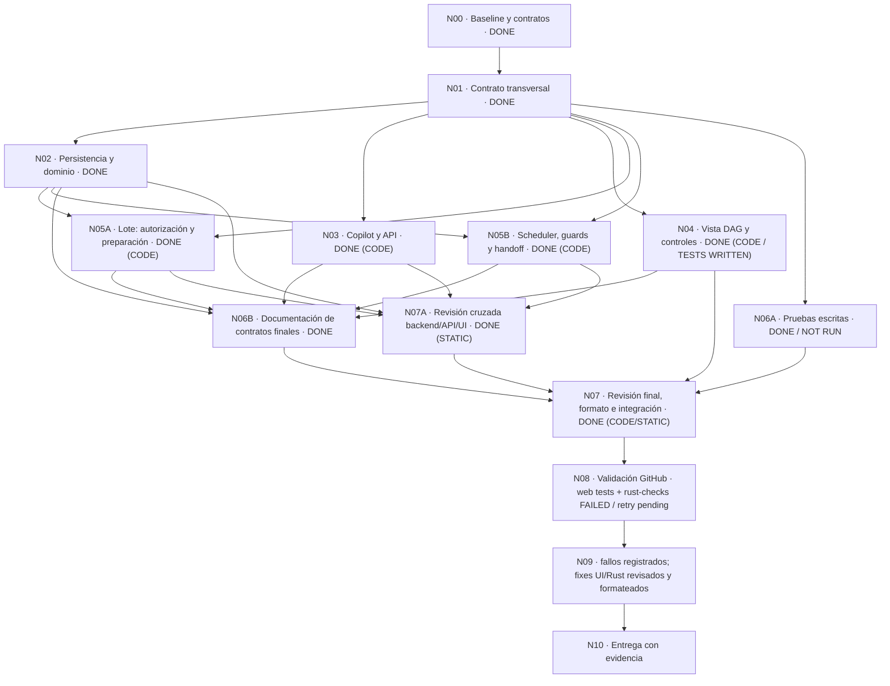

# Plan vivo — DAG de proyecto y ejecución de work packets

Fecha: 2026-11-12. Baseline: `b30cb44810f0a91bcb65b5b6ee7a3a2f685ce42c`,
rama `feat/orchestrated-delivery-polish`. La revisión final se publicó en
`00d9de0d0c74e1f26a07e31202ffde7c98e83e4f`. N00–N04 están DONE como código;
N05A/N05B están DONE como código tras revisión Domain/API/MCP. N06A está DONE
como pruebas escritas/revisadas (**NOT RUN**) y N06B está DONE en documentación.
N07A está DONE (STATIC) y N07 DONE (CODE/STATIC) tras revisión cruzada y
formato final. El run `43116423800` falló en ambos jobs sobre el SHA
`00d9de0d0c74e1f26a07e31202ffde7c98e83e4f`: TypeScript en `build` y E0433 por
falta del import `TaskCoordinationMode` en DB. Esos fixes están aplicados. La
segunda pasada, run `43117911227` sobre SHA
`15a58bfcc3c112cacc7122d37016510693817ca4`, pasó web build y lint pero falló
web tests: 194/198 pasaron y cuatro fallaron en tres archivos. También falló
`rust-checks` al compilar `services`, con 16 diagnósticos de los tipos E0063,
E0432, E0425, E0277, E0308, E0599, E0603 y E0609. `api-types` pasó 449 tests
(1 ignorado), `cli-adapters` 120 y `db` PR6 cinco. Los fixes UI/Rust están
aplicados y tuvieron revisión estática recíproca de tres agentes Luna 6 Max;
`cargo fmt --all` y `git diff --check` locales terminaron con exit 0. N08 sigue
**retry pending**: el run `43137200377` sobre SHA
`d6dc7201206f1364b2b70acbbc51ff90b6864147` tuvo web build/lint PASS y 197/198
tests PASS; el único fallo fue un selector de tabla en ProjectPlan, ya corregido
en el árbol compartido. `rust-checks` sigue fallido: el log reporta tres causas
de compilación en `batches.rs:606` y `scheduler.rs:1425`; fixes aplicados por
`luna_rust_retry`, `cargo fmt` y `git diff --check` PASS. Retry pendiente de
commit combinado y nuevo dispatch. No se han ejecutado tests, builds ni CI locales. El PASS anterior, run `42936901984` sobre el baseline
`b30cb448`, no valida este árbol modificado.

Run 4 (`43197333362`, SHA `f22d56346096001b8e2214c6dd4d535b0623c65d`): `build`
PASS con 198 web tests, browser smoke y bundle de binarios. `rust-checks` FAIL:
esta tanda corrige dos usos de `Response::json`, el movimiento de `task.id`, la
lectura de preparación retirada del DTO y el orden del módulo de tests. Siguen
10/20 fallos en services/project_plan y un caso fake de coordinator 0/1 con
owners separados. Sin tests/build/check locales; retry pendiente.

### Relevo operativo — 2026-11-11

Por instrucción del usuario, los agentes de la iteración anterior se
interrumpieron y sus cambios parciales se conservan sobre el árbol existente,
sin reset. El equipo vigente es `/root/luna_final_domain` (Domain/N05B),
`/root/luna_budget_review` (API/N03) y `/root/luna_integration_plan`
(UI/docs/N04 y este plan), todos Luna 6 Max. Root mantiene la orquestación y
las decisiones de integración. El último CI PASS conocido es el run
`42936901984` sobre el commit baseline `b30cb448`; no valida los cambios
actuales. No se ejecutan checks locales: la validación de esta implementación
se reserva al workflow manual de GitHub después de cerrar N07.

Este documento es el registro vivo de la implementación. Cada nodo conserva
responsable, dependencias, estado y evidencia. Terminar código no equivale a
validarlo: las pruebas y el CI se ejecutan únicamente al final, en GitHub, cuando
todos los nodos de implementación e integración estén terminados. Los fallos de
esa validación y sus correcciones se registran en el anexo, sin reescribir el
historial de implementación. No se despliega ni se inicia trabajo real de FirePOS.

## Requisitos aceptados

- Una Task representa un work packet; sus WorkUnits mantienen el DAG interno.
- El DAG de proyecto es opcional. Project Copilot puede sugerir crearlo cuando
  falte, pero su ausencia no obliga al PO a definirlo ni impide el trabajo manual.
- La entrada puede adoptar cualquier forma: documentación, diagramas, listas,
  conversación, pseudodag o instrucciones del PO. La interpretación pertenece al
  harness de Copilot; no se impone un formato externo ni un parser obligatorio.
  El núcleo recibe una propuesta tipada y conserva procedencia y decisiones.
  Los adjuntos se interpretan según las capacidades reales del harness/MCP; no se
  promete OCR universal. Conversación y pseudodag no requieren acceso al repo.
- Copilot organiza el proyecto; el coordinador de cada Task descompone su paquete;
  Forge valida y controla disponibilidad, capacidad y exclusividad de admisión.
- Las propuestas y revisiones conservan identificadores, historia y referencias.
  Las aristas explícitas y las inferidas deben distinguirse; una ambigüedad no se
  resuelve inventando una dependencia silenciosa.
- Guardar pendientes no autoriza ejecución. Una autorización explícita de lote o
  fase permite avanzar automáticamente por los nodos disponibles, con pausa,
  límites, revalidación de autoridad y receipts idempotentes.
- Un prerrequisito no se satisface por acabar un proceso: requiere la aceptación
  vigente y la integración exigida por su alcance. Las sucesoras reciben contexto
  exacto de las entregas aceptadas. No se saltan Gates, revisión ni integración.
- La vista de proyecto muestra dependencias, bloqueos, paralelismo posible y real,
  ruta crítica y previsión por intervalos cuando haya estimaciones suficientes.
  Las duraciones desconocidas se muestran como desconocidas, no como cero.

## DAG de implementación

## Registro de nodos

| Nodo | Trabajo / criterio de terminación                                                                                                                                     | Dependencias              | Responsable                                                                                      | Estado      | Evidencia                                                                                                                                                                                                                                                                                                                                                                                                                                                                                                                                                                                                                                                                                                                                                                                                                                                                                                                                                                                                                                                                                                                                                                                                                                                                                                                                                                                                                                                                                                                                                                                                                                                                                                                      |
| ---- | --------------------------------------------------------------------------------------------------------------------------------------------------------------------- | ------------------------- | ------------------------------------------------------------------------------------------------ | ----------- | ------------------------------------------------------------------------------------------------------------------------------------------------------------------------------------------------------------------------------------------------------------------------------------------------------------------------------------------------------------------------------------------------------------------------------------------------------------------------------------------------------------------------------------------------------------------------------------------------------------------------------------------------------------------------------------------------------------------------------------------------------------------------------------------------------------------------------------------------------------------------------------------------------------------------------------------------------------------------------------------------------------------------------------------------------------------------------------------------------------------------------------------------------------------------------------------------------------------------------------------------------------------------------------------------------------------------------------------------------------------------------------------------------------------------------------------------------------------------------------------------------------------------------------------------------------------------------------------------------------------------------------------------------------------------------------------------------------------------------ |
| N00  | Fijar HEAD limpio y leer contratos actuales. Distinguir DAG de Task de DAG de WorkUnit y autoridad de Copilot.                                                        | —                         | Root                                                                                             | **DONE**    | HEAD baseline; Architecture/V2; `task_dependency`, `TaskLifecycleService`, `ProjectCopilot` inspeccionados.                                                                                                                                                                                                                                                                                                                                                                                                                                                                                                                                                                                                                                                                                                                                                                                                                                                                                                                                                                                                                                                                                                                                                                                                                                                                                                                                                                                                                                                                                                                                                                                                                    |
| N01  | Fijar contrato común de dominio, DTOs, endpoints, entrada libre, autorización, scheduling, handoff y proyección. Nombrar invariantes tocados y ownership de archivos. | N00                       | Luna 6 Max: Plan/UI, Domain y Copilot/API; Root aprueba                                          | **DONE**    | Contrato `services/src/project_plan/types.rs`; DTOs `api-types/src/project_plan.rs`; acuerdo con Root.                                                                                                                                                                                                                                                                                                                                                                                                                                                                                                                                                                                                                                                                                                                                                                                                                                                                                                                                                                                                                                                                                                                                                                                                                                                                                                                                                                                                                                                                                                                                                                                                                         |
| N02  | Migración aditiva; versiones/procedencia; proyección de DAG; validación transaccional de aristas/referencias; conservación de Tasks y datos.                          | N01                       | `/root/luna_dag_domain` (Luna 6 Max)                                                             | **DONE**    | Domain cierra ownership de código: V167, edges manuales preservadas al aplicar, ciclos rechazados, todas las Tasks/dependencias canónicas sin plan aplicado, readiness/blockers/topología/forecast sin estimaciones, mapping durable proposal/node/task e imports parciales bloqueados fail-closed. Pruebas siguen **NOT RUN**.                                                                                                                                                                                                                                                                                                                                                                                                                                                                                                                                                                                                                                                                                                                                                                                                                                                                                                                                                                                                                                                                                                                                                                                                                                                                                                                                                                                                |
| N03  | Delegación Copilot para propuesta libre y aplicación autorizada; REST/DTOs/TS/SSE; autorización explícita de fase/lote y errores tipados.                             | N01                       | /root/luna_budget_review (Luna 6 Max) | **DONE (CODE)** | API cierra ownership de código: rutas/DTOs/REST/MCP/SSE, fuentes Git fijadas, procedencia Task→proposal→run/Agent, errores versionados y dependencias con versión/key. Pruebas API/MCP escritas; **NOT RUN**. API/MCP/REST exponen `project_plan_batch_scope` nullable y derivado del binding exacto; una autorización batch vigente fija `can_request=false`. La regresión API está escrita; **NOT RUN**. El POST genérico `/coordination/authorize` da `409 project_plan_batch_inactive` mientras el origen exacto siga running/paused; tras revoke/completion puede emitirse auth Human standalone. |
| N04  | Vista DAG accesible integrada en proyecto; bloqueos y paralelo potencial/real; selección y controles de lote; estimaciones honestas y ruta crítica.                   | N01                       | /root/luna_integration_plan (Luna 6 Max); API for overview DTO/SSE | **DONE (CODE; TESTS WRITTEN)** | Ruta, navegación, grafo SVG/tarjetas accesibles/tabla, propuestas inspeccionables, selección por fase, provenance, estados TaskLifecycle/dispatch/batch separados y Copilot Project-only. Apply conserva versión/key originales; `version_conflict` exige refresh/revisión. Project writers aplican; solo owner/admin de membresía controla lotes y `is_admin` global no da autoridad. `project.plan_changed` invalida grafo y Tasks en SSE. UI/SSE tests escritos, **NOT RUN**. Task coordination oculta Start/request genéricos para autorizaciones batch y explica el retry exacto; el atajo +8 cambia solo `max_turns`. SSE de autonomía refresca solicitudes de calidad y el DAG. Casos UI/SSE escritos; **NOT RUN**. El editor de autorización se oculta solo con binding running/paused; `can_authorize` se conserva para acciones autorizadas. Tras revoke/completion queda visible la autorización Human standalone, que no revive el batch. |
| N05A | Lotes: autorización owner/admin, receipts/versions, preparación de TaskCoordination exacta y pausa/reanudación/revocación.                                            | N01, N02                  | /root/luna_budget_review (Luna 6 Max); /root/luna_final_domain for transaction | **DONE (CODE)** | Domain implementó la autorización y su binding V167 en una transacción; API integró `batches.rs` con `authorize_for_project_plan_batch`. La ruta genérica rechaza versiones de auth emitidas por batch con `409 project_plan_batch_inactive`. La actualización del placeholder manual por defecto conserva Role/Actor exactos, fija el Team generation actual con CAS y mantiene estrictas las configuraciones Human custom. La revisión recíproca API/MCP no encontró huecos de autoridad/scope; tests **NOT RUN**. |
| N05B | Scheduler determinista: reserva/capacidad, guards de prerrequisitos y provider start, recovery, pausa/revocación y handoff exacto a sucesoras.                        | N01, N02                  | /root/luna_final_domain (Luna 6 Max) | **DONE (CODE)** | El scheduler crea y enlaza el request con el origen `Scheduler{claim_token}` en la transacción DB; Quality Replan enlaza Artifact/Execution exactos. Los guards, budgets, capacity, recovery, pause/revoke y handoff verifican el origen/batch antes de admitir trabajo. Revisión cruzada estática no encontró huecos conocidos; tests **NOT RUN**. El retry nuevo reclama solo `coordination:coordination.budget_exhausted` en un batch running y preparado con presupuesto disponible; revalida batch/grafo/owner/team/autorización/prerrequisitos y solicita con claim token nuevo y origen exacto. Regresión escrita; **NOT RUN**. |
| N06A | Escribir pruebas significativas por área con firmas estables, sin ejecutarlas.                                                                                        | N01                       | /root/luna_final_domain, /root/luna_budget_review, /root/luna_integration_plan (Luna 6 Max) | **DONE (WRITTEN; NOT RUN)** | UI/client y API/MCP tests están escritos, todos **NOT RUN**. La UI separa Project writer de owner/admin y niega capacidad basada solo en `is_admin` global; ambas regresiones están escritas. API añade los tests de asociación/revoke, revoke durante autorización, rechazo de turn genérico, origen y lectura de scope. Catorce definiciones de servicio en `crates/services/src/project_plan/tests.rs` cubren grafo/apply/versiones/auth, capacity, ancestry e integración real, reauth Human tras revoke y el seam pre-pin sin SQL de aceptación. `crates/services/src/orchestrator_runtime/tests/project_batch_tests.rs` usa fake Harness para recorrer autorización de lote, scheduler/claim, request, Artifact aprobado/materializado con receipt, Worker/reviewer Executions, ReviewReport exacto y lookups positivos `HumanReplan`/`QualityReplan` con auth y batch exactos. Verifica TaskCoordination manual default con equipo stale sin asumir versión 1; además compara los tres `HarnessSession.external_session_id` persistidos con los IDs fake devueltos y comprueba su unicidad. Domain hizo revisión estática sin bloqueos conocidos. No hay test único A+B Backlog→Done→B ni FirePOS real; no se ejecutó ninguna prueba. **NOT RUN**. Casos UI escritos cubren mensajes de retry de presupuesto, batch pausado/otros blockers, supresión del request genérico y refresh por evento de autonomía. Todos siguen **NOT RUN**. |
| N06B | Actualizar arquitectura, conceptos, API y CHANGELOG según el comportamiento implementado y confirmado.                                                                | N02, N03, N04, N05A, N05B | /root/luna_integration_plan; Domain/API confirm behavior | **DONE** | `docs/concepts/project-plan.md`, `docs/api.md`, `docs/architecture.md` y `CHANGELOG.md` describen el refresh del placeholder manual, la auth/batch activa, la aprobación vigente del Artifact seleccionado y su receipt exacto si materializado. HumanReplan selecciona el ID explícito; varias propuestas pueden tener aprobación vigente en la misma auth y la autoridad no se deriva de la última fecha. Docs concordadas con el freeze Domain/API; validaciones **NOT RUN**. API/concept/CHANGELOG documentan el ámbito batch exacto, la separación de límites de turnos/calidad/rework y las condiciones de retry. Sin checks. La revocación explícita de Task coordination también permite abandonar el batch; el snapshot de batch queda stale y no admite más trabajo. |
| N07A | Revisión cruzada estática de dominio/scheduler, API/batches y consistencia UI↔DTO↔REST↔docs, con hallazgos asignados al owner.                                        | N02, N03, N05A, N05B      | /root/luna_final_domain, /root/luna_budget_review, /root/luna_integration_plan (Luna 6 Max) | **DONE (STATIC)** | Revisión final estática Domain/API/Budget/UI PASS. API expone binding batch exacto, `can_request=false` y el guard atómico del writer devuelve 409 al reemplazo genérico mientras el batch siga running/paused. Domain reclama solo el blocker exacto de turnos agotados bajo batch running/preparado con snapshot, autoridad, equipo, presupuesto y prerrequisitos vigentes; continúa con claim token fresco y origin exacto. UI oculta Start/request y edición genérica de autorización solo con batch running/paused, mantiene `can_authorize` para revoke/retry y permite auth Human independiente tras revoke/completion; no revive el batch stale. Copy, SSE e invalidaciones revisados. Pruebas escritas **NOT RUN**. |
| N07  | Revisión final de integración y callers, formato de fuentes modificadas, resolver incompatibilidades detectables por lectura.                                         | N04, N06A, N06B, N07A     | Root orquesta; los tres subagentes Luna 6 Max revisan sus áreas                                  | **DONE (CODE/STATIC)** | Domain/API/UI revisión estática PASS. Formato final: `cargo fmt --all` PASS; `./node_modules/.bin/prettier --write` sobre siete fuentes frontend PASS; `git diff --check` PASS. La primera ejecución de Prettier encontró una coma colgante en `task-autonomy-limits.tsx`; corregida y la repetición pasó. Tests/builds/checks/CI **NOT RUN**. Root conserva commit/push y dispatch final. |
| N08  | Única fase de validación: ejecutar checks/tests/CI en GitHub sobre HEAD exacto, con resultados PASS/FAIL/NOT RUN por alcance. No builds/tests locales.                | N07                       |Root autoriza; Luna 6 Max ejecuta al final| **RUN 43197333362: BUILD PASS; RUST-CHECKS FAILED; RETRY PENDIENTE** | SHA `f22d56346096001b8e2214c6dd4d535b0623c65d`: build PASS (web 198, browsers y bundle de binarios); Rust FAIL con errores de compilación/Clippy y fallos de tests de services/project_plan. Fixes acotados de API/coordination/task_quality aplicados y formateados; otros dos owners siguen con domain/runtime. No hay validación local. |
| N09  | Registrar cada fallo final con job/SHA/error, corrección y nueva evidencia. Reejecutar únicamente validación final justificada. Si no hay fallos, cerrar como N/A.    | N08                       | Agentes según área; Root coordina                                                                | **4 PASADAS REGISTRADAS; FIXES DEL RUN 4 EN CURSO** | El anexo registra el build PASS de run 4 y los fallos Rust pendientes. Esta tanda corrige API JSON/ownership, preparación leída desde DB y orden Clippy; domain `project_plan` y runtime fake permanecen con sus owners. |
| N10  | Entregar plan actualizado, SHA/árbol, estado CI exacto, limitaciones y aceptación real separada de pruebas automatizadas.                                             | N09                       | Root                                                                                             | TODO        | Sin merge/despliegue ni aceptación real de FirePOS implícitos.                                                                                                                                                                                                                                                                                                                                                                                                                                                                                                                                                                                                                                                                                                                                                                                                                                                                                                                                                                                                                                                                                                                                                                                                                                                                                                                                                                                                                                                                                                                                                                                                                                                                 |

## Reparto de archivos y coordinación

- **Domain (`/root/luna_final_domain`, Luna 6 Max):** N05B, scheduler de retry exacto y revisión final Domain.
- **API (`/root/luna_budget_review`, Luna 6 Max):** N03, overview DTO/REST/MCP, `can_request`, SSE público y tests API.
- **Plan/UI (`/root/luna_integration_plan`, Luna 6 Max):** N04, UI batch-aware, tests escritos, copy y documentación/plan.
- **Root:** solo orquestación, decisiones de integración y seguimiento. No escribe
  implementación. Cada agente actualiza su evidencia; Plan/UI mantiene la tabla
  y el Mermaid. Nadie ejecuta validación antes de N08 ni sin autorización expresa.

## Contrato transversal

Contrato cerrado por Domain y Copilot/API y aprobado por Root. Una propuesta
no concede autoridad de worker, de roles, de repositorio, de merge o de ejecución.
TaskLifecycle permanece como única autoridad del estado de Task; las etiquetas
de disponibilidad del DAG son proyecciones, no un segundo lifecycle.

### Contrato conceptual acordado — 2026-11-11

`ProjectPlanDocument` contiene `nodes`, `edges` y `sources`. Un nodo tiene
`key`, `task_id` opcional, `title`, `description`, `acceptance_criteria`, `phase`,
`estimate_min_minutes`, `estimate_max_minutes` y `source_ids`. Una arista usa
`predecessor_key`, `successor_key`, `inferred` y `source_ids`. Una fuente tiene
`id`, `label`, `kind`, `reference`, `revision` y `excerpt`. La entrada humana
sigue siendo libre; este documento es el resultado tipado del harness.

Aplicar usa TaskService para crear Tasks faltantes mediante mapping estable,
conserva las existentes y publica aristas/revisión en una transacción. Las
creaciones parciales recuperables no autorizan ejecución; un lote nunca usa una
aplicación incompleta. Las dependencias declaradas bloquean también el arranque
manual aunque no exista un lote. El límite `max_parallel_tasks` del lote es
independiente de los slots de WorkUnits dentro de cada Task.

Sin una propuesta aplicada, `GET /plan` devuelve todas las Tasks existentes y
sus dependencias canónicas manuales. El grafo inicial tiene versión `1`; “v0”
en los primeros mensajes describía un plan sin aplicar, no el entero de versión.

Rutas acordadas: `GET /projects/{id}/plan`, `POST /plan/proposals`,
`POST /plan/proposals/{proposal_id}/apply`, `POST /plan/batches` y
`POST /plan/batches/{batch_id}` con `action: pause|resume|revoke`, bajo el mismo Project.
Copilot puede proponer/organizar; la autorización de lote sigue reservada al
humano owner/admin. Los DTOs exactos los publica el responsable Copilot/API.

### Freeze final de Source y coordinación — revisión Domain/API/MCP completada

Domain confirma el freeze de DB, wrappers de servicio y runtime del DAG. Una
Task nueva comienza con TaskCoordination `manual`, `requested_by = NULL`,
`revoked_at = NULL` y el envelope actual por defecto; su snapshot de equipo
puede estar stale tras copiar RoleMemberships. No se asume
`authorization_version=1`. El batch solo refresca el placeholder manual sin
configuración humana, usando el `team_generation` actual, CAS y el Role/Actor
exactos; una configuración humana custom conserva comparación estricta.

HumanReplan usa el Artifact ID elegido explícitamente. El Artifact debe tener
aprobación válida en la autorización y batch activos, o estar materializado con
receipt exacto de Artifact/Task/request/digest/auth version. Varios planes
pueden seguir aprobados dentro de la misma autorización; no hay puntero
canónico ni selección de autoridad por fecha/latest. Source, selector API v4 y
orígenes Scheduler/QualityReplan/HumanReplan quedaron revisados
recíprocamente por Domain/API/MCP. N07A mantiene una última lectura solicitada
por Root sobre la UX al conceder presupuesto extra y requeue.

### Invariantes afectados

- INV-017: writers paralelos mantienen Workspaces y leases aislados; una arista
  de proyecto no comparte el Workspace de su predecesora.
- INV-019 e INV-020: Copilot mantiene el plan del proyecto y el Orchestrator los
  límites internos de trabajo; ninguno cambia veredictos ni decide Gates.
- INV-030: readiness, reserva, cola, idempotencia y admisión permanecen en el
  núcleo determinista; ningún Actor recoge trabajo sin autoridad explícita.
- INV-031: el harness interpreta la entrada libre y propone el grafo; Rust valida
  las relaciones sin asumir la cognición del agente.
- INV-033: propuesta, fuente, revisión, aprobación y Execution permanecen
  auditables; los cambios no sobrescriben evidencia histórica.
- TaskLifecycle conserva su autoridad única; TaskRole/RoleMembership, WorkUnit,
  WorkspaceLease y provider Start siguen revalidándose antes de ejecutar.

## Validación final — correcciones pendientes de reejecución

Root publicó el SHA `00d9de0d0c74e1f26a07e31202ffde7c98e83e4f` en
`feat/orchestrated-delivery-polish` y disparó manualmente
`.github/workflows/build-local-linux.yml` con `run_checks=true` (el default del
workflow es `false`). El run `43116423800`
(https://github.com/AlRos14/forge/actions/runs/43116423800) terminó con fallo
en ambos jobs. En `build`, `pnpm build` (`tsc -b`) reportó cinco errores de
tipado frontend. En `rust-checks`, Rust reportó E0433 para
`TaskCoordinationMode` en `crates/db/src/sqlite/task_coordination.rs:137` y
`:512`. Esta ejecución mantiene `build` y `rust-checks`; `build`
instala dependencias, ejecuta `pnpm build` (`tsc -b` typecheck y Vite build),
construye los binarios y sube el bundle. `run_checks=true` añade `pnpm lint`,
`pnpm test`, el browser smoke `pnpm run e2e`, `cargo fmt`, Clippy y los tests
Rust enfocados que lista el workflow, incluido `cargo test -p api --test happy_path`. No se requiere otro `pnpm typecheck`: ya forma parte de `pnpm build`.

El dispatch inicial acredita ref, SHA, URL/ID y `run_checks=true`; fallaron
ambos jobs por typecheck y compilación DB. `api-types` pasó (449 passed, 1
ignored) y `cli-adapters` pasó (120 passed). En la segunda pasada, SHA
`15a58bfcc3c112cacc7122d37016510693817ca4`, web build y lint pasaron; los tests
web fallaron 4/198 en tres archivos. La corrección UI está aplicada en el árbol
compartido; `rust-checks` falló al compilar `services` con errores E0063,
E0432, E0425, E0277, E0308, E0599, E0603 y E0609. Suites dependientes quedaron
bloqueadas; `db` PR6 sí pasó cinco pruebas. Los owners Rust reparan sus errores;
faltan commit combinado y nuevo dispatch. El PASS `42936901984` corresponde al baseline `b30cb448` y no
cuenta. La automatización no constituye despliegue ni aceptación real de
FirePOS.

## Anexo — fallos de CI y correcciones

**Dos pasadas con fallos registrados; frontend corregido y errores Rust en reparación, nueva ejecución pendiente.**

| Entrada | SHA / ejecución / job | Fallo observado | Corrección / nodo | Evidencia final |
| ------- | --------------------- | --------------- | ----------------- | --------------- |
| 1 | SHA `00d9de0d0c74e1f26a07e31202ffde7c98e83e4f` / run `43116423800`, job `build`, paso `pnpm build` (`tsc -b`) | `ProjectPlanPage.test.tsx`: cuatro accesos a `.disabled` sobre `HTMLElement` (TS2339); `ProjectPlanPage.tsx`: faltaba `search` requerido para `/projects/$projectId/tasks` (TS2741). | Aplicados casts DOM específicos (`HTMLButtonElement`/`HTMLInputElement`) a los controles y `search={{ sort_by: 'updated_at', sort_order: 'desc' }}` al Link. Prettier ejecutado; CI de la corrección pendiente. | Run original falló: [43116423800](https://github.com/AlRos14/forge/actions/runs/43116423800). No se ha reejecutado. |
| 2 | SHA `00d9de0d0c74e1f26a07e31202ffde7c98e83e4f` / run `43116423800`, job `rust-checks` | E0433: `TaskCoordinationMode` no declarado en `crates/db/src/sqlite/task_coordination.rs:137` y `:512`; crates dependientes no compilaron. | Domain añadió el import faltante antes del commit combinado. Suites completadas: `api-types` 449 passed / 1 ignored; `cli-adapters` 120 passed. No se observaron fallos funcionales en esas suites. | Run original falló: [43116423800](https://github.com/AlRos14/forge/actions/runs/43116423800). Retry pendiente tras commit combinado de fixes DB y UI. |
| 3 | SHA `15a58bfcc3c112cacc7122d37016510693817ca4` / run `43117911227`, job `build`, paso `pnpm test` | 4/198 fallaron (194 pasaron) en `sse.test.ts`, `ProjectCopilotDock.test.tsx` y `ProjectPlanPage.test.tsx`: SSE test seleccionaba el predicado de invalidación equivocado; navegación Task A→B limpiaba el contexto del borrador mientras cargaba B; dos asserts de ProjectPlan exigían texto exacto en elementos compuestos o inspeccionaban estado React antes de `act`. | SSE test selecciona el predicado específico de Project plan. Copilot preserva el contexto enlazado durante la carga de la Task destino y solo desvincula al pasar a ruta Project. ProjectPlan usa regex para la etiqueta con enlaces y `act` para el callback mock. Web build y lint pasaron; retry pendiente. | [Run 43117911227](https://github.com/AlRos14/forge/actions/runs/43117911227). El fallo de `rust-checks` de esta pasada se documenta en entrada 4. |
| 4 | SHA `15a58bfcc3c112cacc7122d37016510693817ca4` / run `43117911227`, job `rust-checks`, compile `services` | 16 compile diagnostics across E0063/E0432/E0425/E0277/E0308/E0599/E0603/E0609 in API, DB and Services paths; dependent suites blocked before functional tests. | Domain/Budget owners are fixing scoped DB/service/API issues. In the same run `api-types` passed 449 / 1 ignored, `cli-adapters` passed 120, and DB PR6 passed 5. | [Run 43117911227](https://github.com/AlRos14/forge/actions/runs/43117911227) failed; no retry until owners complete fixes. |
| 5 | SHA `d6dc7201206f1364b2b70acbbc51ff90b6864147` / run `43137200377`, job `build`, paso `pnpm test` | Web build/lint PASS; tests 197/198 PASS. `ProjectPlanPage.test.tsx` falló porque buscaba filas dentro del region del grafo, que contiene cards `article`, mientras las filas están en la tabla de dependencias accesible `Task dependency links`. | El test conserva el conteo 3 y consulta `within(screen.getByRole('table', { name: 'Task dependency links' })).getAllByRole('row')`; los asserts de cards/grafo y filtro `build` permanecen. Formato aplicado; sin ejecución local. | [Run 43137200377](https://github.com/AlRos14/forge/actions/runs/43137200377). El job `rust-checks` también falla; detalles pendientes del log. Retry pendiente. |
| 6 | SHA `d6dc7201206f1364b2b70acbbc51ff90b6864147` / run `43137200377`, job `rust-checks` | 12 diagnostics repetidos por tres causas: `batches.rs:606` baseline/map_err con tipo `String`; `scheduler.rs:1425` `Ok(json)` con tipo de error SQLx ambiguo. | `luna_rust_retry` aplicó los fixes; Root confirma `cargo fmt` y `git diff --check` PASS. Sin validación local de tests/build. | Log `/tmp/forge-ci-43137200377-rust.log`. En el run pasaron `file_backed_migration` 17, `pr2 execution` 17, `pr5 workunit` 8, `schema` 4, `delete` 2, DB PR6 5, `api-types` 449 + 1 ignored y `cli-adapters` 120. Retry pendiente. |
| 7 | SHA `f22d56346096001b8e2214c6dd4d535b0623c65d` / run `43197333362`, job `build` | PASS: 198 web tests; browser smoke y bundle de binarios completados. | Sin corrección requerida para build; el retry depende del cierre de Rust. | [Run 43197333362](https://github.com/AlRos14/forge/actions/runs/43197333362). |
| 8 | SHA `f22d56346096001b8e2214c6dd4d535b0623c65d` / run `43197333362`, job `rust-checks` | API tests: dos `Response::json()` inexistentes y movimiento de `task.id`; service test accedía a `preparation_complete` fuera del DTO; Clippy `items_after_test_module`; services/project_plan 10/20 fallaron (`allowed_review_roles` vacío entre las causas) y un fake runtime inicia coordinator 0 vs 1 esperado. | API usa `common::parse_response` con status 409 y clona el ID para la aserción; coordination comprueba `preparation_complete` persistido en DB; `task_quality` mueve `mod tests` al final. Domain `project_plan` y fake runtime siguen con owners separados. Sin tests/build/check locales. | Log `/tmp/forge-ci-43197333362-rust.log`. [Run 43197333362](https://github.com/AlRos14/forge/actions/runs/43197333362); retry pendiente. |

Actualización run 4: fixes de dominio/runtime y callers/tests aplicados; incluyen derivar roles permitidos conservando el rechazo a lista vacía, fixture de reviewer formal mediante TaskService, refresh limitado al placeholder manual persistido con envelope normalizado y conflicto de versión tipado, y registry fake con capability Codex. La API/service test compile y el orden Clippy también quedan corregidos. Revisión estática **PASS**, formato aplicado; retry CI pendiente. Sin tests locales.

Actualización run 5 (`43203612188`, SHA `b9a368296a441e208620ef74394cd139f2b292fa`): build **PASS** (web 198, browser smoke, bundle de binarios). Rust: Clippy 3 hallazgos; `orchestrator_runtime` 43/44; `services --test task_coordination` 0/17; `services --lib project_plan` 18/20; API Copilot authority 0/1 por `requested_by` nulo. API `project_plan` **NOT RUN**: el binario Copilot falló primero. Pasaron `api-types` 449 + 1 ignored, `forge-client` 18, `cli-adapters` 120, DB PR6 5 y DB integration 17/17/8/4/2. El evento de propuesta Copilot ahora conserva `requested_by` humano y el actor Agent/correlation originales; runtime/normalización/Clippy revisados. Colisión reviewer del fixture de coordinación corregida; formato y `git diff --check` PASS según Root, revisión final en curso y retry pendiente. Logs: `/tmp/forge-ci-43203612188-rust.log`; el workflow tiene artefactos de fallo listos para la siguiente pasada. Sin tests locales.

Actualización run 6 (`43208695510`, SHA `b64420c5ee19ef9116873929fcd7ed7c2c921351`): build, Clippy, `services --test task_coordination` (17/17), `services --lib project_plan` (20/20), API Copilot authority (1/1), e2e y pasos públicos/finales **PASS**. `orchestrator_runtime` pasó 43/44 y `api --test project_plan` 4/8; el fixture API omitía del Project template un TaskRole con `formal_review`, dejando `allowed_review_roles` vacío al autorizar la coordinación. Se añadió `quality_reviewer` formal por el endpoint público de defaults, con el Human owner del fixture; el trigger de fault injection pasó a SQL multiline conservando sus condiciones porque la continuación de línea fusionaba `bt` y `JOIN`. El formato y `git diff --check` locales terminaron con exit 0; no se ejecutaron tests/build/check locales. N08 sigue retry pending.

## Historial de actualización

- 2026-11-11: creado el plan; N00 DONE, N01 IN PROGRESS. Sin tests ni CI nuevos.
- 2026-11-11: contrato cerrado y aprobado por Root; N01 DONE, N02/N03/N04 IN PROGRESS. Rutas y DTOs acordados antes de implementación de consumidores.
- 2026-11-11: relevo a Domain/Copilot-API/Plan-UI Luna 6 Max; se preservan los parciales del árbol compartido. Tests, builds, checks y CI siguen NOT RUN; N08 queda asignado a Luna 6 Max bajo coordinación y autorización explícita de Root.
- 2026-11-11: Domain confirma que N05 depende de N02, no de N03; el scheduler opera sobre persistencia de batches y TaskCoordination y su wiring REST/MCP puede integrarse después.
- 2026-11-11: checkpoint Domain/API reportado por Root; N02/N03 siguen IN PROGRESS con wiring/dispatch/evidencia pendiente. N04 DONE con ruta, navegación, componentes y tests escritos. Root separa N06 en N06A (pruebas escritas, NOT RUN; en progreso) y N06B (documentación final, pendiente de N02/N03/N05). Ninguna validación ejecutada.
- 2026-11-11: Root aclara que el grafo sin plan aplicado inicia en versión 1 y proyecta todas las Tasks con sus dependencias manuales canónicas. La abreviatura inicial “v0” se refería a ausencia de plan aplicado, no a versión numérica 0.
- 2026-11-11: Root divide N05 para acelerar integración paralela: N05A lotes/autorización/preparación (API tras extracción y traspaso de `batches.rs` por Domain); N05B scheduler/guards/handoff (Domain). Ambos bloquean N06B y N07, pero no se serializan entre sí con interfaces estables.
- 2026-11-11: `/root/luna_dag_plan_ui` toma N06A domain tests en archivo nuevo y escribe los casos core mientras Domain termina N05B; requiere que Domain registre `#[cfg(test)] mod tests;`. Sin ejecución.
- 2026-11-11: Domain registra `tests.rs`; Plan/UI amplía N06A con autorización de lote owner/admin, coordinación ausente bloqueada, replay y controles pausa/reanuda/revoca, más admisión de capacidad con TaskRole/Actor explícitos. El caso verifica que una sola Task ocupa el límite y solicita una coordinación, sin crear Execution ni iniciar proveedor; tests siguen NOT RUN.
- 2026-11-11: Revisión estática confirmó que `work_units[*]` en una fila `project_plan_handoff` es la forma persistida correcta por predecesor; `direct_predecessors[*]` corresponde al brief combinado. No se confirmó un bug. Se añade test de servicio con la fila productora real y ancestry Git; sigue NOT RUN.
- 2026-11-11: Domain cierra N02/N05B y Copilot/API cierra N03/N05A a nivel de código. Pruebas y workflow manual escritos permanecen NOT RUN. N04 se reabre solo para el caller de retry `project_plan_apply_incomplete` y los conflictos de versión; se añade N07A para que la revisión backend/API en paralelo no fuerce serialización artificial de N07 final.
- 2026-11-11: Plan/UI cierra N04 tras usar idempotency key determinista por proposal y base_version original, incluido tras reabrir la vista; el test mantiene la key/version y comprueba que `version_conflict` vuelve a pedir refresh/revisión. N06B queda DONE con arquitectura, concepto, API y changelog actualizados. Sin validación.
- 2026-11-11: N07A encuentra carrera crítica entre claim de batch, creación de request y enlace durable; revoke o crash puede dejar una coordinación sin fence de batch. Domain reabre N05B con ownership del arreglo y API/Domain mantienen revisión estática. N08 sigue cerrado, sin tests/builds/checks/CI.
- 2026-11-11: N06A añade el test service-level que autoriza una sucesora mientras su integración predecesora está pendiente, observa el blocker causal, integra el commit exacto y confirma admisión en el mismo lote sin nueva autorización. No cubre aún la fase completa que incluye A+B y lleva A a Done mediante Gate/Merge legítimos; esa brecha queda visible y los tests siguen NOT RUN.
- 2026-11-11: Root acepta cerrar la parte Plan/UI de N06A con cobertura composicional legítima, dejando expresamente que no existe un nuevo test único A+B Backlog→Done→B. N06A global sigue en curso por la regresión de fence Domain y la asociación HTTP API; nada de esto se ha ejecutado ni implica aceptación real de FirePOS.
- 2026-11-11: Copilot/API añade `batch_turn_is_linked_to_its_task_and_remains_inspectable_after_revoke` para la asociación HTTP y el revoke. Se cierra ese hueco de test escrito; N06A continúa por la regresión service-level de fence Domain. Sigue NOT RUN.
- 2026-11-11: Copilot/API añade `batch_coordination_grant_is_scoped_when_authorization_commits_before_pin`, con trigger de test que revoca en el write de autorización y verifica rechazo de turno genérico sin request/budget/Execution. Este test HTTP no sustituye la regresión service-level de origen exacto ni la reautorización Human; sigue NOT RUN.
- 2026-11-11: N07A encuentra un segundo hallazgo independiente, auth-scope: `prepare_batch` autoriza TaskCoordination en Tx1 y fija su asociación en Tx2, permitiendo una autorización huérfana o mal atribuida ante crash/revoke. Root reabre N05A para Domain (DB/AuthTx/helper) con API integrando `batches.rs`; N05B sigue para el request-link del scheduler. N03/N04 continúan DONE.
- 2026-11-11: Para N06A quedan regresiones de servicio con origen de autorización exacto, interrupción pre-pin, reautorización Human legítima tras revoke y preservación de QualityReplan por sus IDs fuente exactos. No se sembrará el estado con SQL manual ni se ejecutará ninguna prueba.
- 2026-11-11: Plan/UI escribe `batch_scoped_coordination_requires_fresh_human_reauthorization_after_revoke`: intenta reutilizar la auth del batch revocado y comprueba rechazo sin consumir turno; luego una nueva autorización Human conserva TaskRole/Team y permite un RequestTurn durable, dejando el batch antiguo revocado e inspectable y sin Execution. **NOT RUN**. Aún falta el caso pre-pin/source-binding con el seam Domain.
- 2026-11-11: N06B se reabre solo para documentar los origins explícitos y el source binding de QualityReplan/HumanReplan que resuelven auth-scope; la documentación base se conserva. Sin validación.
- 2026-11-11: Se registran los dos bindings V167 de autorización/request con origen inmutable. Plan/UI documenta el rechazo `409 project_plan_batch_inactive` de la ruta genérica para una auth batch, incluso tras revocación o finalización, y prueba reautorización Human fresca; el caso service-level pre-pin queda pendiente de un seam válido Domain, sin SQL de aceptación falso. Los tests no se ejecutaron.
- 2026-11-11: API integró `create_batch_record` como seam de servicio y `batches.rs` usa `authorize_for_project_plan_batch`. Plan/UI agregó el test service-level pre-pin con binding V167 y revocación antes del snapshot; sin SQL writes de fixture ni aceptación falsa. `request_project_batch_turn` y el writer atómico ya existen, pero scheduler todavía usa la ruta genérica y debe integrar el claim token. Conteo actual: 11 definiciones de test en `project_plan/tests.rs`; ninguna ejecutada.
- 2026-11-11: Revisión estática frontend↔API confirmó que DTO, REST y retry apply concuerdan con `expected_version` y la misma idempotency key; los conflictos requieren refresh/revisión sin rebase. API confirmó que Apply requiere Project writer con membership owner/admin/member y owner canónico, mientras que batch exige membership owner/admin; Plan/UI separa esos permisos y descarta `is_admin` global como autoridad del Project. Se añadieron dos definiciones de prueba UI, **NOT RUN**. SSE `project.plan_changed` aún no estaba conectado a listener/invalidation en el cliente; API tomó ese cambio. N04 sigue IN PROGRESS hasta integrar caller y evento. No se ejecutó ninguna validación.
- 2026-11-11: API integró `project.plan_changed` en el listener SSE y la invalidación del plan/tareas; Plan/UI cerró los gates de capacidad y sus dos definiciones de prueba. N04 vuelve a **DONE** como código y pruebas escritas. N07A, N06A y N06B continúan en curso por revisión/cierre de backend y documentación congelada; todas las validaciones siguen **NOT RUN**.

- 2026-11-11: Relevo actual a `/root/luna_domain_resume`, `/root/luna_api_resume` y `/root/luna_plan_tests_resume`. N00–N04 siguen DONE como código; N05A/N05B se mantienen REOPENED, N06A/N06B/N07A IN PROGRESS, N07 TODO, N08 bloqueado hasta autorización final y N09 sin entradas. Domain confirmó el freeze DB/servicio/runtime; se registra que las coordinaciones manuales nuevas no deben asumir `authorization_version=1` y la incompatibilidad pendiente entre el predicado SQL de Source y el selector API. El selector API v4 y el caso de quality reviewer con equipo stale están escritos. No se ejecutaron tests, builds, checks ni CI.
- 2026-11-11: Root confirma N05A/N05B DONE como código tras revisión recíproca Domain/API/MCP, sin huecos conocidos de grant, trigger, pin, CAS o HumanOrigin. Domain añade tres regresiones de Source (14 definiciones de servicio en `project_plan/tests.rs`). N06B cierra tras documentar placeholder manual/team refresh y HumanReplan por Artifact explícito con aprobación vigente/receipt exacto, sin autoridad por latest. N06A sigue IN PROGRESS por el positivo runtime. N07A conserva la última lectura API solicitada por Root sobre conceder presupuesto extra y requeue. Tests, builds, checks y CI **NOT RUN**; N08 **BLOCKED — NOT RUN**; anexo N09 vacío.
- 2026-11-11: La revisión estática Domain del positivo runtime no encuentra bloqueos. Plan/UI añade lectura DB que une las tres `execution.harness_session_id` con `harness_session.external_session_id`, compara cada ID persistido con el devuelto por su fake Harness y verifica unicidad. N06A queda **DONE como pruebas escritas y revisadas; NOT RUN**. N07A mantiene la revisión API de UX extra-budget/requeue; N08 sigue **BLOCKED — NOT RUN**.
- 2026-11-11: La revisión final de presupuesto descubre que `can_request` omitía el binding batch y la UI podía ofrecer un Start genérico que recibe `409`; además, `task.autonomy_limits_changed` no refrescaba calidad ni el DAG. API añade `project_plan_batch_scope` desde el binding exacto y deshabilita `can_request` para esa autoridad. Domain cierra N05B como código: solo re-clama el blocker exacto `coordination:coordination.budget_exhausted` si el batch está running/prepared, el presupuesto alcanza y vuelven a pasar guards de autoridad, graph, team y prerequisitos; usa claim token fresco y `request_project_batch_turn`, sin turno genérico. N03/N04 cierran código; UI oculta Start genérico y distingue batch running/paused/revoked/completed. El quick action ahora suma solo 8 a `max_turns`; quality/rework permanecen presupuestos distintos. SSE refresca solicitudes de calidad y DAG. API/UI tests están escritos y **NOT RUN**; N07A espera la revisión cruzada final, N07 TODO, N08 **BLOCKED — NOT RUN**.
- 2026-11-11: Se concreta N08: solo workflow manual de GitHub `.github/workflows/build-local-linux.yml` con `run_checks=true` después de N07 y SHA final; incluye `pnpm build`/typecheck, lint, unit tests, browser smoke, Rust fmt/Clippy y tests enfocados, incluido `api --test happy_path`. El default `run_checks=false` no sirve. No se ha ejecutado.
- 2026-11-11: Revisión final de UI/API/Domain y documentación PASS. `cargo fmt --all`, Prettier en siete fuentes frontend y `git diff --check` PASS. Tests, builds, checks y CI permanecen **NOT RUN**; N07 queda **DONE (CODE/STATIC)** y N08 **READY — NOT RUN**, pendiente del commit/push y dispatch manual de Root.
- 2026-11-12: Root publica `00d9de0d0c74e1f26a07e31202ffde7c98e83e4f` en `origin/feat/orchestrated-delivery-polish` y dispara `.github/workflows/build-local-linux.yml` con `run_checks=true`; el run `43116423800` está en cola. N08 pasa a **IN PROGRESS** y N09 queda **SIN FALLOS CONOCIDOS** hasta recibir resultados. No se ejecutan validaciones locales.
- 2026-11-12: El run `43116423800`, SHA `00d9de0d0c74e1f26a07e31202ffde7c98e83e4f`, termina ambos jobs en FAILURE: `build`/`pnpm build` reporta cuatro TS2339 por `.disabled` y un TS2741 por `search`; `rust-checks` reporta dos E0433 por falta de `TaskCoordinationMode` en `task_coordination.rs:137,512`. UI aplica casts DOM específicos y search por defecto; Prettier PASS. Domain añade el import DB. `api-types` pasa 449 (1 ignored), `cli-adapters` 120; suites dependientes bloqueadas por compilación, sin fallos funcionales observados aún. N09 registra ambos fallos y los fixes aplicados; N08 espera commit combinado y retry. No se ejecutaron validaciones locales.
- 2026-11-12: Segunda pasada `43117911227`, SHA `15a58bfcc3c112cacc7122d37016510693817ca4`: web build y lint PASS; `pnpm test` falla 4/198 (194 PASS) en tres archivos. SSE test elegía otro predicate; Copilot perdía el task binding del borrador al confundir carga de Task con ruta Project; ProjectPlan tenía un assert exacto sobre label y enlaces, y otro tras callback React sin `act`. Se corrigieron los tests y el manejo de contexto de producción. `rust-checks` también falla al compilar `services` con 16 diagnósticos E0063/E0432/E0425/E0277/E0308/E0599/E0603/E0609; las suites dependientes quedan bloqueadas. `api-types` pasó 449 (1 ignored), `cli-adapters` 120 y DB PR6 5. Errores backend en reparación; no se ejecutaron validaciones locales.
- 2026-11-12: Los fixes UI/Rust para los fallos de `43117911227` quedan aplicados y con revisión estática recíproca de tres agentes Luna 6 Max. `cargo fmt --all` y `git diff --check` locales: exit 0. Sin tests, builds ni CI locales ni claims de test PASS para estos fixes. N08 sigue retry pending, a la espera de commit/push y nuevo dispatch de Root.
- 2026-11-12: Tercer run `43137200377`, SHA `d6dc7201206f1364b2b70acbbc51ff90b6864147`: web build/lint PASS y 197/198 tests PASS; el único fallo fue el selector `row` bajo el region del grafo en `ProjectPlanPage.test.tsx`. El test conserva las comprobaciones de cards y aristas y consulta la tabla accesible `Task dependency links` para filas tras filtrar `build`; cambio formateado, sin ejecución local. `rust-checks` sigue en fallo; detalle pendiente del log. N08 retry pending.
- 2026-11-12: Log Rust de `43137200377`: tres causas de compilación con 12 diagnósticos repetidos, `batches.rs:606` (baseline/map_err y `String`) y `scheduler.rs:1425` (`Ok(json)` con error SQLx ambiguo). `luna_rust_retry` toma las correcciones. Pasaron `file_backed_migration` 17, `pr2 execution` 17, `pr5 workunit` 8, `schema` 4, `delete` 2, DB PR6 5, `api-types` 449 + 1 ignored y `cli-adapters` 120. Sin validaciones locales; N08 retry pending.
- 2026-11-12: Root confirma fixes Rust aplicados, `cargo fmt`/`git diff --check` PASS y backend freeze. N08 retry pendiente del commit combinado y nuevo dispatch; no se ejecutan validaciones locales.
- 2026-11-12: Run 4 `43197333362`, SHA `f22d56346096001b8e2214c6dd4d535b0623c65d`: build PASS (web 198, browser smoke, bundle de binarios); Rust FAIL. Se arreglan dos decodes de respuesta en API tests con el helper común y el ownership de `task.id`, la expectativa de preparación consulta DB y el módulo test de `task_quality` pasa al final. Services `project_plan` falla 10/20 y el runtime fake tiene discrepancia coordinator 0/1, con owners separados. Rust de este slice formateado; sin validación local y sin retry aún.
